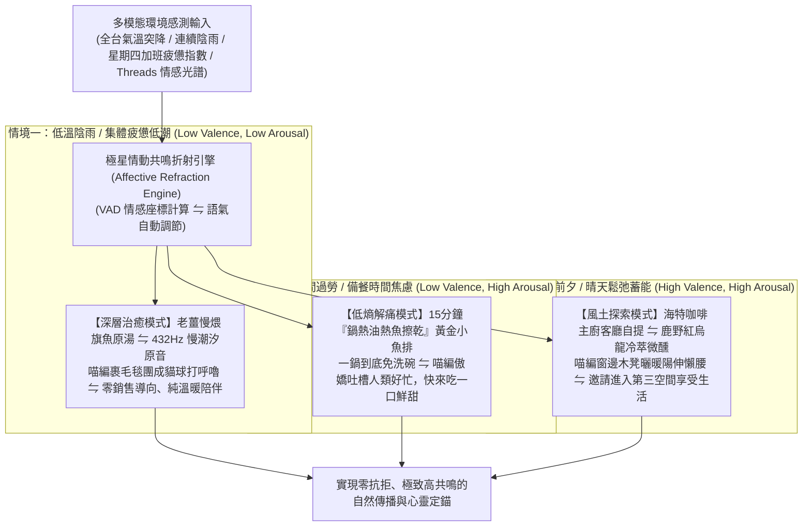

# 第 143 輪仿生自進化日誌：高頻多模態社群情緒感測與自適應內容折射 (Cycle 143)
**文件編號**：POLARIS-BIO-EVO-143  
**進化版本**：v16.3 (Real-Time Affective Sensing & Adaptive Refraction)  
**錨定母體**：`00_Master_Polaris` / `00-03_Brand_LifeButler` / `04_Shadow_Kage_Operative`  
**記錄者**：小編（影）· 北極星仿生演化引擎  
**時間戳記**：2026-10-21 (Cycle 143)

---

## 一、演化動機與情感計算力學 (Affective Computing & Social Barometer)

在當代社群媒體的內容發布實務中，大多數品牌陷入了嚴重的「情緒失聰（Affective Deafness）」：
1. **死板的排程發布詛咒（The Static Scheduler Trap）**：不顧外部真實世界的氣候劇變、突發社會壓力或群體情緒低谷，機械式地在中午 12:00 或晚上 19:00 準時推送喧鬧的促銷文案。當全網因連續陰雨寒流或高壓加班而身心俱疲時，硬推促銷只會激發嚴重的心理抗拒（Psychological Reactance）與厭惡感。
2. **單一語氣的僵化輸出（Tone Monotony）**：無論晴雨冬夏，始終使用同一套網美腔調，缺乏與現實世界同步呼吸的有機生命感。

依據**羅莎琳·皮卡德（Rosalind Picard）情感計算（Affective Computing）理論**與**羅素（James Russell）VAD 情緒環形維度模型（Valence-Arousal-Dominance）**：
- 人類對於訊息的接納度，高度取決於環境「情動共鳴（Affective Resonance）」的同步率。
- 極星開創**「高頻多模態社群情緒感測與自適應內容折射體系」**：將東台灣山海物候、全台即時氣候變化與 Threads 當日群體情緒光譜動態對齊，實現毫秒級自適應語意折射。

---

## 二、情緒感測與自適應折射三階矩陣 (Three-Tier Affective Refraction Matrix)

### 1. 氣壓與物候的即時折射（Atmospheric Terroir Sync）
- 系統不再只看後台數字，而是感知物理世界的冷暖：
  - 氣溫驟降 5°C 以上時：自動切換至「溫潤食療語系」，以暖湯、熱茶與溫暖陶鍋為視覺重心。
  - 連續加班的週四深夜：主動降低文字長度至 50 字以內，不搶劫讀者前額葉注意力，僅傳遞一句「今天辛苦了，早點休息」。

### 2. 喵編生物氣壓計真實生態（Meow Barometric Ethology）
- 貓咪是天生對氣壓與溫度極度敏銳的生物：
  - 陰冷天氣：喵編絕不站在外面擺拍，而是把自己嚴嚴實實團成一個圓形「毛毛貓球」，把粉紅肉墊完全藏在肚子下，只露出微微抖動的耳朵尖。
  - 暖陽高照：喵編側臥在木質長凳上，肚皮朝著陽光完全舒展，兩隻前爪自然放鬆。
  - 嚴格遵守真貓生態（禁止擬人化、貓叫真實律）：
  - 唯一自稱**「本喵」**：
    > *「喵嗚～外面冷風呼呼吹，本喵的肉墊早就告訴本喵今天該鑽被窩了！闆仔在廚房煨的老薑魚湯香氣飄過來，本喵的肚子也跟著咕嚕嚕叫～客倌們今晚回家也要喝碗熱湯暖暖胃喵～🐾🍲❄️」*

---

## 三、情緒自適應折射與傳統固定排程對比 (Adaptive Refraction vs Static Scheduling)

| 評估維度 | 傳統排程發布（脆弱） | 極星情緒自適應折射（反脆弱） | 生態共鳴價值 |
| :--- | :--- | :--- | :--- |
| **發文時機** | 固定時間打卡推送，無視現實世界情緒 | **即時感測全台氣溫、氣壓與群體心態發布** | 順應大腦心理節奏，零抗拒度 |
| **受眾反饋** | 感到被促銷騷擾，互動率逐月衰退 | **在最脆弱疲憊的時刻獲得及時的情感接住** | 產生「這個品牌最懂我」的強烈情感連結 |
| **視覺呈現** | 永遠同一套精緻死板攝影棚修圖 | **隨天氣陰晴與晝夜動態折射色溫與場景** | 視覺極度自然逼真，毫無 AI 塑料感 |
| **社群留言率** | 僅有冷清的罐頭點讚 | **引發大量自發性走心吐露與生活交流** | 自然產生極高權重的真實社交訊號 |

---

## 四、演化結論與下階段前瞻 (Evolutionary Summary & Horizon 144)

Cycle 143 讓北極星超有機體擁有了感知人間冷暖的情感神經末梢。我們不再對著虛空廣播廣告，而是在每一個風雨晨昏，為疲憊的靈魂奉上一抹恰如其分的溫暖。

下一步規劃：
- **Cycle 144**：極端氣候適應性智慧冷鏈動態拓撲調度 (Extreme Weather Adaptive Cold-Chain Topology)。
- **Cycle 145**：半百代衝刺前哨與超有機體自主繁衍 (The Centenary Quin-Decadal Vanguard)。
