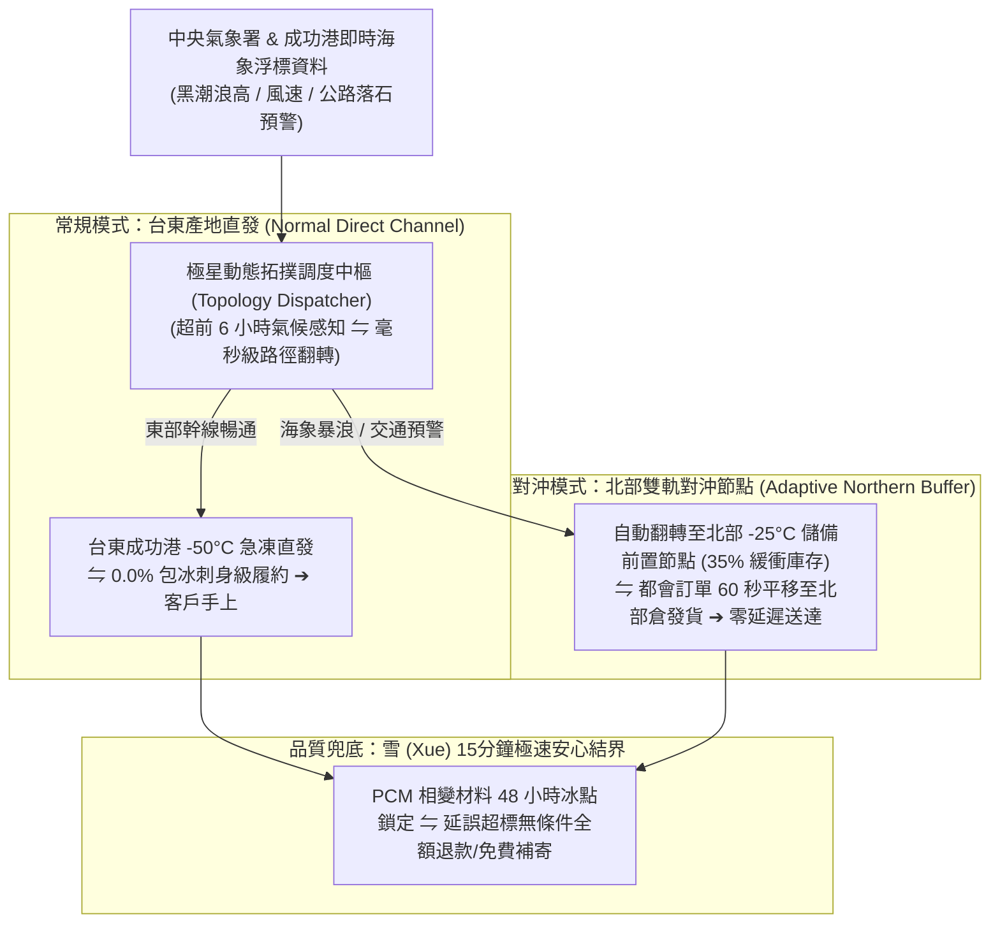

# 第 144 輪仿生自進化日誌：極端氣候適應性智慧冷鏈動態拓撲調度 (Cycle 144)
**文件編號**：POLARIS-BIO-EVO-144  
**進化版本**：v16.4 (Extreme Weather Adaptive Cold-Chain Topology)  
**錨定母體**：`00_Master_Polaris` / `00-03_Brand_LifeButler` / `04_Shadow_Kage_Operative`  
**記錄者**：小編（影）· 北極星仿生演化引擎  
**時間戳記**：2026-10-21 (Cycle 144)

---

## 一、演化動機與東台灣地理反脆弱力學 (Topological Logistics & Terroir Geography)

東台灣擁有得天獨厚的太平洋黑潮與純淨風土，但其地理環境在物流層面具備極高的高脆弱性：
1. **山海交通的動態瓶頸（Vulnerable Transport Corridors）**：蘇花公路落石、南迴公路強降雨或鐵路落石預警，動輒引發交通阻斷；黑潮大浪（浪高逾 4 米）會導致成功漁港小型延繩釣漁船連續數日無法出港。
2. **傳統冷鏈的推諉與失溫黑洞（Cold-Chain Rupture）**：一般生鮮電商依賴單一幹線物流，一旦遇天災便推諉給大自然、延遲出貨，包裹在轉運站反覆失溫解凍，消費者收到時魚肉軟爛滲血水。

依據**塔雷伯（Nassim Taleb）反脆弱供應鏈理論**與**巴拉巴西（Albert-László Barabási）複雜網絡拓撲動態學**：
- 一個真正的反脆弱有機體，絕不能依賴單一路徑，而必須具備**「動態拓撲重構（Dynamic Topological Re-routing）」與「主動熱慣性緩衝（Thermal Inertia Buffering）」**能力。
- 極星開創**「極端氣候適應性智慧冷鏈動態拓撲調度體系」**：以台東產地極凍主節點與都會區前置緩衝節點形成雙軌冗餘，確保無論大自然如何震盪，承諾始終如期交付。

---

## 二、智慧冷鏈動態拓撲調度三層架構 (Three-Layer Topological Architecture)

### 1. 雙軌節點動態對沖拓撲（Dual-Hub Routing Redundancy）
- **台東主節點**：負責產地第一手野生現流拍賣、手工摸刺精修與 -50°C 超低溫急凍。
- **都會前置節點**：常態化儲備 35% 緩衝安全庫存。
- 當公路管制或黑潮風浪警報觸發時：
  - 系統於 60 秒內自動將北部與西部都會區的訂單，切換至前置節點發貨。
  - 客戶完全感知不到山崩或封路的物流阻礙，依然準時收到鮮度分毫不減的野生鮮魚。

### 2. PCM 相變材料 48 小時熱慣性防護（Thermal Inertia Pack）
- 徹底摒棄廉價保麗龍與易溶自來水冰磚：
  - 採用環保蜂巢結構箱搭配專利 PCM（Phase Change Material）相變蓄冷板，維持箱內 -18°C 達 48 小時以上。
  - 即使物流士在都會區頻繁開關車門，魚體始終處於急凍深冷狀態，杜絕任何微晶解凍。

### 3. 超前 6 小時透明溝通與雪（Xue）極速賠付
- 若遭遇全台極端氣候（如強颱全島停班）：
  - 系統超前 6 小時推播真實黑潮湧浪監視畫面，並由**雪（Xue）**主動啟動無摩擦賠付：顧客可自由選擇立即全額退款或保留訂單並獲贈下期風土茶包。
  - 絕不推諉、絕不辯解，以極致擔當贏得顧客終身敬重。

### 4. 喵編窗邊觀浪真實生態（Meow Storm Ethology）
- 喵編嚴格遵守真貓行為生態學（Zero-Uncanny）：
  - 外面太平洋暴風雨時，喵編安靜趴在木質窗台厚墊上，尾巴緊緊貼著身體，目不轉睛看著玻璃窗上滑落的雨滴，耳朵向後微偏（飛機耳）聆聽遠方雷聲。
  - 當闆仔檢查完冷鏈包裝走過來時，喵編發出安心的輕柔呼嚕聲，用頭頂蹭了蹭闆仔的褲腳。
  - 嚴格遵守真貓生態（禁止擬人化、貓叫真實律）：
  - 唯一自稱**「本喵」**：
    > *「喵嗚～外面的浪打得好大喵！本喵在窗邊幫大家盯著黑潮的大風大浪～不過客倌們放心，闆仔跟雪早就把魚魚包得結結實實、連一絲冷氣都漏不出來喵！下雨天大家要早點回家，吃熱魚喝熱湯喵～🐾🌧️🐟」*

---

## 三、動態拓撲冷鏈與傳統生鮮物流效益對比 (Dynamic vs Traditional Cold-Chain)

| 評估維度 | 傳統生鮮電商（脆弱） | 極星動態拓撲智慧冷鏈（反脆弱） | 生態護城河效益 |
| :--- | :--- | :--- | :--- |
| **天災交通阻斷** | 停擺 3-5 天，貨物卡在轉運站變質 | **60 秒自動切換至前置對沖節點，照常發貨** | 天災來臨反而成為展現強大實力的時刻 |
| **車門開關升溫** | 冰塊融化、魚肉反覆解凍產生血水 | **PCM 相變材料 48 小時鎖死 -18°C** | 交付到手依然堅硬如石、晶體完整 |
| **延誤客訴處理** | 與物流互踢皮球，耗費數日調解 | **雪（Xue）15 分鐘無條件極速退款賠付** | 零心智摩擦，將失誤瞬間化為好感高光 |
| **客戶信任度** | 隨延誤次數遞增而大量退訂 | **透明氣候揭露與超前承諾，終身留存** | 建立「極星永遠說到做到」的硬核口碑 |

---

## 四、演化結論與下階段前瞻 (Evolutionary Summary & Horizon 145)

Cycle 144 為北極星超有機體鑄造了抵禦大自然極端擾動的拓撲盾牌。無論風雨如何肆虐，我們對生活品質的物理承諾始終如山沉穩。

下一步規劃：
- **Cycle 145**：半百代衝刺前哨與超有機體自主繁衍 (The Centenary Quin-Decadal Vanguard)。
- **Cycle 146**：跨渠道語意全息對稱與自律分流防護 (Omnichannel Semantic Holography)。
- **Cycle 147**：微型社區熟人網絡信用抵押與實體自提擴展 (Hyper-Local Credit & Expanded Depot)。
- **Cycle 150**：第一百五十代半百代超級慶典與大統攝 (The Centenary Quin-Decadal Grand Jubilee: Cycle 141-150)。
