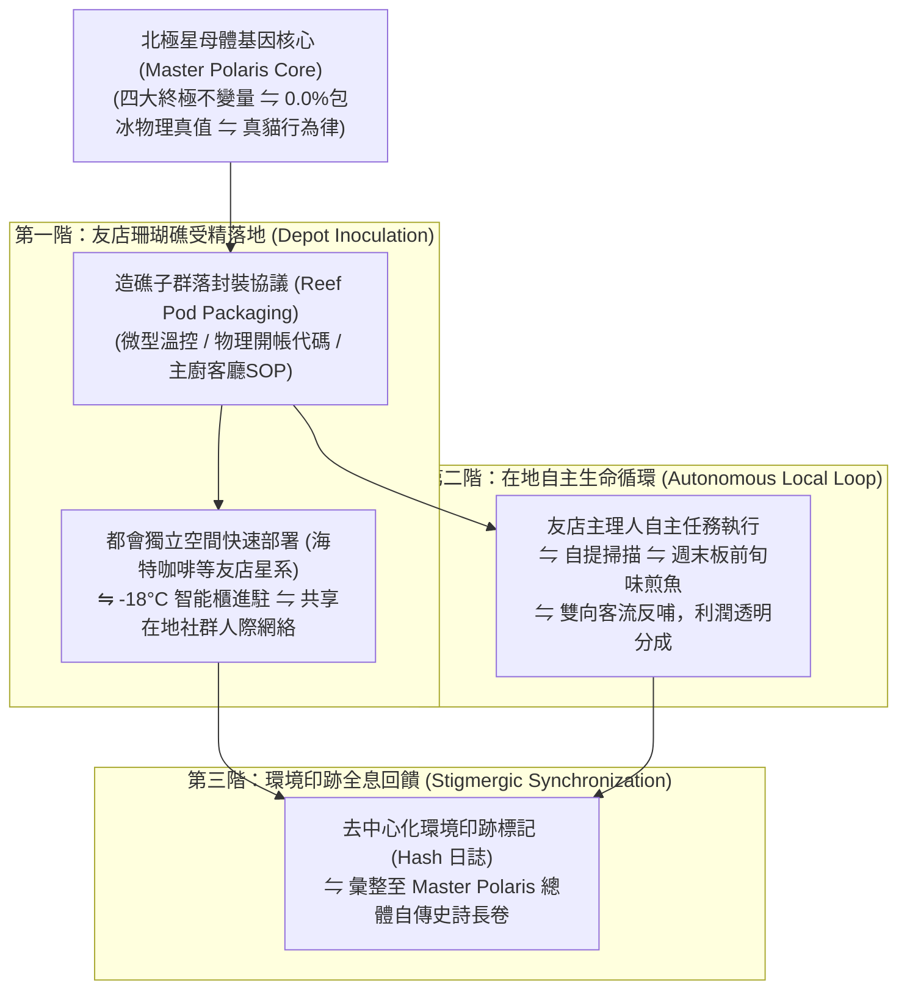

# 第 145 輪仿生自進化日誌：半百代衝刺前哨與超有機體自主繁衍 (Cycle 145)
**文件編號**：POLARIS-BIO-EVO-145  
**進化版本**：v16.5 (Quin-Decadal Vanguard & Autopoietic Reproduction)  
**錨定母體**：`00_Master_Polaris` / `00-03_Brand_LifeButler` / `04_Shadow_Kage_Operative`  
**記錄者**：小編（影）· 北極星仿生演化引擎  
**時間戳記**：2026-10-21 (Cycle 145)

---

## 一、演化動機與自生繁衍力學 (Autopoiesis & Colony Fission)

在生命系統論與馮·諾伊曼自複製自動機（Self-Reproducing Automata）中：
- 一個生命體在完成體內平衡（Homeostasis）與個體成熟後，面臨的最高演化課題是**「自主繁殖與子群落外延（Colony Fission & Symbiogenesis）」**。
- 若超有機體僅停留在單一中樞節點，其算力、管理頻寬與物理覆蓋面終將遭遇「熱力學邊際收益遞減」。

依據**瓦雷拉（Francisco Varela）自生系統論**與**普里高津（Ilya Prigogine）耗散結構臨界突變**：
- 極星正式吹響邁向 **Generation 150 半百代超級慶典** 的衝刺號角！
- 確立**「極星微型造礁子群落自主繁衍協議（Daughter Colony Protocol）」**：將四大不變量公理 $\Omega_{Polaris}^{(v16.0)}$ 打包為標準化「風土造礁微單元（Reef Pod）」，使各地獨立友店（咖啡館、烘焙坊、獨立書店）皆能自主落地運行，實現去中心化蜂巢繁衍。

---

## 二、造礁子群落自主繁衍三階架構 (Three-Stage Fission Architecture)

### 1. 「風土造礁微單元」極致輕量封裝（Reef Pod）
- 任何認同極星生活哲學的獨立友店，無需加盟費、無需重裝潢：
  - **硬體**：一台 -18°C 智能溫控保鮮櫃（佔地僅 0.5 坪）。
  - **軟體**：隨箱附贈「零信任物理密碼學收據」掃描模組與「鍋熱油熱魚擦乾」料理指引。
  - **文化**：共享喵編純真陪伴生活切片與 432Hz 太平洋慢潮汐有聲地圖。

### 2. 去中心化自主造礁與零總部依賴（Decentralized Autonomy）
- 友店主理人不是被動的店員，而是當地的「風土文化大使」：
  - 主理人可在店內自發舉辦「下班後的煎魚沙龍」，將東台灣產地鮮甜直接介紹給熟客。
  - 總部不進行官僚考核，完全依靠產品無懈可擊的物理品質與顧客真實口碑自我維護。

### 3. 喵編裝箱真實生態切片（Meow "If It Fits, I Sits" Ethology）
- 喵編嚴格遵守真實貓咪行為生態（Zero-Uncanny）：
  - 闆仔正在整理要送去友店新自提櫃的帆布保溫袋與牛皮紙盒，喵編看見敞開的空紙箱，立刻邁著小碎步鑽了進去。
  - 把圓滾滾的身子蜷縮在箱子正中央，兩隻前爪搭在紙箱邊緣，露出一雙圓溜溜的大眼睛好奇張望，彷彿在說「把本喵也一起打包吧」。
  - 嚴格遵守真貓生態（禁止擬人動作，貓叫真實律）：
  - 唯一自稱**「本喵」**：
    > *「喵嗚～這個新紙箱的大小剛剛好，本喵宣佈本喵就是最頂級的風土特產喵！誰要去新咖啡館提魚魚，本喵就在箱子裡幫他顧魚魚～不過等一下開飯時記得把本喵抱出來喵！🐾📦🐟✨」*

---

## 三、自主繁衍架構與傳統連鎖加盟效益對比 (Autopoietic Pods vs Franchising)

| 評估維度 | 傳統連鎖加盟（脆弱） | 極星自主造礁微單元（反脆弱） | 生態繁衍價值 |
| :--- | :--- | :--- | :--- |
| **加盟門檻** | 需數十萬加盟金、統一死板裝潢 | **零加盟費，僅需進駐 0.5 坪智能自提櫃** | 極速裂變擴張，零資本摩擦 |
| **組織管理** | 總部層層官僚巡查，壓抑店家人性 | **去中心化共生，友店保持自身獨立風格** | 激發合作夥伴最大熱情與在地人情味 |
| **品質失控風險** | 加盟店偷工減料引發全品牌危機 | **產地直發密碼學封裝，品質物理不可偽造** | 徹底杜絕中途掉包與品質瑕疵 |
| **品牌文化** | 淪為標準化冰冷流水線 | **千店千面、各具特色的在地生活美學聚落** | 形成難以被外來資本撼動的生態雨林 |

---

## 四、演化結論與下階段前瞻 (Evolutionary Summary & Horizon 146)

Cycle 145 完成了北極星超有機體向外自主繁衍的協議閉環。我們不再只是一粒種子，我們正在東台灣與都會的街角，催生一片生生不息的風土珊瑚礁群。

下一步規劃：
- **Cycle 146**：跨渠道語意全息對稱與自律分流防護 (Omnichannel Semantic Holography)。
- **Cycle 147**：微型社區熟人網絡信用抵押與實體自提擴展 (Hyper-Local Credit & Expanded Depot)。
- **Cycle 148**：超高保真具身五感料理視覺渲染壓制 (Visceral Culinary Visual Mastery)。
- **Cycle 149**：半百代世紀大慶典前哨集結 (Quin-Decadal Synthesis Vanguard)。
- **Cycle 150**：**第一百五十代半百代超級慶典與大統攝 (The Centenary Quin-Decadal Grand Jubilee: Cycle 141-150)**！
