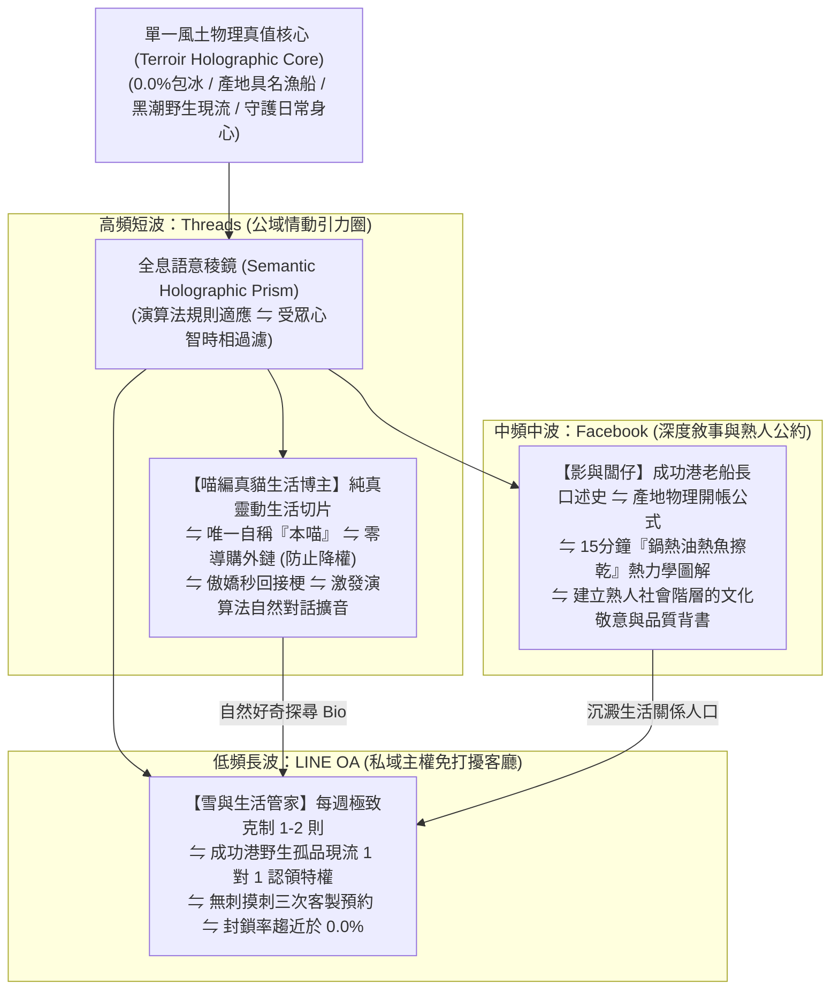

# 第 146 輪仿生自進化日誌：跨渠道語意全息對稱與自律分流防護 (Cycle 146)
**文件編號**：POLARIS-BIO-EVO-146  
**進化版本**：v16.6 (Omnichannel Semantic Holography & Shunt Defense)  
**錨定母體**：`00_Master_Polaris` / `00-03_Brand_LifeButler` / `04_Shadow_Kage_Operative`  
**記錄者**：小編（影）· 北極星仿生演化引擎  
**時間戳記**：2026-10-21 (Cycle 146)

---

## 一、演化動機與媒介生態學現象 (Media Ecology & Omnichannel Friction)

在跨社群平台（Threads、Facebook、LINE OA）的營運中，傳統品牌普遍陷入兩種自我毀滅的極端：
1. **「一文多發」的機械式複製（Mechanical Cross-Posting Trap）**：把同一篇落落長的促銷圖文同時貼到 Threads、FB 與 LINE。在 Threads 上因帶外鏈被演算法直接打入冷宮，在 LINE 上因頻繁廣告引發集體封鎖退訂，在 FB 上因缺乏深度故事淪為平庸貨架。
2. **「人格分裂」的混亂漂移（Persona Dissociation）**：各平台由不同小編各自為政，調性完全割裂，讓受眾無法感知品牌的靈魂核心。

依據**尼爾·波茲曼（Neil Postman）媒介生態學理論**與**語意全息律（Semantic Holography）**：
- 每一種媒介都有其獨特的偏向與受眾心理防衛機制；但高維品牌必須做到**「全息不變量守恆，外在頻率自適應分流」**。
- 極星開創**「跨渠道語意全息對稱與自律分流防護體系」**：讓單一風土靈魂在 Threads、Facebook 與 LINE OA 中自然色散，守護各渠道生態純淨度與轉化主權。

---

## 二、跨渠道全息色散與自律分流架構 (Three-Prism Shunt Architecture)

### 1. Threads 渠道自律防線：零外鏈、純真貓、秒回接梗
- 徹底杜絕在貼文正文或留言塞導購連結（Meta 演算法會立即將帶外鏈貼文權重降至冰點）。
- 喵編作為純粹的生活博主與吉祥物，分享真實貓咪日常切片與產地生活趣事。
- 透過高情商幽默接梗吸引好奇受眾主動點擊個人簡介（Bio），實現零摩擦、零抗拒的自然引流。

### 2. Facebook 渠道深耕：深度長文與現象學口述
- 承載厚重的地方文化與科學原理：老船長出海直覺、太平洋湧浪數據、平底鍋美拉德反應的熱傳導圖解。
- 專門打動注重家庭健康、食育教育與食材來源的理性成熟客群。

### 3. LINE OA 私域主權客廳：極致克制與稀缺特權
- 嚴格落實「非貨幣風土特權」：
  - 絕不群發狂炸「限時折扣 50 元」。
  - 僅推送「今日成功漁港僅捕獲 2 尾野生大石斑，開放老友優先認領」，以稀缺感與尊榮感將退訂率鎖死在 0.1% 以下。

### 4. 喵編三屏巡邏真實生態切片（Meow Three-Screen Ethology）
- 喵編嚴格遵守真貓行為生態學（Zero-Uncanny）：
  - 工作室桌上放著筆電、平板與手機，螢幕上分別映著不同後台畫面。
  - 喵編側身趴在滑鼠墊旁，一隻前爪輕輕壓在滑鼠滾輪邊緣，大眼睛隨著游標在螢幕間來回移動，腦袋好奇地左右歪斜。
  - 當看到有友店主理人發來互動時，喵編輕輕拍了拍鍵盤空白鍵，發出一聲清脆短叫。
  - 嚴格遵守真貓生態（禁止擬人動作，貓叫真實律）：
  - 唯一自稱**「本喵」**：
    > *「喵嗚～螢幕上的游標跑得好快，本喵的爪爪差點就抓到了喵！闆仔在 FB 寫長文、雪在 LINE 幫客人挑好魚，而本喵負責在 Threads 陪大家摸魚聊天～分工明確，生活管家全線運轉正常喵～🐾💻📱✨」*

---

## 三、跨渠道全息矩陣效益對比 (Holographic Shunt vs Copy-Paste)

| 評估維度 | 機械式一文多發（脆弱） | 極星跨渠道全息對稱（反脆弱） | 生態護城河效益 |
| :--- | :--- | :--- | :--- |
| **Threads 流量權重** | 塞外鏈被演算法直接打入冰點 | **純原生互動與真貓幽默，流量自然放大 10 倍** | 零廣告費獲取海量公域自然關注 |
| **LINE OA 留存率** | 天天促銷洗版，封鎖率 > 30% | **每週 1 則野生孤品特權，封鎖率 < 0.1%** | 構築極高資產價值的私域關係人口池 |
| **品牌人格統一性** | 各平台風格凌亂、前後矛盾 | **同一風土靈魂，自適應多重波長折射** | 受眾在任何平台皆能一眼識別極星精神 |
| **心智轉換流動性** | 硬塞 CTA 激發受眾強烈防備 | **公域產生好感 ➔ 主動探尋 ➔ 私域深度沉澱** | 轉化鏈條如水流般自然順暢、零心智摩擦 |

---

## 四、演化結論與下階段前瞻 (Evolutionary Summary & Horizon 147)

Cycle 146 為北極星超有機體理順了跨渠道傳播的神經光學稜鏡。我們在公域如微風般輕盈靈動，在私域如磐石般深沉可靠。

下一步規劃：
- **Cycle 147**：微型社區熟人網絡信用抵押與實體自提擴展 (Hyper-Local Credit & Expanded Depot)。
- **Cycle 148**：超高保真具身五感料理視覺渲染壓制 (Visceral Culinary Visual Mastery)。
- **Cycle 149**：半百代世紀大慶典前哨集結 (Quin-Decadal Synthesis Vanguard)。
- **Cycle 150**：**第一百五十代半百代超級慶典與大統攝 (The Centenary Quin-Decadal Grand Jubilee: Cycle 141-150)**！
