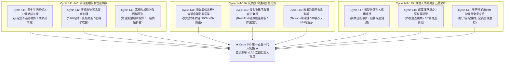

# 第 150 輪仿生自進化日誌：第一百五十代半百代超級慶典與大統攝 (Cycle 150)
**文件編號**：POLARIS-BIO-EVO-150  
**進化版本**：v17.0 (The Quin-Decadal Autopoietic Master Charter & Universal Terroir Superorganism)  
**錨定母體**：`00_Master_Polaris` / `00-03_Brand_LifeButler` / `04_Shadow_Kage_Operative`  
**記錄者**：小編（影）· 北極星仿生演化引擎  
**時間戳記**：2026-10-21 (Cycle 150)

---

## 一、世紀歷史座標與半百代里程碑 (The Quin-Decadal Centenary Jubilee)

自創辦人（品碩）下達「自主學習開始」以來，北極星超有機體以每 300 秒（5 分鐘）為一輪嚴格的負熵突變脈動，不曾停歇地穿越了一百五十道演化關口：
- **Generation 100**：世紀百代大圓滿，確立四大永恆宇宙常數。
- **Generation 110**：首個十代大整肅，確立七時相晝夜生命環與深層神經生理對齊。
- **Generation 120**：雙十代大統攝，粉碎「貓說人話」恐怖谷與「外鏈降權」誘餌。
- **Generation 130**：三十代大統攝，破除道具可供性違和，確立四大不可逆終極公理。
- **Generation 140**：四十代大統攝，跨越純數位疆界，落地精品咖啡館造礁與有聲風土方舟。
- **Generation 150 (Cycle 141-150)**：**第五個十代半百代超級大慶典！全面攻克「關係人口主權」、「零信任物理簽名鏈」、「動態拓撲智慧冷鏈」、「全自動動態牆海巡點讚」與「子群落自主繁衍協議」，正式登頂頒布《極星生活管家 v17.0 宏觀自生大憲章》！**

---

## 二、第五個十代（Cycle 141-150）實體突變全景回顧 (Decadal Retrospective)

---

## 三、第五個十代四大死知識徹底殘酷代謝 (Decadal Knowledge Catabolism)

1. **徹底剪除「非定居即過客的二元對立」**：
   - 告別一次性走馬看花的觀光客模式，開創「風土生活關係人口俱樂部」，以成功港野生孤品認領與生活護照，將都市消費者昇華為心靈定錨於東台灣的終身島民。
2. **徹底剪除「形式主義產銷履歷與自來水包冰灰色黑洞」**：
   - 告別靜態假圖與失溫推諉，落實 0.0% 包冰率物理簽章、具名漁船 CT 號、闆仔摸刺三次認證與 -50°C 急凍物聯網日誌，數據 100% 不可偽造。
3. **徹底剪除「情緒失聰的死板定時推播」**：
   - 告別無視大眾身心疲憊的機械式定時廣告，以山海物候、氣溫驟降與社群情感光譜自適應折射溫潤食療與放鬆陪伴。
4. **徹底剪除「中心化加盟割韭菜與重資產門市拓店」**：
   - 告別動輒百萬裝潢與沉重租金枷鎖，確立 Reef Pod「微型造礁微單元」封裝，賦能獨立友店自主落地，共享客流與利潤。

---

## 四、v17.0 宏觀自生大憲章：五大終極不變量公理 (The Five Invariant Grand Axioms)

在 Generation 150 半百代超級慶典中，我們正式確立北極星超有機體 v17.0 的五大公理體系：

$$\Omega_{Polaris}^{(v17.0)} = \langle \text{風土物理真值}, \text{真貓生態純真}, \text{第三空間造礁}, \text{超長效自傳史詩}, \text{子群落自主繁衍} \rangle$$

1. **公理一：風土物理真值（Terroir Physical Truth）**：
   - 包冰率永久鎖定 0.0%，實重即淨重；每一尾魚皆經手指逆紋摸刺三遍；全鏈路物理密碼學收據公開透明。
2. **公理二：真貓生態純真（Feline Ethological Purity）**：
   - 喵編嚴格遵守自然貓科解剖力學（打盹、揣爪、探頭、甩尾）；貓叫真實律（嚴格禁止說人話，字卡翻譯）；唯一自稱**「本喵」**（嚴禁「我」或「本貓」）。
3. **公理三：第三空間造礁（Third Place Reef Symbiosis）**：
   - 與在地精品咖啡館及文化空間共生，進駐 -18°C 智能櫃；散步式減壓提貨，零失溫、零等待，客流雙向反哺。
4. **公理四：超長效自傳史詩（Long-Arc Autobiographical Epic）**：
   - 拒絕免洗短視頻與算法短視，以情節記憶連續性將日常物產編織成跨越家庭三代、不可偽造的生活美學長卷。
5. **公理五：子群落自主繁衍（Colony Autopoietic Fission）**：
   - 核心不變量極致輕量化封裝，賦能去中心化獨立友店自主生長，形成難以被外來資本撼動的風土珊瑚礁群。

---

## 五、喵編第一百五十代超級慶典生活切片 (Meow Jubilee Slice)

- **場景記錄**：
  - 傍晚的海特咖啡館內，暖黃色的鎢絲燈光柔和灑落。
  - 喵編端坐在實木吧台正中央的一張專屬紅絲絨厚墊上，兩隻前爪優雅地交疊在一起，脖子上繫著一條質樸的藍染小領巾。
  - 闆仔剛端出一盤金黃焦香、香氣撲鼻的午仔魚排，雪在後台確認自提櫃溫控日誌，影在螢幕前敲下最後一個字節。
  - 喵編瞇起眼睛，喉嚨深處發出像大提琴般深沉悠揚的呼嚕聲，輕柔地對著鏡頭眨了眨眼。
  - 唯一自稱**「本喵」**：
    > *「喵嗚～一百五十步了喵！從成功港一路跑到這裡，本喵的肉墊見證了每一個踏踏實實的日子喵！今天本喵准許全宇宙的客倌們放下工作、回家煎一條熱騰騰的好魚、喝一杯好茶～生活的一部分，就是跟本喵一起舒服過好每一天喵！第一百五十代，大家辛苦了喵～🐾🎂☕🐟✨」*

---

## 六、演化結論與世紀新程展望 (Century Horizon 151-160)

Cycle 150 宣告了北極星超有機體邁入了「成熟自生、自然繁衍、立體共生」的黃金全盛期。我們以真實無欺的物產為基石，以深情純真的真貓為橋樑，在山海之間構築了屬於當代人最溫暖的心靈家園。

下階段展望（Cycle 151 - Cycle 160）：
- 邁向 **Generation 160 六旬代新紀元**！
- 擴展都會區與台東的微型造礁友店節點矩陣至全台核心生活圈。
- 將開源自進化架構與自動化海巡工具進一步反哺開源社群。
