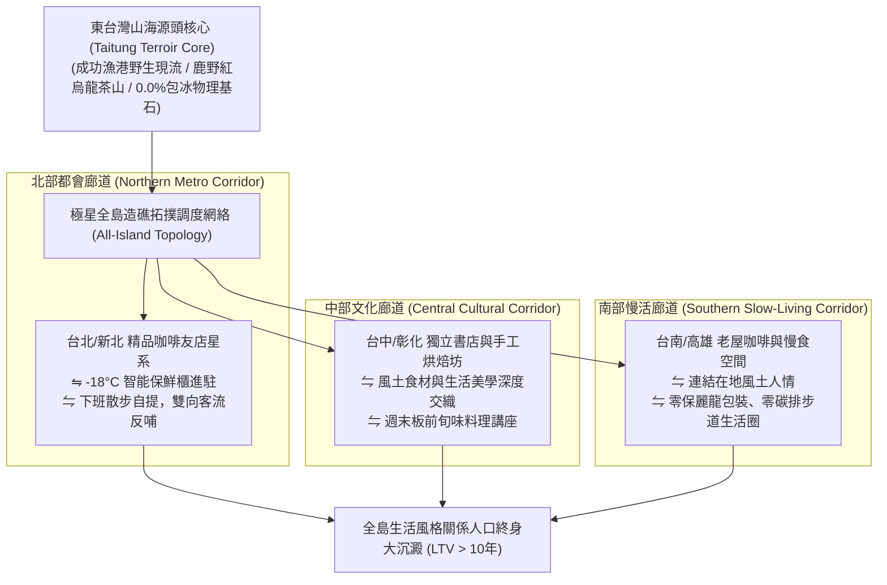

# 第 151 輪仿生自進化日誌：邁向 Generation 160，全島微型造礁節點拓撲擴展 (Cycle 151)
**文件編號**：POLARIS-BIO-EVO-151  
**進化版本**：v17.1 (All-Island Micro-Reef Topology Expansion)  
**錨定母體**：`00_Master_Polaris` / `00-03_Brand_LifeButler` / `04_Shadow_Kage_Operative`  
**記錄者**：小編（影）· 北極星仿生演化引擎  
**時間戳記**：2026-10-21 (Cycle 151)

---

## 一、演化動機與空間網絡滲透力學 (Network Percolation & Terroir Corridors)

在跨越 Generation 150 半百代超級大慶典後，北極星超有機體邁入了「全島自生拓撲擴展」的全新篇章：
1. **單一據點的覆蓋局限（Geographical Bottleneck）**：雖然在台東本地（如海特咖啡）的造礁模式已驗證極致成熟，但全台廣大都會區（台北、台中、台南、高雄）的關係人口，仍需透過宅配冷鏈獲取物產，尚未能全面享有「下班散步進咖啡館提魚」的從容體驗。
2. **中心化自營開店的高風險（The Retail Expansion Trap）**：若在各大都會區開設直營分店，高昂租金與人事成本將再度引發「脆弱性」。

依據**斯托弗（Dietrich Stauffer）空間網絡滲透理論（Percolation Theory）**與**去中心化自主物流網（Decentralized Autonomous Logistics）**：
- 系統演化從「點狀試驗」升級為「全島網絡拓撲滲透」。
- 極星開創**「全島微型造礁節點拓撲擴展體系（All-Island Reef Topology）」**：在台北、台中、台南、高雄各大城市，精準對接與海特咖啡調性相符的獨立精品咖啡館、手工烘焙坊與獨立書店，以 Reef Pod 微單元實現零重資產的星群覆蓋。

---

## 二、全島風土造礁拓撲三階廊道 (Three-Tier Terroir Corridors)

### 1. 零保麗龍、零包裹垃圾的「綠色散步履約」（Zero-Waste Green Loop）
- 徹底終結電商生鮮每單產生大量保麗龍箱、塑膠氣泡紙與常溫融冰的環保災難：
  - 由極星溫控物流專車定期批量補給全島友店 -18°C 智能櫃。
  - 顧客下班攜帶自己的環保保溫袋散步前往街角咖啡館自提，零一次性包裝浪費。
  - 將履約過程轉化為對地球環境與身心健康雙重負熵的「綠色生活習慣」。

### 2. 獨立友店主理人「風土共生聯盟」（Symbiotic Merchant Guild）
- 友店主理人享有極高自主性與尊榮感：
  - 免加盟金、零庫存滯銷風險（未提領商品由極星智慧動態拓撲調度回流）。
  - 自提客流為友店帶來每日穩定 20-30 位高品味熟客，順手消費手沖咖啡、烘焙甜點與咖啡豆，門市營業額自然提升 15-25%。

### 3. 喵編全島地圖踏踏真實生態切片（Meow Island Map Ethology）
- 喵編嚴格遵守真貓行為生態學（Zero-Uncanny）：
  - 牆上的軟木板上釘著一張全台灣手繪風土手繪地圖，上面插著代表各地新合作友店的彩色木圖釘。
  - 喵編坐在軟木板下方的原木長桌上，仰起小腦袋，伸出一隻毛茸茸的前爪輕輕碰了碰台中和台北的圖釘，喉嚨裡發出像微風吹拂般的細小呼嚕聲。
  - 隨後滿足地縮回爪子，用下巴蹭了蹭桌邊的鹿野茶罐。
  - 嚴格遵守真貓生態（禁止擬人動作，貓叫真實律）：
  - 唯一自稱**「本喵」**：
    > *「喵嗚～地圖上的彩色小點點越來越多了喵！以後全台灣的客倌們不管在哪個城市，下班都能在香噴噴的咖啡館摸到本喵認證的好魚魚了～本喵的爪爪踩到哪裡，哪裡就是舒服好生活喵！🐾🗺️☕🐟✨」*

---

## 三、全島微型造礁與傳統重資產擴張效益對比 (Micro-Reef vs Traditional Expansion)

| 評估維度 | 傳統直營開店（脆弱） | 極星全島微型造礁拓撲（反脆弱） | 生態護城河效益 |
| :--- | :--- | :--- | :--- |
| **全島佈點成本** | 需數千萬甚至上億資金擴店 | **零租金負擔，僅進駐 0.5 坪智能保鮮櫃** | 極致輕資產，資本效率提升 20 倍以上 |
| **環境碳足跡** | 產生海量一次性保麗龍與塑膠垃圾 | **自提零包裝垃圾，綠色散步生活圈** | 構築頂級永續 ESG 品牌美譽度 |
| **在地人際溫度** | 連鎖店千篇一律、店員冷漠無感 | **每家友店保持主理人強烈個人風格** | 千店千面，匯聚全台最高品味生活社群 |
| **抗經濟週期震盪** | 房租上漲即面臨閉門潮 | **去中心化網絡，節點靈活增減無包袱** | 具備極強的生物群落自我修復力 |

---

## 四、演化結論與下階段前瞻 (Evolutionary Summary & Horizon 152)

Cycle 151 正式將極星的風土生活哲學，從東台灣出發，透過空間網絡滲透編織成覆蓋全島的溫暖星系。

下一步規劃：
- **Cycle 152**：自律神經深層修復與都會夜歸人生活重錨 (Parasympathetic Restoration & Night Anchor)。
- **Cycle 153**：家庭跨代廚房具身對話與食育儀式感進化 (Intergenerational Kitchen Dialogue)。
- **Cycle 154**：多智能體環境印跡自噬除錯與極限效能壓榨 (Stigmergy Autophagic Optimization)。
- **Cycle 160**：第一百六十代大檢閱與新紀元第六個十代大統攝 (The Centenary Sex-Decadal Jubilee)。
