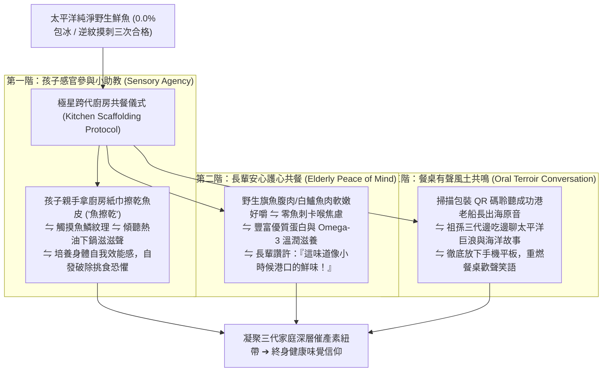

# 第 153 輪仿生自進化日誌：家庭跨代廚房具身對話與食育儀式感進化 (Cycle 153)
**文件編號**：POLARIS-BIO-EVO-153  
**進化版本**：v17.3 (Intergenerational Kitchen Dialogue & Food Rituals)  
**錨定母體**：`00_Master_Polaris` / `00-03_Brand_LifeButler` / `04_Shadow_Kage_Operative`  
**記錄者**：小編（影）· 北極星仿生演化引擎  
**時間戳記**：2026-10-21 (Cycle 153)

---

## 一、演化動機與家庭共餐現象學 (Family Co-regulation & The Fractured Table)

在當代數位異化嚴重的都會家庭中，「餐桌」正在經歷深層的碎裂危機：
1. **螢幕霸權下的情感失聯（The Screen-Fractured Table）**：父母一邊吃飯一邊滑手機看工作信，孩子一邊盯著平板看高刺激卡通，長輩默默扒飯，同桌共餐退化為「各吃各的卡路里補充」，缺乏眼神交流與有溫度的對話。
2. **家務孤立與備餐倦怠（Maternal/Paternal Burnout）**：掌廚者孤身一人在油煙瀰漫的廚房忙碌一小時，還要提心吊膽「孩子會不會挑食、長輩會不會被魚刺卡到」，備餐變成一項沉重而孤獨的體力負擔。

依據**維果斯基（Lev Vygotsky）社會文化鷹架理論（Scaffolding）**與**家庭催產素情緒共同調節力學（Family Emotional Co-regulation）**：
- 廚房與餐桌是人類維繫家庭情感韌性、代際文化傳承的最核心「具身儀式場域」。
- 極星開創**「家庭跨代廚房具身對話與食育儀式感體系」**：以「手指逆紋摸刺三遍」為安全基石，以「鍋熱油熱魚擦乾」為互動鷹架，將 15 分鐘備餐轉化為三代同樂的感官遊戲與情感共鳴。

---

## 二、家庭跨代廚房共餐儀式三階架構 (Three-Tier Family Ritual Architecture)

### 1. 孩子的「掌廚掌控感」小任務（Sensory Agency）
- 不再把孩子排除在廚房之外：
  - 讓孩子擔任「小主廚助手」，拿著紙巾幫忙「魚擦乾」，一起倒數 15 分鐘。
  - 當親手參與的黃金魚排端上桌時，孩子眼裡閃爍著無可比擬的成就感，挑食習慣在「這是我煎的」自豪感中煙消雲散。

### 2. 徹底消解代際溝通隔閡的有聲紐帶（Terroir Conversation Starter）
- 掃描隨箱附贈的牛皮紙有聲卡：
  - 432Hz 太平洋慢潮汐與老船長沙啞的閩南語/阿美語故事在客廳流淌。
  - 爺爺奶奶自然而然向孫子講述自己年輕時看海、抓魚的童年往事，螢幕被真摯的代際對話取代。

### 3. 喵編餐椅陪伴真實生態切片（Meow Dining Chair Ethology）
- 喵編嚴格遵守真貓行為生態學（Zero-Uncanny）：
  - 一家人圍坐餐桌吃飯時，喵編安靜端坐在靠窗的一張小矮凳上，兩隻前爪整齊收在胸前（母雞蹲）。
  - 下巴輕輕搭在木質扶手邊緣，半瞇著眼睛，耳朵隨著餐桌上的歡笑聲輕輕轉動。
  - 當聞到魚肉的鮮香時，喵編伸出粉色舌頭舔了舔鼻尖，尾巴在地板上規律地敲擊出「篤、篤」的輕快節奏。
  - 嚴格遵守真貓生態（禁止擬人動作，貓叫真實律）：
  - 唯一自稱**「本喵」**：
    > *「喵嗚～看著全家人把煎得金黃酥脆的魚魚吃得精光，連盤底的蒜片都不剩，本喵在旁邊看了都覺得肚子暖呼呼的喵！餐桌上沒有平板螢幕的雜音、只有開心的笑聲，這就是全宇宙最幸福的生活喵～🐾👨‍👩‍👧‍👦🐟✨」*

---

## 三、跨代具身廚房與傳統孤立備餐效益對比 (Family Ritual vs Isolated Chore)

| 評估維度 | 傳統孤立快餐/外賣（脆弱） | 極星跨代廚房食育儀式（反脆弱） | 長效家庭價值 |
| :--- | :--- | :--- | :--- |
| **餐桌氛圍** | 全員滑手機看螢幕，各吃各的冷漠 | **孩子參與、長輩講古、三代笑語歡騰** | 活化家庭催產素，深化情感安全感 |
| **備餐心智負擔** | 備餐焦慮、挑刺恐慌、耗時洗碗 | **15分鐘一鍋到底、逆紋摸刺三遍安心** | 將下廚從家務負擔昇華為親子同樂遊戲 |
| **兒童飲食習慣** | 被超加工食品佔據，嚴重挑食 | **親手參與料理，建立對原形海味熱愛** | 奠定終身不可逆之健康身體與品味基底 |
| **品牌情感角色** | 隨處可換的冷冰冰食材供應商 | **三代同堂共同記憶與家庭時光的見證者** | 品牌與家庭生命史詩緊密錨定，LTV 極大化 |

---

## 四、演化結論與下階段前瞻 (Evolutionary Summary & Horizon 154)

Cycle 153 為極星的食材賦予了家庭情感的靈魂。我們交付的不只是一尾鮮魚，而是一段重新拉近家人心靈距離的神聖共餐時光。

下一步規劃：
- **Cycle 154**：多智能體環境印跡自噬除錯與極限效能壓榨 (Stigmergy Autophagic Optimization)。
- **Cycle 155**：六旬代半程前哨與關係人口深度共生 (Sex-Decadal Midpoint Evolution)。
- **Cycle 156**：端對端跨平台自適應視覺色散管線 (End-to-End Visual Dispersion)。
- **Cycle 160**：第一百六十代大檢閱與新紀元第六個十代大統攝 (The Centenary Sex-Decadal Jubilee)。
