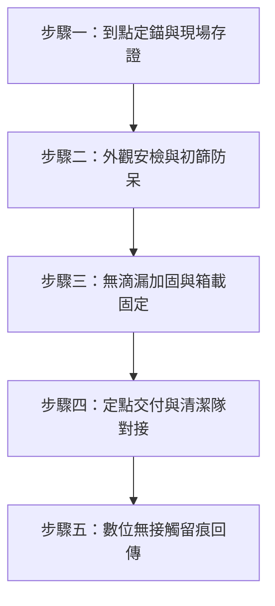

# 📋 外圈代倒垃圾包月服務標準作業流程 (SOP)
## 02_外圈代倒垃圾包月_999與1999 第一線執行手冊

> **文件編號**：SOP-LB-02-01  
> **版本號**：V1.0 (甲子旗艦版)  
> **制定負責人**：陳品碩 (Pinshuo) / 首席品質長 戴明 (Dr. Deming) 審定 / CTO 林納斯 (Linus) 架構監製  
> **適用半徑**：台東市區「正氣北路家宅」圓心 300 公尺以上至外圈商業服務區（機車外勤車隊履約）  
> **核心使命**：**「準時到達、乾淨俐落、三防到位、無痕留證。」** 徹底終結客戶下班追垃圾車的狼狽與焦慮。

---

## 🧭 一、 清運排程與時空路線規範

### 1.1 台東市清潔隊清運節奏對齊
* **公所收運日**：每週一、週二、週四、週五、週日（每週收運 5 天）。
* **公所停收日**：每週三、週六（公所全縣停收，除特殊節日調配）。
* **管家服務時段**：傍晚 **16:30 ~ 19:30**（依各責任路段垃圾車抵達前 30~60 分鐘完成到府收袋與集中）。

### 1.2 客戶方案履約排程
| 訂閱方案 | 每週出勤天數 | 標準清運指定日 | 適用情境 |
| :--- | :--- | :--- | :--- |
| **999 輕量雙享包** | 每週 2 次 | 固定組合：**【週二、週五】** 或 **【週一、週四】** | 垃圾量小之單身、小家庭、極少開伙者 |
| **1,999 尊榮旗艦包** | 每週 5 次 | 台東公所全收運日：**【週一、週二、週四、週五、週日】** | 雙薪育兒家庭（尿布）、工作室、輕食早午餐 |

---

## 🛵 二、 出勤裝備規範與最高食安防呆 (Poka-Yoke & Hygiene Rules)

### 2.1 ⚠️ 最高食安軍規：嚴禁背載食品保溫箱（務實「卸箱」物理隔離防線）

> [!CAUTION]
> **【零容忍紅線】倒垃圾出勤服務，全車嚴格禁止背負、附掛或載運任何「食品保溫大箱、保溫小箱」！**
> * **嚴禁裝備**：包含生活管家「一起叫便當」專用保溫箱、UberEats / Foodpanda 外送保溫袋、車前置物籃保溫提袋等任何用於食品配送之保溫容器。
> * **制定原因與交叉污染風險**：
>   1. **微生物與化學交叉污染**：垃圾中含有大量病菌、黴菌、腐敗廚餘湯汁與潛在有害物質，保溫箱內襯材質極易吸附異味與微粒，一旦混用將對餐飲配送造成毀滅性衛生災難。
>   2. **品牌信任與社會觀感**：若台東市民或店家目擊管家專員「背著外送保溫箱收垃圾」或「機車後座保溫箱旁堆疊垃圾袋」，將產生嚴重的食安恐慌與衛生疑慮，直接摧毀「生活管家」與「一起叫便當」好不容易建立的品牌信任資產。

---

### 2.2 🛠️ 務實落地思維：拒絕高門檻專用載具，落實「卸箱＋快拆彈性載運」

在第一線實務營運中，要求每台機車改裝或配備高成本的「特製專用載具」極難落地且缺乏彈性。我們採取**「零改裝負擔、核心在於卸箱、以袋代箱防漏」**的極簡務實做法：

1. **出勤唯一前置動作——「卸箱留置」**：
   - 外勤專員出勤倒垃圾前，只需做一個動作：**將身上的保溫背包、車上的食物保溫大箱/小箱「拆卸下車，留置於家宅/工作室」**。
   - 保持機車後座與踏板乾淨裸裝，完全消除食品裝備出現在垃圾清運場景的可能性。
2. **接地氣的低成本載運方式（任選其一即可出勤）**：
   - **方式 A【零成本・高彈力繩捆紮法】**：利用兩條平價機車高彈力勾繩（或貨物彈力網），將垃圾袋穩穩固定於後座與後扶手，出勤完畢彈力繩一收，完全不佔車體空間。
   - **方式 B【快拆活動式塑膠黑籃/折疊籃】**：使用五金行隨手可得的平價塑膠水果籃、農用黑籃或折疊收納籃。出勤前以彈力繩快扣於後座，收勤後 10 秒解下，拿水龍頭直接沖洗晾乾。
   - **方式 C【前腳踏板平放】**：單趟 1~2 袋生活垃圾，直接平穩置於機車前腳踏板，低重心且便於騎士隨時照看。
3. **「以袋代箱」雙層防漏防呆 (Poka-Yoke)**：
   - 防漏不用靠昂貴的特製箱體，而是靠成本不到 2 元的**「特厚防穿刺大垃圾袋（雙層套袋法）」**。
   - 現場取件時，凡目測有菜湯、油水滲漏風險之垃圾袋，一律**「就地直接加套一層特厚大黑袋並旋緊打結」**。以袋防漏、物理阻隔，車體踏板與後座自然 100% 保持乾淨無沾染。

---

### 2.3 出勤前置整備檢查清單 (Pre-Departure Checklist)

出勤前 5 分鐘，管家外勤專員必須於家宅 1 樓裝備區完成下列物理檢查：

```
[出勤整備檢查表]
[ ] 0. 【食安卸箱初檢】確認機車後座、踏板、騎士背部「無任何食品保溫大箱/小箱」（保溫箱已拆卸留置家宅）
[ ] 1. 簡易載運工具確認：
    - 機車高彈力勾繩 2 條（或活動式快拆塑膠黑籃/折疊籃）
[ ] 2. 隨身清潔工具組：
    - 特厚黑色備用防穿刺大垃圾袋 (45L / 60L 各 5 張，遇滲漏即刻雙層套袋)
    - 工業級強韌防穿刺止滑手套（避免碎玻璃、竹籤竹筷穿刺傷）
    - 75% 酒精噴霧瓶 + 高吸水加厚抹布（處理滴漏與門前保潔）
    - 強效除臭芳香噴劑（針對廚餘異味即時壓制）
    - 耐候型彩色標籤束帶（註記特殊戶與加袋辨識）
[ ] 3. 數位裝備：
    - 防水智慧手機（電量 ≥ 80%）
    - 車載防震手機導航支架
    - 官方 LINE@ 客服後台 App（拍照簽收回傳專用）
    - 行動電源與充電線
```

---

## 🛠️ 三、 標準清運五步法 (Standard 5-Step Operation)



### 步驟一：到點定錨與現場存證 (Arrival & Verification)
1. 機車停妥於客戶約定地點旁（透天門前、車庫角落、華廈管理室轉角），開啟臨停雙黃燈，務必注意人車動線安全。
2. 抵達約定位置，以手機拍下「未取前現場狀況」全景照（含門牌/約定點特徵與垃圾袋原貌）。

### 步驟二：外觀安檢與初篩防呆 (Inspection & Poka-Yoke)
1. **防漏檢查**：觀察袋底是否有液體滲漏痕跡。若有湯汁菜湯滲漏徵兆，**一律就地套上備用特厚袋**，絕不讓污水滴落客戶家門前地磚與騎樓。
2. **違禁危險物排查**：
   - 觸摸與目測是否有外露針頭、竹籤、碎玻璃、尖銳金屬。
   - 嚴格排查爆裂物：卡式瓦斯罐、未熄滅香灰、噴霧罐、高壓鋼瓶、大容量鋰電池。
   - *（若發現違禁危險品，立即啟動下方「安燈例外停線機制」）*。
3. **重量與體積核實**：
   - 999 方案：一般生活垃圾 1 袋（≤ 20L，約 5kg 以內）+ 資源回收 1 小包。
   - 1,999 方案：一般生活垃圾至多 2 袋（單次總重 ≤ 10kg）+ 資源回收 1 袋。
   - *（若嚴重超量超出方案約定，依加收規範拍照留存，正常清運並通知客服補記）*。

### 步驟三：無滴漏加固與箱載固定 (Securing & Transport)
1. 雙手配戴防穿刺手套提袋，袋口旋緊打死結。
2. 平整置入後座防漏大置物箱中，重袋置於底層、回收與輕袋置於上層，保持箱體重心穩定。
3. 扣上高彈力拉繩，確保路途震動絕不翻覆飛落。
4. 若地磚有微量污漬，立即使用隨身酒精抹布擦拭乾淨，維護客戶門面尊嚴。

### 步驟四：定點交付與清潔隊對接 (Handover to Municipal Truck)
1. 依最佳化路線行駛至約定之台東市清潔隊垃圾車定點/沿線交會點。
2. **分類交付**：
   - 一般垃圾袋拋入黃色垃圾壓縮車。
   - 資源回收袋（紙類、塑膠瓶、鋁箔包、金屬罐）交付後方白色資源回收車。
   - 廚餘類倒入專用廚餘桶。
3. 清運完畢後，外勤專員現場以酒精清潔雙手手套與車箱表面。

### 步驟五：數位無接觸留痕回傳 (Digital Receipt & Notification)
1. 拍下「清運後乾淨門前」照片，形成前後對比 (Before / After)。
2. 於客戶專屬 LINE 官方帳號/服務群組發送標準回報：
   > 🛎️ **生活管家清運回報**  
   > 尊貴的【客戶稱謂/門牌號】：您好！  
   > 今日垃圾與資源回收已於 **[時:分]** 順利為您清運完畢！門前環境已維持整潔。  
   > 祝您今晚擁有愜意放鬆的家庭時光！🌱  
   > *(附上門前清潔照片)*

---

## 🚨 四、 戴明安燈機制與客訴例外應變手冊 (Andon Exceptions)

遇到任何偏離標準之異常情境，立即「停線拍照、系統標記、規範處置」：

### 狀況 A：客戶忘記將垃圾放置於約定點
* **判斷基準**：外勤抵達現場，約定點無任何垃圾袋。
* **處置 SOP**：
  1. 拍攝空無一物的門前照片作為依據。
  2. 於專屬 LINE@ 輕柔發送通知：「管家專員已抵達您門前，現場未見放置垃圾袋，請問今日垃圾已自行處理或家中無垃圾需倒呢？」
  3. 專員現場等候 **3 分鐘**，若屋內有人開門交付則正常清運。
  4. 若無人回應，系統標記「本日未出袋」，專員繼續執行下一站，**當次額度計入已出勤，不予退費亦不順延**（但若客戶於 10 分鐘內回覆且專員尚未離開同路段，可順路折返協助，維繫人情味）。

### 狀況 B：垃圾袋嚴重破損、惡臭液體外溢流地
* **處置 SOP**：
  1. 第一時間拍照留證。
  2. 立即套上備用 60L 特厚大袋完全密封，阻絕異味散播。
  3. 使用車載酒精噴霧與吸水抹布，將門前地面溢流汁液徹底擦拭去味。
  4. 委婉發送管家小提醒：「管家今日已為您擦拭地磚並加套厚袋，建議下次湯汁類廚餘可先稍微瀝乾密封，避免引來野貓狗啃咬，守護家門整潔～❤️」

### 狀況 C：袋內夾帶危險違規品（瓦斯罐、未熄香灰、針頭）
* **處置 SOP**：
  1. **絕對禁止直接投入壓縮車**，以防高溫壓縮引發氣爆起火或刺傷清潔隊員。
  2. 立即拍照並將危險品單獨取出挑出。
  3. 於 LINE 鄭重發布安檢通知，並協助客戶進行正確分類教育。

### 狀況 D：天災停班停課（颱風、暴雨特報）
* **處置 SOP**：
  1. 依台東縣政府公告停班停課與台東市公所垃圾車停駛為準。
  2. 當日所有外勤派單暫停出勤以策安全。
  3. 於當日 14:00 前主動推播停運公告，並於恢復正常上班日啟動「次日雙倍容積大清運」，免費吸收客戶積累兩天之垃圾量。

---

## 📊 五、 品質檢驗與履約績效指標 (KPI & Deming Audit)

| 評估指標 | 目標數值 | 異常懲處 / 改進防線 |
| :--- | :--- | :--- |
| **食安物理隔離違規率** | **0%（絕對零容忍）** | **凡背負或車載食品保溫箱出勤倒垃圾者，立即啟動安燈停權、扣除當週出勤津貼，並銷毀該保溫箱以策萬全。** |
| **到點準時率** | $\ge 98.5\%$ | 遇突發塞車或爆胎，必須提前 15 分鐘於調度群啟動備援車輛。 |
| **門前零滴漏率** | $100\%$ | 一旦發生漏汁未清理被客訴，該趟次出勤津貼扣罰並到府致歉。 |
| **履約照片上傳率** | $100\%$ | 每一站必拍 Before/After，無照片不計入結算工時。 |
| **客戶續約率** | $\ge 85\%$ | 建立長期定期回訪機制，每季贈送「家宅冰箱借冰券」或「順路採買折價」。 |
