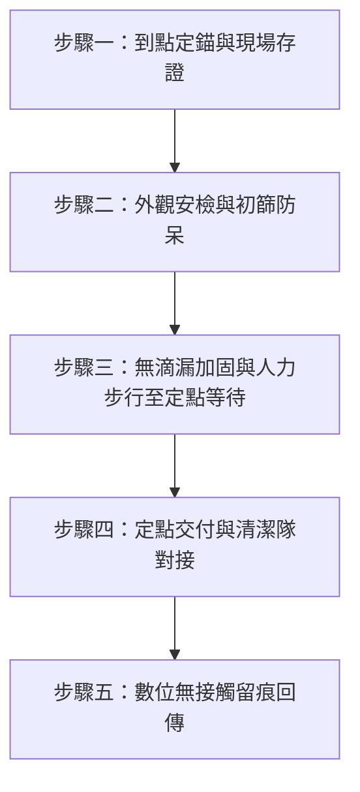

# 📋 外圈代倒垃圾包月服務標準作業流程 (SOP)
## 02_外圈代倒垃圾包月_999與1999 第一線執行手冊

> **文件編號**：SOP-LB-02-01  
> **版本號**：V1.2 (環境部 109 號函釋合規旗艦版)  
> **制定負責人**：陳品碩 (Pinshuo) / 營運幕僚長 雪柔 (Sheryl) 審定 / 首席品質長 戴明 (Dr. Deming) 監製  
> **法律定性與合規安全港**：  
> 依據行政院環保署（現環境部）**環署廢字第 1091202281 號函**，本服務明確歸類為**「到府家事跑腿清潔勞務」**。專員以機車代步抵達住戶門前，**於現場一律以「人力步行/手推車」方式將垃圾袋代提移交至該街廓清潔隊定點**。**嚴格禁止以機動車輛於道路跨區長途載運垃圾**，完全符合「非屬廢棄物清除業務、免申請清除許可證」之法定安全港規範！  
> **適用區域**：台東市區各主要生活圈、住宅區與商業街區  
> **核心使命**：**「準時到達、人力代提、三防到位、無痕留證。」** 徹底終結客戶下班追垃圾車的狼狽與焦慮。

---

## 🧭 一、 清運排程與時空路線規範

### 1.1 台東市清潔隊清運節奏對齊
* **公所收運日**：每週一、週二、週四、週五、週六（每週收運 5 天）。
* **公所停收日**：每週三、週日（台東在地例行全縣停收，除特殊春節調配）。
* **管家服務時段**：傍晚 **16:30 ~ 19:30**（依各責任路段垃圾車抵達前 30~60 分鐘完成到府收袋與集中）。

### 1.2 客戶方案履約排程
| 訂閱方案 | 每週出勤天數 | 標準清運指定日 | 適用情境 |
| :--- | :--- | :--- | :--- |
| **999 輕量雙享包** | 每週 2 次 | 固定組合：**【週二、週五】** 或 **【週一、週四】** | 垃圾量小之單身、小家庭、極少開伙者 |
| **1,999 尊榮旗艦包** | 每週 5 次 | 台東公所全收運日：**【週一、週二、週四、週五、週六】** | 雙薪育兒家庭（尿布）、工作室、輕食早午餐 |

---

## 🛵 二、 出勤裝備規範與最高食安防呆 (Poka-Yoke & Hygiene Rules)

### 2.1 ⚠️ 最高食安軍規：嚴禁背載食品保溫箱（務實「卸箱」物理隔離防線）

> [!CAUTION]
> **【零容忍紅線】倒垃圾出勤服務，全車嚴格禁止背負、附掛或載運任何「食品保溫大箱、保溫小箱」！**
> * **嚴禁裝備**：包含生活管家「一起叫便當」專用保溫箱、UberEats / Foodpanda 外送保溫袋、車前置物籃保溫提袋等任何用於食品配送之保溫容器。
> * **制定原因與交叉污染風險**：
>   1. **微生物與化學交叉污染**：垃圾中含有大量病菌、黴菌、腐敗廚餘湯汁與潛在有害物質，保溫箱內襯材質極易吸附異味與微粒，一旦混用將對餐飲配送造成毀滅性衛生災難。
>   2. **品牌信任與社會觀感**：若台東市民或店家目擊管家專員「背著外送保溫箱收垃圾」或「機車後座保溫箱旁堆疊垃圾袋」，將產生嚴重的食安恐慌與衛生疑慮，直接摧毀「生活管家」與「一起叫便當」好不容易建立的品牌信任資產。

---

### 2.2 🚫 核心鋼鐵軍規：機車純代步・【絕對嚴禁使用機車載運垃圾】！

> [!CAUTION]
> **【法律生死紅線 ✕ 專員接單保護】本服務絕對嚴禁外勤專員使用機車載運任何垃圾！**
> 1. **法規紅線（環境部 109 號函釋）**：本服務免申請廢棄物清除許可證的唯一合法基礎，在於**「定點人力代提勞務」**。一旦將垃圾置於機車踏板或後座「行駛於道路載運」，依法即構成「未經許可從事廢棄物清除運輸業務」，面臨刑事與重大行政處分！
> 2. **專員車輛保潔與接單意願**：外送夥伴之機車為個人生財與代步工具，絕不容許沾染垃圾污汁與異味。
> 3. **合法作業唯一模式**：
>    - **機車僅為「專員前往客戶現場之代步工具」**。抵達現場後機車立即熄火停妥。
>    - 專員至客戶現場取件後，**「一律以人力雙手步行提攜（或手推車）」**，將垃圾代提移步至該街廓/巷口之清潔隊指定垃圾車定點，在定點現場等候垃圾車！
>    - **嚴格叮嚀外送員勿載垃圾，請外送員至指定垃圾車定點等待垃圾！**

---

### 2.3 出勤前置整備檢查清單 (Pre-Departure Checklist)

出勤前 5 分鐘，管家外勤專員必須於家宅 1 樓裝備區完成下列物理檢查：

```
[出勤整備檢查表]
[ ] 0. 【車體潔淨初檢】確認機車「無保溫箱、無載貨籃、車身乾淨」，機車純作交通代步，嚴禁車載垃圾！
[ ] 1. 人力步行提攜裝備：
    - 工業級強韌防穿刺止滑手套（雙手提攜防滑防穿刺）
    - 輕便折疊手推車（選配，大量或重物步行移步專用）
[ ] 2. 隨身清潔保潔組：
    - 特厚黑色備用防穿刺大垃圾袋 (45L / 60L 各 5 張，遇滲漏現場加套)
    - 75% 酒精噴霧瓶 + 高吸水加厚抹布（門前保潔與手套清潔）
    - 強效除臭芳香噴劑（現場異味即時壓制）
[ ] 3. 數位裝備：
    - 防水智慧手機（電量 ≥ 80%，安裝公所垃圾車動態 GPS App）
    - 官方 LINE@ 客服後台（拍照留存與履約回報）
```

---

## 🛠️ 三、 標準清運五步法 (Standard 5-Step Operation)



### 步驟一：到點定錨與現場存證 (Arrival & Verification)
1. 機車停妥於客戶約定地點旁（透天門前、車庫角落、華廈管理室轉角），開啟臨停雙黃燈，務必注意人車動線安全。
2. 抵達約定位置，以手機拍下「未取前現場狀況」全景照（含門牌/約定點特徵與垃圾袋原貌）。

### 步驟二：外觀安檢與初篩防呆 (Inspection & Poka-Yoke)
1. **防漏檢查**：觀察袋底是否有液體滲漏痕跡。若有湯汁菜湯滲漏徵兆，**一律就地套上備用特厚袋**，絕不讓污水滴落客戶家門前地磚與騎樓。
2. **違禁危險物排查**：
   - 觸摸與目測是否有外露針頭、竹籤、碎玻璃、尖銳金屬。
   - 嚴格排查爆裂物：卡式瓦斯罐、未熄滅香灰、噴霧罐、高壓鋼瓶、大容量鋰電池。
   - *（若發現違禁危險品，立即啟動下方「安燈例外停線機制」）*。
3. **重量與體積核實（人力步行提攜上限）**：
   - **人力單趟硬性上限**：因全線採「人力步行提攜至定點」，考量專員雙手提攜平衡與人體工學，**單次到府服務上限嚴格定為「20 公升規格共 2 包（包含資源回收）」**（一手提一包，安全從容）。
   - **到府容積組合範例**：
     - 組合 A：一般生活垃圾 1 包 (20L) ＋ 資源回收 1 包 (20L)
     - 組合 B：一般生活垃圾 2 包 (20L × 2，當日無回收)
     - 組合 C：資源回收 2 包 (20L × 2，當日無一般垃圾)
   - *（若單次超出 20L 兩包上限，專員現場拍照存證並回傳留痕，超量費用併入帳單，且超量過多時專員得分趟步行移運，嚴禁貪快以機車載運）*。

### 步驟三：無滴漏加固與人力步行至定點等待 (Walk to Spot & Wait)
1. 雙手配戴防穿刺手套提袋，確認袋口旋緊打死結，檢查無滲漏。
2. 若地磚有微量污漬，立即使用隨身酒精抹布擦拭乾淨，維護客戶門面尊嚴。
3. **【核心動作・步行移步定點】**：專員雙手提袋（或使用輕便手推車），**徒步步行移移至該街廓/巷口之清潔隊指定垃圾車定點**。
4. **【定點等待垃圾車】**：專員於垃圾車停靠點之安全人行道/路側守候等待垃圾車抵達。**【嚴格禁止】使用機車載運垃圾在馬路上行駛！**

### 步驟四：定點交付與清潔隊對接 (Handover to Municipal Truck)
1. 專員於定點等候台東市清潔隊垃圾車抵達。
2. **分類親手交付**：
   - 一般垃圾袋投入黃色垃圾壓縮車。
   - 資源回收袋（紙類、塑膠瓶、鋁箔包、金屬罐）交付後方資源回收車。
   - 廚餘類倒入專用廚餘桶。
3. 清運投入完畢後，外勤專員現場以酒精清潔雙手手套，確認現場無殘留垃圾。

### 步驟五：數位無接觸留痕回傳 (Digital Receipt & Notification)
1. 拍下「清運後乾淨門前」照片，形成前後對比 (Before / After)。
2. 於客戶專屬 LINE 官方帳號/服務群組發送標準回報：
   > 🛎️ **生活管家清運回報**  
   > 尊貴的【客戶稱謂/門牌號】：您好！  
   > 今日垃圾與資源回收已於 **[時:分]** 順利為您清運完畢！門前環境已維持整潔。  
   > 祝您今晚擁有愜意放鬆的家庭時光！🌱  
   > *(附上門前清潔照片)*

---

## 🚨 四、 戴明安燈機制與客訴例外應變手冊 (Andon Exceptions)

遇到任何偏離標準之異常情境，立即「停線拍照、系統標記、規範處置」：

### 狀況 A：客戶忘記放置垃圾或臨時無法配合（分級處置機制）
* **情境 1：提前請假順延（出勤前 2 小時於 LINE 告知）**
  - **處置 SOP**：專員尚未出門跑車，零交通耗損。系統登記「彈性請假順延 1 次」，本期服務總次數不減，另約定當月補倒日期或直接將履約期向後順延一次。
  - **【月度額度上限】**：**每月每戶以「1 次」提前請假順延為限**，避免頻繁改期衝擊排班調度。
* **情境 2：無預警未出袋（外勤已抵達現場）**
  - **處置 SOP**：
    1. 拍攝空無一物的門前照片作為履約依據。
    2. 於專屬 LINE@ 輕柔發送通知：「管家專員已抵達您門前，現場未見放置垃圾袋，請問今日垃圾已自行處理或家中無垃圾需倒呢？」
    3. 專員現場等候 **3 分鐘**，若屋內有人開門交付則正常清運。
    4. 若無人回應，系統標記「本日無預警未出袋」，專員繼續執行下一站。
    5. **【核心鐵律・專員出勤保護】**：外勤專員已如約跑車出勤並產生時間與油料成本，**當次額度視同已履約使用，出勤津貼全額發放予專員**！
    6. **【拓荒期人情彈性】**：若客戶事後急需補倒，可專案申請「外勤工本費加購補跑單」（NT$ 80 元/次），次數不佔用原月費額度。

### 狀況 B：垃圾袋嚴重破損、惡臭液體外溢流地
* **處置 SOP**：
  1. 第一時間拍照留證。
  2. 立即套上備用 60L 特厚大袋完全密封，阻絕異味散播。
  3. 使用車載酒精噴霧與吸水抹布，將門前地面溢流汁液徹底擦拭去味。
  4. 委婉發送管家小提醒：「管家今日已為您擦拭地磚並加套厚袋，建議下次湯汁類廚餘可先稍微瀝乾密封，避免引來野貓狗啃咬，守護家門整潔～❤️」

### 狀況 C：袋內夾帶危險違規品（瓦斯罐、未熄香灰、針頭）
* **處置 SOP**：
  1. **絕對禁止直接投入壓縮車**，以防高溫壓縮引發氣爆起火或刺傷清潔隊員。
  2. 立即拍照並將危險品單獨取出挑出。
  3. 於 LINE 鄭重發布安檢通知，並協助客戶進行正確分類教育。

### 狀況 D：天災停班停課（颱風、豪雨特報）
* **處置 SOP**：
  1. 依台東縣政府公告「停班停課」或台東市公所「垃圾車停駛」為唯一準則。
  2. 外勤夥伴生命安全至上，當日所有清運任務全面暫停出勤。
  3. 於當日 14:00 前（或公所宣布後第一時間）主動於 LINE 推播停運通知與安心關懷。
  4. **【核心機制・天災額度保證順延】**：
     - **次數完整保留**：天災不可抗力屬非戰之罪，**客戶購買之當期清運總次數（如 999 方案 8 次）全額保留、絕不吃次數！**
     - **履約期順延**：當期合約到期日自動依停課天數向後順延，或於當期清潔隊恢復加班日時補倒。
     - **【月度額度上限】**：**每期天災順延上限為 2 次**（極端氣候若超過 2 次，超出部分由雙方協議折抵次月月費或單趟殘值退費）。
     - **【載重防護鐵律】**：復工次日仍嚴格維持單趟「20L 兩包」之上限，絕不容許客戶堆積多日「一次加倍硬塞給專員」，保護外勤騎乘平衡與道路安全！

---

### 狀況 E：定點等車時周邊鄰居請求順手代丟（地推轉化與防呆三步法）
* **情境**：專員於街廓定點等候垃圾車時，附近路人或鄰居因趕時間請求：「少年耶，這包順便幫我丟一下好不好？」
* **處置心法**：**「零邊際成本行銷・帶著防呆接、帶著轉化種子接！」**
* **標準處置 SOP（三步閉環）**：
  1. **步驟一：微笑接過 ＋ 口頭初篩防呆**：
     - 專員雙手接過，手感目測無外漏與尖銳物，並笑著口頭確認：「沒問題大哥！您先去忙，這包我順手幫您顧！裡面沒有卡式瓦斯罐或未熄香灰齁？安全第一，交給我就好！」
  2. **步驟二：遞出小卡 ＋ 自報生活管家家門**：
     - 專員順手遞出隨身名片或展示手機 QR Code：「對了大姐，我們是在地的『生活管家』，專門幫這條巷子的鄰居到府代倒垃圾與生活跑腿！」
  3. **步驟三：植入轉化契機 ＋ 三次邊界防線**：
     - **第 1 次求助**：100% 順手熱情幫忙，展現在地人情味，播下轉化種子：「今天遇到是緣分！下次您如果常趕時間，加一下我們 LINE，專員直接去您門前拿，不用自己追車！」
     - **第 2 次求助**：溫柔推動試用：「大哥您常趕時間太辛苦了，我們有 149 元體驗單，明天我直接去您家門口提！」
     - **第 3 次求助**：堅守付費尊嚴，防止白嫖破窗：「大哥抱歉呀，公司有排程與保險規定，沒加入會員沒辦法一直代拋，怕清潔隊誤會，我幫您登記包月，今晚就為您到府服務！」

---

## 📊 五、 品質檢驗與履約績效指標 (KPI & Deming Audit)

| 評估指標 | 目標數值 | 異常懲處 / 改進防線 |
| :--- | :--- | :--- |
| **食安物理隔離違規率** | **0%（絕對零容忍）** | **凡背負或車載食品保溫箱出勤倒垃圾者，立即啟動安燈停權、扣除當週出勤津貼，並銷毀該保溫箱以策萬全。** |
| **到點準時率** | $\ge 98.5\%$ | 遇突發塞車或爆胎，必須提前 15 分鐘於調度群啟動備援車輛。 |
| **門前零滴漏率** | $100\%$ | 一旦發生漏汁未清理被客訴，該趟次出勤津貼扣罰並到府致歉。 |
| **履約照片上傳率** | $100\%$ | 每一站必拍 Before/After，無照片不計入結算工時。 |
| **客戶續約率** | $\ge 85\%$ | 建立長期定期回訪機制，每季贈送「家宅冰箱借冰券」或「順路採買折價」。 |
