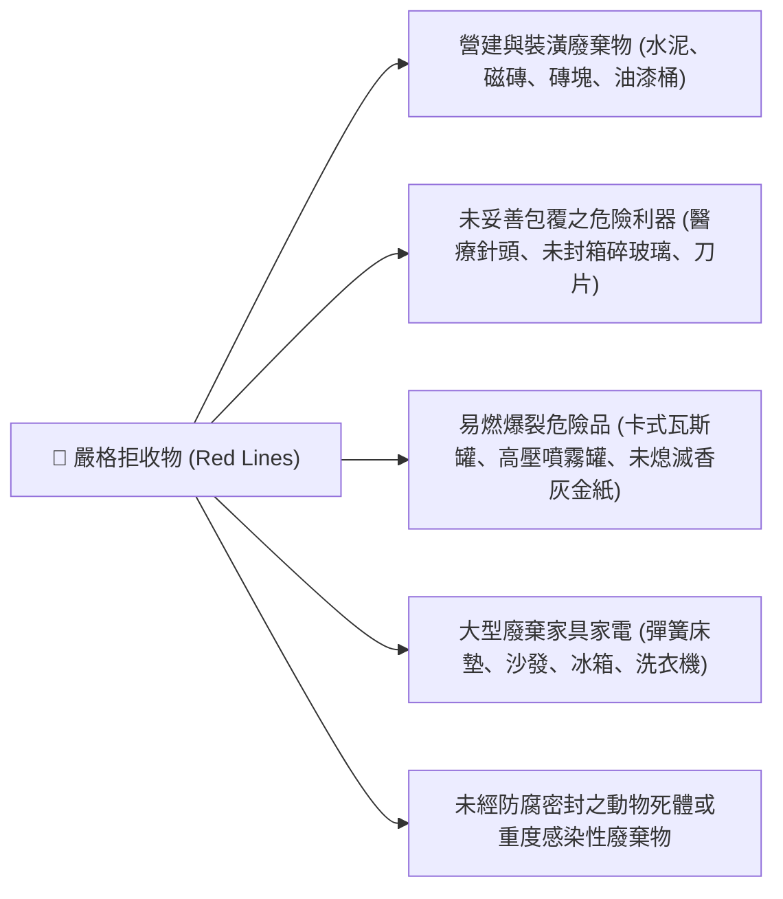

# 📜 產品規格與定價手冊 (Product Specification & Pricing)
## 02_外圈代倒垃圾包月_999與1999 交易契約與服務標準書

> **文件編號**：SPEC-LB-02-02  
> **版本號**：V1.0 (甲子旗艦版)  
> **發行主管**：陳品碩 (Pinshuo) / 財務長 算盤 (Abacus) 精算核定  
> **服務商標**：生活管家 (LifeButler)  
> **核心定位**：專為距離正氣北路家宅 300 公尺以外之雙薪家庭、醫護上班族、設計工作室、早午餐與生活選物店，提供**免追車、免狼狽、可預期、全包月**之專業垃圾與資源回收定時清運服務。

---

## 🎯 一、 產品方案矩陣與收費標準 (Pricing Matrix)

台東市清潔隊目前實行「垃圾不落地與資源回收政策」（尚未實施專用垃圾袋隨袋徵收，住戶使用自備之堅固垃圾袋即可）。本服務提供兩種標準化包月訂閱等級：

| 規格維度 | 【方案 A】999 輕量雙享包 | 【方案 B】1,999 尊榮旗艦包 |
| :--- | :--- | :--- |
| **月訂閱費用** | **NT$ 999 元 / 月** | **NT$ 1,999 元 / 月** |
| **單趟折合成本** | 約 **NT$ 125 元 / 次**（每月約 8 次出勤） | 約 **NT$ 99 元 / 次**（每月約 20~22 次出勤） |
| **每週服務頻率** | **每週 2 次**（固定選定組合） | **每週 5 次**（覆蓋台東全收運日） |
| **可選收運日** | 【週二、週五】或【週一、週四】 | **週一、週二、週四、週五、週日**（週三、週六公所停收） |
| **單趟垃圾額度** | 一般生活垃圾 **1 袋**（≤ 20L，重量 ≤ 5kg） | 一般生活垃圾至多 **2 袋**（單袋 ≤ 25L，總重 ≤ 10kg） |
| **資源回收額度** | 隨附簡易資源回收 **1 小包**（紙類/容器/瓶罐） | 隨附標準資源回收 **1 大袋**（紙箱平整壓扁） |
| **適合對象** | 單身貴族、兩人頂客族、早出晚歸外食族、租屋族 | 育兒家庭（每日尿布量大）、三代同堂、微型工作室、手作輕食咖啡館 |
| **會員專屬權益** | 享有「家宅 1 樓冰箱借冰」單次 8 折優惠 | 享有「家宅 1 樓冰箱借冰」每月 2 次免費暫存額度<br>享有「管家專業居家清潔」單次 9 折專屬折扣 |

---

## ➕ 二、 彈性增額與加值計費條款 (Add-on Services)

日常難免遇到網購拆箱、親友聚餐或大掃除等突發垃圾暴增，本手冊制定清晰明確之加價透明標準：

### 2.1 臨時超量加袋費 (Per-Bag Add-on)
* **一般垃圾超量**：
  * 每額外增加 1 袋（20L 以內）：**加收 NT$ 50 元 / 袋**。
  * 每額外增加 1 袋（超過 20L 至 45L）：**加收 NT$ 80 元 / 袋**。
* **資源回收超量**：
  * 大型廢紙箱未拆解壓縮（材積大）：**加收 NT$ 30 ~ 50 元 / 件**（建議住戶預先壓平綑綁）。
* **加收扣款方式**：當日現場拍照存證，次月帳單合併請款或於 LINE 數位儲值金中即時扣抵。

### 2.2 節慶大掃除與換屋搬家大清運 (5D Pricing Matrix)
* **適用情境**：農曆春節年前全戶大掃除、學生退租換屋、店面換約清空。
* **計價原則**：不適用一般包月額度，導入「**北極星 5D 價值精算時間矩陣**」現場專案場勘估價：
  $$\text{專案費用} = \text{基礎工時點數 (D1)} + \text{高重/髒污風險加成 (D2)} + \text{車趟清運運能費}$$
* **基本起跳價**：NT$ 800 元起（視實際廢棄物立方數與重量報價）。

---

## 🛑 三、 服務邊界與嚴格拒收清單 (Service Boundary & Prohibited Items)

為保障外勤管家專員之人身安全、合規對接台東市清潔隊作業標準，生活管家堅守以下「安全紅線」：



### 3.1 食安與衛生雙重保證（絕對物理隔離防線）
* **【嚴禁保溫箱出勤】**：生活管家嚴格實行**「生活廢棄物清運與食品冷鏈配送 100% 物理隔離」**。
* **卸箱出勤與雙層防漏**：所有倒垃圾出勤專員**嚴格禁止背負或車載任何食品保溫大箱、保溫小箱**（保溫裝備必須拆卸留置家宅）。清運採用機車後座彈力繩綑紮、前踏板或活動快拆籃，並強制落實「高風險滲漏袋現場加套特厚防漏大黑袋」，杜絕病菌、異味與任何交叉污染風險，給予客戶與合作店家最高標準的食安承諾。

### 3.2 履約地點與權利義務邊界
1. **一樓平面交接地點**：
   - 客戶必須將垃圾與回收密封綑綁完畢，放置於**約定之「一樓外部指定地點」**（例如：透天門口遮雨棚下、私人車庫角落、華廈社區大門警衛室指定籃內）。
   - **管家專員不持有住戶私人內門鑰匙**，不進入私人居住私領域進行翻找或打包服務（如需專人入室收納打掃，請洽「04_管家級專業清潔派單」服務）。
2. **防動物啃咬與保潔責任**：
   - 建議住戶若於上午即提前放置門外，應使用「附蓋垃圾桶」或「防貓狗抓咬格網」，以防台東街巷流浪犬貓撕咬散落。
   - 若因住戶未妥善密封造成地面積水髒污，管家小隊當日提供基本擦拭，若連續多次發生將通知改善。

---

## 💳 四、 訂閱流程、付款方式與終止條款 (Subscription & Terms)

### 4.1 訂閱與啟動流程
```
[線上登記/加LINE諮詢] ➔ [確認地址與門牌/現場停放點核定] ➔ [選定方案與收運日期] ➔ [線上轉帳完成付款] ➔ [正式排入專員清運航線]
```

### 4.2 付款週期與方式
* **預付訂閱制**：本服務採「先付款、後履約」原則。每月 25 日發送次月續約帳單，客戶於次月 1 日前完成匯款（支援 ATM 轉帳、LINE Pay、台灣 Pay）。
* **月度試跑期**：首次訂閱享有「首月不綁約」保障，滿月前 3 天由客服主動關懷並確認是否續訂。

### 4.3 中途暫停與退費機制
* **返鄉出差請假暫停**：
  * 客戶若因返鄉、出國、出差需連續暫停服務超過 **7 天（含）以上**，於出發前 3 天透過官方 LINE 提出申請，該週次費用可全額順延至次月扣抵（每年累計最多暫停 30 天）。
* **中途退訂退費**：
  * 當月服務開始後若因搬遷離東或不可抗力需終止合約，費用依已履約次數按單次原價（999方案按 125元/次；1999方案按 100元/次）核實扣除後，剩餘未出勤款項於 3 個工作天內無息退還。
