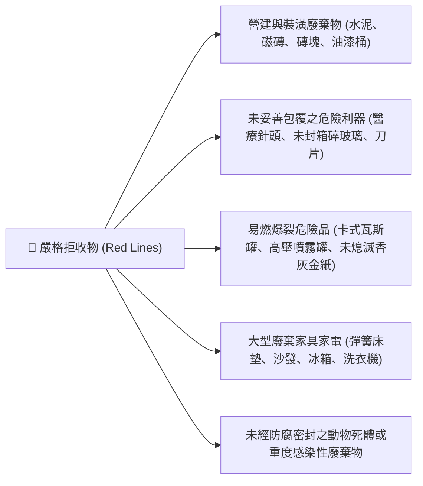

# 📜 產品規格與定價手冊 (Product Specification & Pricing)
## 02_外圈代倒垃圾包月_999與1999 交易契約與服務標準書

> **文件編號**：SPEC-LB-02-02  
> **版本號**：V1.0 (甲子旗艦版)  
> **發行主管**：陳品碩 (Pinshuo) / 財務長 算盤 (Abacus) 精算核定  
> **服務商標**：生活管家 (LifeButler)  
> **核心定位**：專為台東市區各主要生活圈之雙薪家庭、醫護上班族、設計工作室、早午餐與生活選物店，提供**免追車、免狼狽、可預期、全包月**之專業垃圾與資源回收定時清運服務。

---

## 🎯 一、 產品方案矩陣與收費標準 (Pricing Matrix)

台東市清潔隊目前實行「垃圾不落地與資源回收政策」（尚未實施專用垃圾袋隨袋徵收，住戶使用自備之堅固垃圾袋即可）。本服務提供兩種標準化包月訂閱等級：

| 規格維度 | 【方案 A】999 輕量雙享包 | 【方案 B】1,999 尊榮旗艦包 |
| :--- | :--- | :--- |
| **月訂閱費用** | **NT$ 999 元 / 月** | **NT$ 1,999 元 / 月** |
| **單趟折合成本** | 約 **NT$ 125 元 / 次**（每月約 8 次出勤） | 約 **NT$ 99 元 / 次**（每月約 20~22 次出勤） |
| **每週服務頻率** | **每週 2 次**（固定選定組合） | **每週 5 次**（覆蓋台東全收運日） |
| **可選收運日** | 【週二、週五】或【週一、週四】 | **週一、週二、週四、週五、週日**（週三、週六公所停收） |
| **單趟載運總上限** | **每次限 20 公升共 2 包（包含資源回收）** | **每次限 20 公升共 2 包（包含資源回收）** |
| **載運規格說明** | 🛵 **因採機車外勤出勤，受限車體空間與騎乘平衡安全，兩方案單趟上限完全相同**。<br>住戶可自由彈性分配：<br>• 1 包一般垃圾(20L) ＋ 1 包回收(20L)<br>• 或 2 包一般垃圾(20L×2)<br>• 或 2 包回收(20L×2) | 🛵 **因採機車外勤出勤，受限車體空間與騎乘平衡安全，兩方案單趟上限完全相同**。<br>住戶可自由彈性分配：<br>• 1 包一般垃圾(20L) ＋ 1 包回收(20L)<br>• 或 2 包一般垃圾(20L×2)<br>• 或 2 包回收(20L×2) |
| **月度累計清運總量** | 每月約 **16 包**（約 320 公升總額度） | 每月約 **40 ~ 44 包**（約 800 ~ 880 公升總額度，天天清運不積累） |
| **適合對象** | 單身貴族、兩人頂客族、早出晚歸外食族、租屋族 | 育兒家庭（每日尿布量大）、三代同堂、微型工作室、手作輕食咖啡館 |
| **會員專屬權益** | 享有「家宅 1 樓冰箱借冰」單次 8 折優惠 | 享有「家宅 1 樓冰箱借冰」每月 2 次免費暫存額度<br>享有「管家專業居家清潔」單次 9 折專屬折扣 |

---

## ➕ 二、 彈性增額與加值計費條款 (Add-on Services)

日常難免遇到網購拆箱、親友聚餐或大掃除等突發垃圾暴增，本手冊制定清晰明確之加價透明標準：

### 2.1 臨時超量加袋條款 (Per-Bag Add-on)
* **超量認定原則**：
  * 單次到府清運以 **20 公升規格共 2 包（含資源回收）** 為基準。
  * 若因親友聚會、網購拆箱等突發需求，單次放置超過 2 包，管家專員將依現場車載安全許可順手協助清運，並拍照存證回傳留痕。
* **計費與請款方式（併入下月帳單）**：
  * **超量費用依每袋規格另行計收**（目前費率保留動態調整彈性，收費標準公告於官方 LINE@）。
  * **現場零現金交易**：外勤專員現場絕不經手現金、不找零，所有超量加收費用**「一律統一併入下月帳單合併結算」**，安全透明、清楚留證。

### 2.2 節慶大掃除與換屋搬家大清運 (5D Pricing Matrix)
* **適用情境**：農曆春節年前全戶大掃除、學生退租換屋、店面換約清空。
* **計價原則**：不適用一般包月額度，導入「**北極星 5D 價值精算時間矩陣**」現場專案場勘估價：
  $$\text{專案費用} = \text{基礎工時點數 (D1)} + \text{高重/髒污風險加成 (D2)} + \text{車趟清運運能費}$$
* **基本起跳價**：NT$ 800 元起（視實際廢棄物立方數與重量報價）。

---

## 🛑 三、 服務邊界與嚴格拒收清單 (Service Boundary & Prohibited Items)

為保障外勤管家專員之人身安全、合規對接台東市清潔隊作業標準，生活管家堅守以下「安全紅線」：



### 3.1 法律合規性與勞務定性聲明（環境部 109 號函釋安全港）
* **【法規合規性宣告】**：
  依據環境部（原環保署）**環署廢字第 1091202281 號函**，本服務明確歸屬於**「到府家政清潔與生活跑腿勞務」**，非屬《廢棄物清理法》第 41 條管轄之「動力車輛事業廢棄物清除業」，無須取得清除機構許可證。
* **【履約形式鐵律】**：
  管家專員至客戶門前服務時，**一律以「人力步行代提/手推車」方式將垃圾袋移送至該街廓清潔隊垃圾車交接**。機車僅為專員通勤代步工具，嚴禁於機車上裝載跨街區之長途垃圾運送，確保 100% 合法合規！

### 3.2 食安與衛生雙重保證（絕對物理隔離防線）
* **【嚴禁保溫箱出勤】**：生活管家嚴格實行**「生活廢棄物清運與食品冷鏈配送 100% 物理隔離」**。
* **卸箱出勤與雙層防漏**：所有倒垃圾出勤專員**嚴格禁止背負或車載任何食品保溫大箱、保溫小箱**（保溫裝備必須拆卸留置家宅）。清運採用機車後座彈力繩綑紮、前踏板或活動快拆籃，並強制落實「高風險滲漏袋現場加套特厚防漏大黑袋」，杜絕病菌、異味與任何交叉污染風險，給予客戶與合作店家最高標準的食安承諾。

### 3.2 履約地點與權利義務邊界
1. **一樓平面交接地點**：
   - 客戶必須將垃圾與回收密封綑綁完畢，放置於**約定之「一樓外部指定地點」**（例如：透天門口遮雨棚下、私人車庫角落、華廈社區大門警衛室指定籃內）。
   - **管家專員不持有住戶私人內門鑰匙**，不進入私人居住私領域進行翻找或打包服務（如需專人入室收納打掃，請洽「04_管家級專業清潔派單」服務）。
2. **防動物啃咬與保潔責任**：
   - 建議住戶若於上午即提前放置門外，應使用「附蓋垃圾桶」或「防貓狗抓咬格網」，以防台東街巷流浪犬貓撕咬散落。
   - 若因住戶未妥善密封造成地面積水髒污，管家小隊當日提供基本擦拭，若連續多次發生將通知改善。

---

## 💳 四、 訂閱流程、付款方式與終止條款 (Subscription & Terms)

### 4.1 訂閱與啟動流程
```
[線上登記/加LINE諮詢] ➔ [確認地址與門牌/現場停放點核定] ➔ [選定方案與收運日期] ➔ [線上轉帳完成付款] ➔ [正式排入專員清運航線]
```

### 4.2 付款週期與方式
* **預付訂閱制**：本服務採「先付款、後履約」原則。每月 25 日發送次月續約帳單，客戶於次月 1 日前完成匯款（支援 ATM 轉帳、LINE Pay、台灣 Pay）。
* **月度試跑期**：首次訂閱享有「首月不綁約」保障，滿月前 3 天由客服主動關懷並確認是否續訂。

### 4.3 中途暫停與退費機制
* **返鄉出差請假暫停**：
  * 客戶若因返鄉、出國、出差需連續暫停服務超過 **7 天（含）以上**，於出發前 3 天透過官方 LINE 提出申請，該週次費用可全額順延至次月扣抵（每年累計最多暫停 30 天）。
* **中途退訂退費**：
  * 當月服務開始後若因搬遷離東或不可抗力需終止合約，費用依已履約次數按單次原價（999方案按 125元/次；1999方案按 100元/次）核實扣除後，剩餘未出勤款項於 3 個工作天內無息退還。

### 4.4 天災順延與請假額度管制條款 (Rescheduling & Monthly Quota Cap Policy)
* **【天災停班停課：次數全額順延（每期上限 2 次）】**：
  * 凡遇颱風、豪雨特報等自然災害，經台東縣政府宣布「停班停課」或台東市公所宣布「垃圾車停駛」時，為維護第一線外勤夥伴生命安全，當日全面暫停清運出勤。
  * **次數保證順延原則**：天災不可抗力非客戶之過，**客戶購買之當期服務總次數（如 999 方案 8 次）全數獲得保障，絕不扣抵額度！**
  * **履約期自動延長**：該期訂閱之服務截止日自動向後順延相應停課天數，或於當期清潔隊恢復加班日時補倒。
  * **【月度天災順延上限】**：每期以 **2 次** 順延為限（若遇極端連續颱風超過 2 次，超出部分由雙方協議折抵次月月費或退還單趟殘值）。
  * **【次日防爆載鐵律】**：恢復收運次日仍維持「單趟 20L 兩包」標準額度，禁止客戶將數日垃圾一次性硬塞要求單趟全載，若有額外超量需求依標準超量計費處理，保護外勤騎乘平衡與道路安全。
* **【客戶個人因素：分級請假與專員出勤保護機制】**：
  * **情境 1：提前請假順延（出勤前 2 小時告知，每月限 1 次）**
    * 客戶若因外出、出差或無垃圾，於預定清運時間前 2 小時透過官方 LINE@ 提出請假，專員因未跑車而無交通成本，**該次額度保留順延**，可於當月內另約定日期補倒或順延至期末。
    * **每月每戶以「1 次」提前請假為限**，超次請假因影響整體航線排程，視同該次額度已使用。
  * **情境 2：無預警未出袋（專員已抵達門前）**
    * 專員依約抵達現場，若客戶忘記放置垃圾且等候 3 分鐘無人應門，拍照留證後離開。
    * **額度視同已履約**：因外勤專員已實際付出跑車油資與工時成本，該次額度視同已使用，專員出勤報酬全額發放，保障基層接單信任！
    * **【拓荒期補跑專案】**：若客戶事後急需補倒，可專案申請「外勤補跑單」（享專員路程工本費優惠 NT$ 80 元/次），次數不佔原月費額度。
