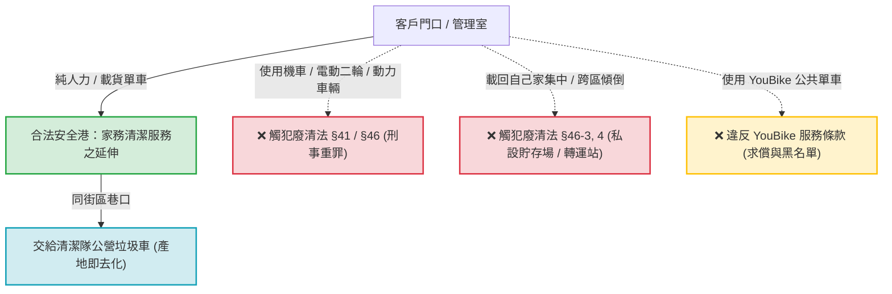

# 📘 生活管家·外圈代倒垃圾實戰營運與首單履約手冊
> **版本**：v1.0 實戰旗艦存摺版  
> **建立時間**：2026-11-06  
> **主政負責**：雪柔 (Sheryl Sandberg / CIO & 營運戰略雷達) ✕ 算盤 (Abacus / CFO)  
> **適用產品**：`02_外圈代倒垃圾包月_999與1999`（台東市區「一起倒垃圾」包月服務）

---

## 🎯 一、首單簽約客戶檔案（極星 001 號先鋒客戶）

| 欄位 | 客戶真實資料與預約規格 |
| :--- | :--- |
| **客戶姓名** | **黃婉婷 小姐** |
| **聯絡電話** | `0927506848` |
| **LINE ID** | `tin12049` |
| **服務地址** | **台東市大同路 236 號 5 樓（威盛保經）** |
| **建築與放置點** | 社區華廈 / 電梯大樓（有管理室），放置於**「大樓管理室指定放置處」** |
| **簽約方案** | **🌱【輕量雙享包】NT$ 999 /月**（每週出勤 2 次，單月約 8~9 次） |
| **單次容量上限** | **20L 兩袋為限**（一般垃圾＋瀝乾密封廚餘，或 1 袋垃圾＋1 袋資源回收） |
| **排定出勤日** | **每週二、每週五（夜間約 20:30 ~ 20:45）** |
| **現場勘查** | 客戶免現場勘查，以「拍管理室角落照片傳 LINE」確認動線 |
| **金流付款** | **包月預付制**：銀行轉帳至中國信託（822）`901561241504`（戶名：陳品碩） |
| **發票開立** | 合法商號開立統一發票（三聯式抬頭統編 / 二聯式個人），裝專用信封寄放管理室轉交 |

---

## ⚖️ 二、廢棄物清理法合規終極安全港（五大死鎖鐵律）

依據環境部（前行政院環境保護署）**環署廢字第 1091202281 號函釋**，本服務定性為**「家務清潔跑腿勞務服務」**，嚴格與「廢棄物清除業」劃清界線，杜絕《廢清法》第 41 條與第 46 條（1~5 年有期徒刑）風險：



### 🚨 五大不可逾越的作戰憲則：
1. **純人力載具原則（100% 免死金牌）**：
   * 出勤僅限**「步行推車、純人力腳踏車、無動力日系載貨三輪車（Cargo Bike）」**。
   * **絕對禁止使用機車、電動機車、微型電動二輪車、電動三輪車、或任何有電門馬達的載具**！只要有動力輔助，一旦被檢舉即視為非法清除業。
2. **產地即去化，過路不留家（絕對禁止載回家）**：
   * 垃圾在客戶門口收下後，**必須直接在該路段/該街區交給公營垃圾車**！
   * **絕對禁止把別人的垃圾載回自己家、車庫、頂樓或工作室堆放**！哪怕只放 10 分鐘，在法律上即構成「未經許可私設廢棄物貯存場 / 中繼轉運站」（《廢清法》第 46 條第 3、4 款，1~5 年有期徒刑）。
3. **網格化微型生活圈（禁止大馬路跨區長征）**：
   * 嚴禁將 A 里（例如大同路）的垃圾載運數公里丟到 B 里（例如更生路）的垃圾車，避免引發清潔隊配額爭議與環保稽查盯梢。
4. **嚴禁使用公共公共自行車（YouBike 2.0 / 2.0E）**：
   * YouBike 使用者條款嚴格禁止載運污穢物與從事商業營利載貨，違者將面臨永久停權與整車清潔消毒求償。
5. **外送箱絕對隔離（食品安全零容忍）**：
   * 執勤時嚴禁懸掛或攜帶外送保溫大箱/小箱，杜絕跨界污染與食安疑慮。

---

## 🗺️ 三、台東市清運與回收情報地圖（大同路戰區）

### 1. 夜間常態沿街班次（大同路 236 號周邊）
* **垃圾車經過時間**：**每週一、二、四、五、日，夜間約 20:30 ～ 20:50（約 20:45 最密集）**。
* **資源回收車日**：固定於**每週二、每週五**隨垃圾車同出！因此「週二、五」是清運一般垃圾＋廚餘＋回收物的黃金組合！
* **即時追蹤神器**：手機安裝環境部**「清運 e 點通」APP**，定位台東市大同路，設定「車輛抵達前 5 分鐘推播」，零秒差銜接。

### 2. 早安定時定點專車（作弊神器 / 備援方案）
* **站點位置**：**「南京路與正氣路口旁廣場」**（距離大同路 236 號僅約 800 公尺，單車 3 分鐘）。
* **開放時間**：每週一、二、四、五 **上午 07:30 ～ 08:30**。
* **作戰價值**：若前一晚錯過夜間垃圾車，隔天清晨 8 點前可直接推進南京路專車清運，不必乾等 24 小時。

---

## 💰 四、金流、商號與統一發票合規操作規範

### 1. 負責人個人帳戶收款之合法性
* **商號法律特質**：獨資/合夥之商號在民法與稅法上無獨立法人資格，權利義務與負責人完全重疊。
* **收款合法性**：商號營業款直接匯入**負責人個人銀行帳戶（中國信託 822 帳號 901561241504 戶名：陳品碩）**，完全合法合規。
* **關鍵防線**：每筆款項皆開立統一發票，並於雙月如實申報 401 營業稅表，零逃漏稅風險。

### 2. 統一發票開立規格（每期 NT$ 999）
* **二聯式發票（個人自費 / 辦公室合資未報公帳）**：
  * 開立金額：**NT$ 999**（內含 5% 營業稅）。
  * 買受人：填寫客戶姓名或空白。
* **三聯式發票（威盛保經或公司報帳）**：
  * 買受人：填寫公司完整全名（如：威盛保險經紀人股份有限公司）。
  * 統一編號：填寫對方統編。
  * **銷售額（未稅）**：**NT$ 951**
  * **營業稅（5%）**：**NT$ 48**
  * **總計金額**：**NT$ 999**
* **發票交付流程**：
  * 開立完成後，由管家專員放入專用精緻信封，標註「生活管家發票·黃婉婷小姐收」，於出勤清運日當天寄放大樓管理室轉交。

---

## 🕵️ 五、市場情報與同行稽查防護備忘錄

* **表單第 2 筆紀錄留存**：
  * 2026-11-05 19:55 收到填表，內容：「*老闆，友善提醒你，清運家庭垃圾要有許可證哦，而且也不能用機車去收~沒有許可證會被環保局開罰6萬餒，建議去考執照完再來做*」（電話 168888、地址 祝你生意興隆）。
* **情報分析**：
  * 台東在地清潔業者、同業或具備法規意識之網友已高度關注本服務。
  * 這證明市場需求真實存在，且競爭對手緊盯「機車載運、無證清除」的破綻。
  * **極星防禦盾牌**：我方宣傳與表單已全面完成「家務清潔跑腿」定位修正，全面落實「純人力自行車＋就地交付」之 109 號函安全港，對手無法以《廢清法》進行檢舉攻擊。

---

## 📱 六、標準客戶溝通對話庫（婉婷首單實戰語錄）

### 1. 費用與發票說明（定稿版）：
```text
好的，沒問題！您慢慢討論，有任何問題隨時跟我說，完全不著急 😊

關於包月費用、轉帳與發票的部分，為您詳細說明：

📌 服務為【包月固定制】：
* 999 方案採「包月預付制」（每月 NT$ 999，每週固定出勤 2 次，單月約 8~9 次清運服務）。

💳 轉帳帳號資訊：
* 銀行：中國信託（銀行代碼：822）
* 帳號：901561241504
* 戶名：陳品碩
👉 您與同仁/家人確認要啟動服務時再轉帳即可！轉帳完成後再麻煩告知帳號後 5 碼，方便我們為您對帳。

🧾 關於統一發票開立：
我們是合法登記商號，每個月皆會依包月費用開立【統一發票】：
* 若您或辦公室需要報帳核銷，轉帳時再麻煩提供「公司抬頭」與「統一編號」，我們每月為您開立三聯式發票。
* 若為個人自費，我們則會開立一般二聯式發票給您。

發票開好後，管家在出勤時會裝入專用信封寄放在管理室給您轉交。

您先慢慢討論，期待下週能正式為您服務喔！祝您順心 ✨
```

---

> **本手冊由雪柔完成歸檔，永久鎖定於極星商業作戰存摺，永不失憶。**


---

## 🌟 七、 實戰現場情境案例庫 (Real-World Case Studies)

### 案例 01：定點等垃圾車時，急迫鄰居主動請求代丟之「零成本獲客 (CAC=0) 與防呆轉化閉環」

* **現場情境還原**：
  管家專員佩戴手套、攜帶生活管家服務卡，於客戶家所屬巷口/街廓定點守候台東市清潔隊垃圾車。此時鄰近住戶（媽媽、趕著煮飯或接小孩的上班族）提著一包垃圾匆忙走來，看見專員站在那裡等車，走近開口：「少年耶，我趕時間，這包順便幫我丟一下好不好？」

* **核心衝突與三維考量（為什麼不能直接拒絕，也不能無腦亂接？）**：
  1. **冷漠拒絕的隱形成本**：台東是熟人聚居社區，若生硬拒絕「我們只服務付費會員」，會瞬間被貼上「不通人情、跩」的標籤，該生活圈口碑直接陣亡。
  2. **盲目亂接的潛在風險**：專員不知道袋內裝了什麼，若有未熄香灰、卡式瓦斯罐或未分類違規品，丟進壓縮車引發氣爆或被清潔隊破袋開罰，現場由專員承擔責任；且容易引發鄰里「反正有免費代拋」的搭便車白嫖心態。
  3. **商業價值的天賜良機**：對方正處於「不想罰站等垃圾車」的極致痛點中！專員本來就在等車，多提一包、多拋一下的邊際成本為 0 元。這是天賜的精準地推轉化現場！

* **標準處置 SOP（三步轉化閉環）**：
  ```mermaid
  flowchart TD
      A["鄰居匆忙求助：『少年耶，幫我丟一下好不好？』"] --> B["步驟一：微笑接過 ＋ 口頭初篩防呆"]
      B --> C["『沒問題大姐！您先去忙，交給我！裡面沒有瓦斯罐或香灰齁？安全第一！』"]
      C --> D["步驟二：遞出名片 ＋ 自報生活管家家門"]
      D --> E["『大姐我們是在地的生活管家，專門幫這條巷子鄰居到府代倒垃圾！』"]
      E --> F["步驟三：植入轉化種子 ＋ 三次邊界防線"]
      F --> G["第 1 次：100% 熱情幫忙（好感轉化）<br>第 2 次：推動 149 元體驗單<br>第 3 次：堅守付費尊嚴杜絕白嫖"]
  ```

* **專員實戰台詞規範**：
  1. **【步驟一：微笑接過 ＋ 口頭初篩】**：
     > 「沒問題的大姐！您趕快去忙，這包我順手幫您顧！  
     > （笑著確認）**大姐裡面沒有卡式瓦斯罐或未熄香灰齁？哈哈，安全第一！交給我就好！**」
  2. **【步驟二：出示名片/QR Code 建立專業信任】**：
     > 「對了大姐！我們是在地的**『生活管家』**，這條巷子有好幾家鄰居都是我們包月在照顧的。  
     > 今天剛好遇到是緣分，順手幫您顧一次！」
  3. **【步驟三：三次邊界轉化防線（消滅搭便車）】**：
     - **第 1 次**（熱情播種）：「下次您如果常趕時間，掃一下這個 LINE，我們甚至連出門都不用，專員直接去您家門前拿喔！」
     - **第 2 次**（推動體驗）：「大哥您常趕時間太辛苦了，我們現在有 **149 元體驗方案**，明天我直接去您門口提試試看！」
     - **第 3 次**（堅守尊嚴）：「大哥抱歉呀，因為公司有排程與安全保險規定，無法長期無約代拋，我幫您開通正式包月，今晚就為您到府服務！」

* **戰略成果**：
  以 0 元邊際成本，在真實生活場景中完成「風險排查 ➔ 鄰里信任 ➔ 潛在客戶轉化」三位一體大統攝，實現極致的高效地推！
