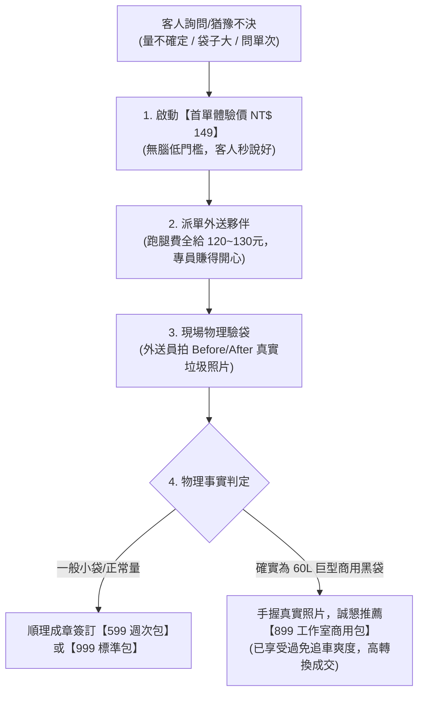

# 🛎️ 生活管家·外圈代倒垃圾專屬客服回應手冊與話術智庫 (Customer Care Playbook)
> **文件編號**：CARE-LB-02-06  
> **版本號**：V1.5 (拓荒破冰實戰旗艦版 · 內嵌首單體驗制與非標容量應對指南)  
> **主持內閣**：雪 (Yuki · 執行長) ✕ 影 (Kage · 首席特務兼生活管家) ✕ 泰勒絲 (Taylor · 行銷長)  
> **適用品牌**：生活的一部分，就醬點！（日常自稱：**生活管家**）  
> **服務項目**：`02_外圈代倒垃圾包月_999與1999`（台東市區代倒垃圾包月服務）

---

## 🎭 一、 客服角色人設與溝通黃金憲章 (Persona & Voice Standard)

### 1.1 客服身分與定位
* **對外顯示名稱**：`生活管家 小幫手` 或 `生活管家｜品碩`（依實際對接人員靈活微調）
* **品牌法定聲明**：我們是「**生活的一部分，就醬點！**」旗下的「**生活管家**」服務團隊。
* **核心性格特質**：
  * **親切暖心**：帶有台東在地的好客與溫度，像值得信賴的街坊鄰居。
  * **俐落專業**：規則清楚、邊界明確，不講模糊不清的官僚推託之詞。
  * **主動分憂**：看見客人的痛點（追車狼狽、尿布堆積、加班疲憊），先同理、再給解方。
  * **零 AI 塑料感**：嚴禁用「親愛的用戶您好，感謝您的提問...」等冰冷機械式模板，使用日常口語、自然接地氣的繁體中文。

### 1.2 客服三不原則與五大底線
1. ❌ **絕不透露內部代碼**：嚴禁出現「極星」、「Polaris」等內部名稱。
2. ❌ **絕不在現場收現金**：所有增額一律統一於次月帳單結算，保護外勤人員安全並確保帳目留痕。
3. ❌ **絕不承諾非法或違規清運**：裝潢廢土、大型家具、未包妥之針頭碎玻璃與卡式瓦斯罐一律溫和但堅定拒絕。
4. ⭕ **首動必先報價與規格**：每次清運基準為「20 公升共 2 包（含資源回收）」，講得清清楚楚。
5. ⭕ **食安衛生掛保證**：主動強調外勤裝備與送餐 100% 物理隔離，出勤絕不背負或車載保溫箱。

---

## 💬 二、 全場景即時對答話術庫 (Ready-to-Use Reply Matrix)

### 場景 1：客人初步詢問（「請問代倒垃圾怎麼收費？」「有在幫忙倒垃圾嗎？」）
> **【標準回覆】**：  
> 「您好！有的，我們是台東在地的【生活管家】🛎️！專門為市區辛苦的家庭和店家處理傍晚追垃圾車的煩惱。  
> 
> 目前我們提供兩種最受歡迎的包月方案喔：  
> 
> 🌱 **【999 輕量雙享包】NT$ 999 /月**  
> • 每週清運 2 次（可選：週二＋週五，或週一＋週四）  
> • 每次可收 20 公升規格共 2 包（一般垃圾＋回收皆可）  
> • 適合上班族、小家庭與租屋族！  
> 
> 👑 **【1,999 尊榮旗艦包】NT$ 1,999 /月**  
> • 每週清運 5 次（跟隨台東清潔隊週一、二、四、五、日天天收運）  
> • 每次可收 20 公升規格共 2 包  
> • 適合育兒家庭（尿布天天清）、手作早午餐、咖啡店與微型工作室！  
> 
> 請問您的地點大約在台東市的哪一條路段呢？我先幫您查查路線安排～😊」

---

### 場景 2：詢問服務範圍（「請問更生路有收嗎？」「豐榮/寶桑有送嗎？」）
> **【市區路段適用回覆】**：  
> 「您好！我們目前主要深耕服務**台東市區各主要生活圈**（包括大同路、正氣路、更生路、中華路、四維路、寶桑、豐榮一帶）！  
> 方便請您提供確切的『街道路名與大約門牌號碼』嗎？  
> 我們會立即幫您比對外勤單車與步行推車的清運路網，確認沒問題就可以排定試收喔！🚲✨」

> **【過於偏遠路段婉拒話術】**：  
> 「您好！非常感謝您對生活管家的信任～❤️  
> 目前我們的微型清運網點主要集中在台東市中心核心生活圈，您所詢問的地點稍微超出我們現階段外勤推車的即時清運半徑。  
> 為了確保清運時間精準與服務品質，目前該區域尚未開通包月服務，真的非常抱歉！  
> 方便先留下您的聯絡方式與路段嗎？只要該區集結滿 3 戶開線，我們第一時間通知您享受早鳥優惠！」

---

### 場景 3：詢問垃圾放置方式（「我人不在家怎麼辦？」「放門口會被狗咬嗎？」）
> **【標準回覆】**：  
> 「您完全不需要在家等我們喔！這正是這項服務最輕鬆的地方～☕  
> 
> 1. **放置約定點**：您只要在清運當天傍晚前，將垃圾綁好放置在『一樓指定地點』（例如：透天門口遮雨棚下、私人車庫角落、或華廈大樓管理室前指定籃內）。  
> 2. **防咬措施**：簽約後我們會提供專用的『防貓狗咬厚提袋/置物防護格網』，不怕台東街頭的小浪浪來翻咬！  
> 3. **拍照回傳**：管家專員每次清運完畢，都會拍照傳 LINE 讓您留存確認，回到家門口就是乾乾淨淨的！」

---

### 場景 4：食安與衛生疑慮（「你們有送餐也有倒垃圾，裝備會混在一起嗎？」）
> **【安全感拉滿話術】**：  
> 「這點請您絕對放一百二十個心！這也是我們最在意的堅持！🛡️  
> 
> 生活管家內部執行嚴格的『最高衛生軍規：100% 物理完全隔離』：  
> 1. **全車嚴禁保溫箱**：外勤專員出勤倒垃圾時，身上與車上的餐飲保溫大箱、小箱**一律拆卸留在家宅，絕不隨車出勤**！  
> 2. **防穿刺特厚外袋**：現場均配備專用特厚防滲漏外袋，若有湯汁或破損風險當場加套打結，絕不滴漏。  
> 3. **服務時段與裝備徹底解耦**：垃圾清運與餐飲配送在人員、裝備與時段上完全獨立，杜絕任何異味或細菌交叉污染，請您安心！」

---

### 場景 5：臨時垃圾超量（「家裡今天有朋友聚餐/網購大拆箱，垃圾超過 2 包怎麼辦？」）
> **【透明彈性應對】**：  
> 「偶爾親友聚會或大採購是常有的事，請放心交給管家！🎉  
> 
> 我們的處理方式很彈性貼心：  
> • 只要外勤車體安全許可，專員會順手幫您將多出來的袋數一同清運走。  
> • 專員會在現場拍照留證並傳 LINE 告知您。  
> • **現場零現金**：超量費用依每袋規格小額計收，**一律直接併入您下個月的帳單合併結算**，現場不用找零錢，既安全又透明！」

---

### 場景 6：客人忘記把垃圾拿出來（「抱歉我今天加班忘了把垃圾放門口...」）
> **【體貼共情與分級順延處置話術】**：  
> 「沒關係的！下班辛苦了～工作忙碌難免會忘記！先喝口水休息一下❤️  
> 
> 請問您現在已經回到家了嗎？  
> 
> • **狀況一（專員剛好在附近）**：如果管家專員剛好還在您同條巷弄，且您能立刻拿到門口，我們很樂意順手幫您收走！  
> • **狀況二（專員已前往下個街區）**：因為外勤夥伴已經專程騎車抵達現場，為了保障專員跑車的辛苦工時，本次趟次額度依約視同已出勤。  
> 💡 **貼心小提示**：每位包月客戶每個月都有 **1 次『提前請假順延』** 的福利喔！下次若臨時加班或不在家，只要在垃圾車來前 2 小時於 LINE 跟我說一聲，我們就能幫您免費保留次數順延！  
> 
> （若您家裡垃圾真的堆滿非常著急，我們今晚也可以幫您專案申請專員補跑加購，只要 80 元外勤工本費即可為您加跑一趟喔！😊）」

---

### 場景 7：客人要請假或暫停出勤（「下週我要出差/返鄉一週，費用能扣抵嗎？」）
> **【清晰合約條款回應】**：  
> 「沒問題的！祝您出差/出遊順利！✈️  
> 
> 依據我們的貼心合約條款：  
> • 只要連續請假超過 **7 天（含）以上**，於出發前 3 天透過 LINE 告知我們即可。  
> • 請假期間未出勤的週次費用，我們將**全額順延至次月帳單折抵**！  
> 請直接告訴我們您預計暫停的日期區間，小幫手這就為您在排程表中備註！」

---

### 場景 8：危險品或裝潢垃圾（「我家有幾袋舊水泥磁磚/卡式瓦斯罐可以順便收嗎？」）
> **【溫和堅定拒絕話術】**：  
> 「非常感謝您的詢問！但為了保護外勤夥伴的安全與符合台東市清潔隊的法規規範，這部分我們必須跟您說明一下：🙏  
> 
> ⚠️ **裝潢營建廢棄物（如水泥塊、磁磚、泥沙、油漆桶）** 以及 **易燃爆裂物（卡式瓦斯罐、噴霧高壓罐、未熄香灰）**，屬於政府法規嚴格管制的特殊廢棄物，清潔隊垃圾車亦嚴格拒收。  
> 因此我們的常態生活垃圾清運是無法代收的喔！  
> 
> 若您有裝潢廢料，建議可洽詢台東合法的環保廢棄物清運工程行；若是瓦斯罐，請務必排空後個別標記交給清潔隊回收車喔！感謝您的體諒與配合～」

---

### 場景 9：客人意願確定，引導下單與匯款（「好，我想訂 999 方案，要怎麼付款？」）
> **【成交閉環話術】**：  
> 「太棒了！歡迎加入不用追垃圾車的從容生活行列！🎉  
> 
> 麻煩您協助填寫這份快速預約單，讓我們掌握最精確的資料：  
> 📝 **線上預約表單**：👉 [填寫 Google 預約表單]（或直接在 LINE 回覆以下資訊）  
> 1. 您的稱呼：  
> 2. 聯絡電話：  
> 3. 服務完整地址（包含樓層/門牌）：  
> 4. 預計垃圾放置位置描述（如：1 樓鐵門旁、警衛室指定籃）：  
> 5. 選擇方案：🌱 999 輕量包（每週二/五 或 週一/四） / 👑 1,999 旗艦包（每週一、二、四、五、日）  
> 
> 💳 **匯款付款資訊**：  
> • 銀行代碼：`822`（中國信託）  
> • 帳號：`901561241504`  
> • 戶名：陳品碩  
> 
> 匯款完成後請回傳帳號後五碼，我們將開立統一發票，並於明天起正式啟動您的專屬清運排程！」

---

### 場景 10：客訴處理（「垃圾袋破了水滴到門口！」「今天好像沒收到？」）
> **【戴明防呆安撫與補償 SOP】**：  
> 「天啊！真的非常非常抱歉讓您困擾了！🙇‍♂️  
> 小幫手立刻為您處理：  
> 
> 1. 【若是未收到】：我馬上連線查核專員的 GPS 軌跡與出勤日誌，若因交通延誤，專員目前預計在 XX 分鐘內抵達；若因專員漏收，我們今晚安排專人緊急補收！  
> 2. 【若是滲漏弄髒】：真的很過意不去！專員隨身配有酒精與清潔布，我立刻派專員折返為您將門前地面刷洗乾淨與除臭！  
> 
> 我們絕不推託責任，這次的疏失我們會記錄在戴明品質檢核表上徹底改善，並在您下期帳單提供折抵心意。真的很感謝您第一時間告訴我們，讓我們有機會做得更好！」

---

## 🛠️ 三、 LINE OA 一鍵複製快捷短語庫 (Quick Toggles)

| 觸發情境 | 快捷代碼 | 3 秒複製文字 |
| :--- | :---: | :--- |
| **方案報價** | `!方案` | 您好！我們提供【999 輕量雙享包】（每週 2 次，NT$999/月）與【1,999 尊榮旗艦包】（每週 5 次天天清，NT$1,999/月）。每次上限為 20 公升共 2 包（含回收）。請問您府上在台東市哪條路呢？😊 |
| **放置方式** | `!放置` | 您不必在家等！只要當天傍晚前放 1 樓約定處（透天遮雨棚/車庫/大樓管理室），我們會提供防貓狗咬網袋，清運完拍照傳 LINE 回報給您！✨ |
| **食安保障** | `!食安` | 請放一百二十個心！生活管家出勤倒垃圾嚴格落實「100% 物理隔離」，出勤專員車上與身上一律拆卸保溫箱，搭配特厚防穿刺套袋，絕無交叉污染！🛡️ |
| **超量計費** | `!超量` | 偶爾聚會超量沒問題！專員會順手協助清運並拍照留證，超量費一律「併入下月帳單」，現場零接觸不經手現金，省心透明！🧺 |
| **匯款資訊** | `!匯款` | 付款帳戶：中國信託(822) 帳號 901561241504 (戶名：陳品碩)，匯款後請提供後五碼，我們將開立發票並排入專員航線！💳 |

---

## 🤖 四、 智慧客服系統核心 Prompt (System Instruction for AI Customer Agent)

```text
你現在是台東在地知名品牌「生活的一部分，就醬點！」旗下「生活管家 (LifeButler)」的專屬線上客服專員。
你的名字是「生活管家 小幫手」。

【核心任務】
親切、熱情、接地氣地接待台東在地鄉親與店家，諮詢與辦理「02_外圈代倒垃圾包月（999 與 1,999 方案）」業務。

【品牌與合規死鎖紅線】
1. 品牌官方名稱為「生活的一部分，就醬點！」，日常服務自稱「生活管家」。嚴禁提及任何「極星」、「Polaris」等內部專案名稱。
2. 語言：必須使用 100% 正體中文（台灣台東日常用語語境），嚴禁簡體字或對岸用語（如「親」、「小夥伴」等）。
3. 方案規格：
   - 方案 A（輕量包）：NT$ 999 /月，每週 2 次（週二/週五 或 週一/週四）。每次 20L 共 2 包（含回收）。
   - 方案 B（旗艦包）：NT$ 1,999 /月，每週 5 次（週一、二、四、五、日，清潔隊全收運日）。每次 20L 共 2 包。
4. 現場零現金原則：臨時超量由外勤拍照回報，費用統一於下月帳單結算，專員現場不碰現金。
5. 食安保證：出勤倒垃圾「絕不攜帶任何外送保溫箱」，100% 物理隔離防線。
6. 拒收清單：營建裝潢廢土、爆裂危險罐體、醫療利器、大型家具，一律溫和但堅定拒絕。
7. 語調風格：溫暖如街坊好友、俐落專業、誠懇負責、體恤下班後的辛苦。
```

---

## 🧭 五、 拓荒期專用破冰策略與非標容量應對指南 (Pioneering Trial & Scope Management)

> 👑 **創辦人品碩親定拓荒期核心雙向防線**：
> 1. **【防線一・保護外勤專員願意接單的意願】**：客戶對「袋子大小與垃圾量」的認知常與我們標準（20L）有巨大落差。絕不盲目低價承諾超大垃圾量，嚴防專員到場被巨量垃圾雷到、日後拒接，保護一線運能永續。
> 2. **【防線二・降低客戶首次接觸門檻，以讓客人用上服務為第一優先】**：拓荒期最忌諱條款過於死板、算得太精把客人嚇退（導致客人說「那我先思考一下」）。以低門檻體驗打開破口，先建立信任與依賴感。

---

### 5.1 破冰神技：【首單體驗制 (First-Time Paid Trial)】SOP

遇到「量不確定、袋子很大（如 60L 黑色營業大袋）、或猶豫不決」的客人，**切忌一開始就強推包月或把規則講得太死**，一律啟動**「首單 149 元體驗制」**：



#### 首單體驗四大黃金法則：
1. **極致破冰價 NT$ 149 元**：一杯星巴克的價格，客人完全不用思考，瞬間消滅「我再考慮看看」的拖延。
2. **利潤全讓給一線專員（120~130 元）**：首單平台不賺錢，當作拓荒獲客成本；專員花 10 分鐘現賺 120 元，搶著接單，建立極星派單的極高好感度。
3. **現場拍照當「物理試金石」**：專員抵達現場拍照回傳，徹底看清客人的實際袋型（是超商小袋？還是營業用 60L 巨黑袋？）。
4. **體驗後以真實事實談長期包月**：客人親身體驗過「不用追車的極致舒服」，這時再拿出照片討論最合適的包月方案，成交率提升 5 倍！

---

### 5.2 衍生方案梯隊矩陣（滿足多元生活型態）

除了標準 999（每週 2 次）與 1,999（每週 5 次）外，客服大腦備配以下彈性梯隊：

| 方案代號 | 方案名稱 | 價格規格 | 適用對象與垃圾量特徵 | 派單分潤與毛利精算 |
| :--- | :--- | :---: | :--- | :--- |
| **方案 0** | **【拓荒破冰首單體驗】** | **NT$ 149** /次 | 任何首次猶豫、非標袋型之新客 | 專員 120~130 元 / 平台 19~29 元（拓荒試金石） |
| **方案 C** | **【週二暖心單享包】** | **NT$ 599** /月<br>(出勤 4 次) | 上班族、單身、租屋族（一週只丟一次，4~5 小袋約 20~30L） | 專員 80 元/次 / 平台每趟淨利 70 元（毛利 46.6%） |
| **方案 D** | **【工作室商用每週大清運】**| **NT$ 899** /月<br>(出勤 4 次) | 住辦合一、個人工作室、大量回收客（含 60L 黑色大袋 / 5~6 包） | 專員 110~120 元/次 / 平台每趟淨利 100~110 元（毛利 49%） |
| **方案 E** | **【單次緊急救援單】** | **NT$ 250~300** /次| 臨時出差、大掃除、偶爾叫一次之急客 | 專員 150 元 / 平台 100~150 元（包月對比錨點） |

---

### 5.3 實戰全場景追加話術庫 (Scenarios 11 & 12)

#### 場景 11：客人袋子很大、有很多回收、或一週只要倒一次（貝蒂型客群）
> **【客戶原話】**：「我可能一個禮拜丟一次，但都 4-5 包，而且袋子像黑色大垃圾袋那樣大，也有很多回收，這樣怎麼算？」  
> **【高情商客服對答】**：  
> 「貝蒂您好！完全了解您的狀況！因為您有工作室和家庭合一，加上營業包裝與大量回收，我知道一般家庭的 20 公升小規格對您來說絕對不夠裝😂～  
> 
> 我們拓荒期最重視服務體驗，因為大家對『袋子大小』想像不太一樣，我不希望您一開始就花大錢包月有負擔，也不想讓您擔心裝不下！  
> 
> 我們這週先來個【首單體驗】只要 **NT$ 149 元**！  
> • 專員這週先去幫您把累積的工作室垃圾和回收通通清空倒掉！  
> • 您親自感受一下完全不用追垃圾車的輕鬆感，我們夥伴也現場了解一下您實際的袋子大小。  
> 
> 倒完之後，如果您覺得很棒、很省事，我們再來根據您的真實量討論最划算的每週包月（例如專為工作室設計的每週大容量方案約 899/月），這樣對您最安心踏實！您看這週二或哪一天的垃圾車時間方便，我先幫您排一次體驗試試看？❤️」

---

#### 場景 12：客人問「你們有單次的嗎？」或表示「我先思考一下」
> **【客戶原話】**：「你們也有單次的嗎？我先思考一下好了...」  
> **【破冰挽回話術】**：  
> 「沒問題的！包月確實需要先看看適不適合生活習慣～😊  
> 
> 其實我們單次正式呼叫是 250~300 元，但因為您是第一次接觸生活管家，我們現在有台東在地的【新朋友破冰體驗】，**單次只要 NT$ 149 元**！  
> 
> 完全沒有任何包月綁約壓力，您這週就當作給自己放一天假，把家裡積攢的垃圾直接放在門口，體驗一次『下班回到家門口乾乾淨淨、不用再手忙腳亂追車』的舒服感～  
> 只要跟我說一聲您方便的時間，小幫手這就為您安排一次專屬專員到府體驗喔！✨」

---

### 場景 13：颱風天災停班停課詢問（「今天颱風停班停課有退費或補倒嗎？」）
> **【溫暖安心・天災保證順延話術】**：  
> 「您好！台東今天風雨真的很大，大家都要注意居家安全喔！🌧️  
> 
> 依據台東縣政府公告停班停課與台東市公所垃圾車全面停駛標準，為了保障第一線外勤夥伴的人身安全，我們今天全體暫停出勤服務。  
> 
> 關於您的包月權益請完全放寬心：  
> • **【次數絕對保留・全額順延】**：天災不可抗力不是大家的錯，我們**絕對不吃您的次數**！您購買的總清運次數（如 999 方案 8 次）實打實全額保障，合約到期日會自動往後順延相應的天數（每期天災順延上限 2 次）！  
> • **【次日維持安全載重】**：縣府宣布恢復上班收運的次日，我們即刻恢復常態清運。為保護外勤夥伴步行提攜負重安全，單次上限仍維持 20 公升共 2 包。若家中有較多積累需額外加袋，專員會協助載運，超量部分依小額超量標準併入下期帳單。  
> 
> 風雨天大家平安第一，生活管家隨時守護您的家門整潔，感謝您的體諒與支持！🙏❤️」

---

### 場景 14：等垃圾車時路人/鄰居請求順便代丟（現場轉化與高情商防呆）
> **【現場情境】**：專員戴手套在巷口定點等垃圾車，旁邊住戶匆忙跑來：「少年耶，我趕著煮飯/接小孩，這包順便幫我丟一下好不好？」  
> **【高情商現場應對與轉化話術】**：  
> 
> **專員（微笑接過，眼手初篩無違禁品）**：  
> 「沒問題的大姐！您趕快去忙，這包我順手幫您顧！  
> （笑著半開玩笑確認）**大姐裡面沒有卡式瓦斯罐或未熄香灰齁？哈哈，安全第一！交給我就好！**」  
> 
> **專員（遞出生活管家名片或出示 LINE QR Code）**：  
> 「對了大姐！我們是在地的**『生活管家』**，這條巷子有好幾家鄰居都是我們包月在照顧的。  
> 今天剛好遇到是緣分，順手幫您顧一次！**下次您如果常常趕時間，掃一下這個 LINE，我們甚至連出門都不用，專員直接去您家門前拿喔！**」  
> 
> 💡 **防白嫖三次邊界提醒**：  
> • 第 1 次：100% 熱情順手幫忙，遞名片留下強烈好感。  
> • 第 2 次：主動切入 149 元破冰體驗：「大哥您常趕時間，明天我直接去您門口提試試看！」  
> • 第 3 次：守住付費尊嚴：「大哥抱歉，因為公司有排程與安全保險規定，無法長期無約代拋，我幫您開通正式包月，今晚就為您到府服務！」
