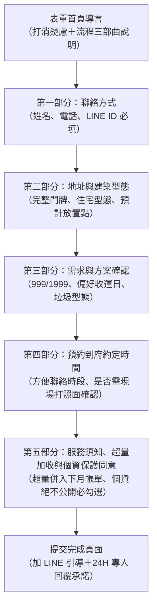

# 📋 生活管家·代倒垃圾包月服務 Google 表單設計規範書
## 需求確認 ➔ 預約時間 ➔ 到府場勘/首趟履約

> **文件定位**：專為「生活管家代倒垃圾服務」設計之 Google 表單題型、邏輯跳轉、文案與資料庫欄位標準。  
> **核心設計原則**：**「低填寫摩擦力、排除疑慮、資訊閉環、預留到府約定」**。讓客戶在 2 分鐘內填完，並能自動對齊外勤路線規劃。

---

## 🎨 表單全景架構規劃



---

## 📝 表單逐題設計規格 (Form Questions Spec)

### 【表單名稱】
**【生活管家】代倒垃圾包月服務｜需求登記與到府服務預約單**

### 【表單開頭導言 (Description)】
```text
您好！感謝您對「生活管家」代倒垃圾包月服務的關注。

從今天起，您不用再為了追垃圾車中斷晚餐、狼狽狂奔！
為了替您安排最流暢的機車清運路線與專屬服務時段，請協助填寫以下資訊（只需 1~2 分鐘）。

【我們的服務承諾】：
🛵 機車專車出勤，每次限 20L 兩包（一般生活垃圾＋回收各一包，可自由搭配）。
🌿 100% 物理隔離：倒垃圾出勤全車嚴禁攜帶食品保溫箱，徹底杜絕交叉污染。
📱 每次清運拍照 LINE 回傳留痕，回到家門前永遠乾淨清爽。

【填表後的服務流程】：
1. 填寫本表單 ➔ 2. 管家在 LINE 與您確認需求與路線 ➔ 3. 約定時間到府確認放置點 ➔ 4. 正式啟動清運！
```

---

### 第一部分：基本聯絡資料（建立溝通橋樑）

* **Q1. 您的稱謂（姓名或小姐/先生）** `[必填 · 簡答題]`
  * 提示文字：例如：陳先生、林小姐
* **Q2. 聯絡電話（手機）** `[必填 · 簡答題]`
  * 提示文字：例如：0912-345-678（專員確認路線時電話聯繫）
* **Q3. LINE ID 或 LINE 顯示名稱** `[必填 · 簡答題]`
  * 提示文字：極重要！清運完成拍照回傳、通知專員到府均透過 LINE 官方聯繫。

---

### 第二部分：服務地址與住宅型態（路線與安全評估）

* **Q4. 服務清運地址** `[必填 · 簡答題]`
  * 提示文字：請填寫完整地址（例如：台東市新生路OO號，若為店家請備註店名）
* **Q5. 您的建築/居住型態** `[必填 · 單選題]`
  * ○ 獨棟透天（門前有一樓空地或騎樓）
  * ○ 社區華廈 / 電梯大樓（有管理室 / 可放指定暫存區）
  * ○ 傳統公寓（無電梯 / 需約定一樓大門旁放置）
  * ○ 沿街實體店面 / 微型工作室（早午餐、咖啡、手作等）
  * ○ 其他：______
* **Q6. 預計垃圾放置位置** `[必填 · 單選題]`
  * ○ 自家一樓大門口（遮雨棚下）
  * ○ 自家私人車庫角落
  * ○ 大樓 / 社區管理室指定放置處
  * ○ 店面後門 / 側門約定點
  * ○ 尚未確定，希望能與管家現場約定討論

---

### 第三部分：方案選擇與清運需求（確認需求顆粒度）

* **Q7. 您希望預約的包月方案** `[必填 · 單選題]`
  * ○ **🌱【輕量雙享包】NT$ 999 /月**｜每週清運 2 次（每次限 20L 兩包含回收，適合兩人小家庭、上班族）
  * ○ **👑【尊榮旗艦包】NT$ 1,999 /月**｜每週清運 5 次（全收運日天天清不積累，適合育兒家庭、店家工作室）
  * ○ **🤔 還在考慮中**｜希望能與管家專員通話討論後再決定
* **Q8. 若選擇「999 輕量方案」，您偏好的清運日組合** `[選填 · 單選題]`
  * ○ 【週二、週五】組合（適合平日小開伙、週末前清空）
  * ○ 【週一、週四】組合（適合清空週末外帶垃圾）
  * ○ 聽從管家最佳化路線安排皆可
  * ○ （我選擇 1,999 方案，全收運日 5 天皆出勤）
* **Q9. 家中日常主要的垃圾類型（多選，讓專員預先準備裝備）** `[選填 · 核取方塊]`
  * □ 一般外帶餐盒、家庭常態廚餘（已瀝乾密封）
  * □ 嬰幼兒尿布（每日固定產出）
  * □ 網購紙箱、包材、寶特瓶等資源回收
  * □ 店家商業廢料（咖啡渣、鮮奶盒、手作耗材）
  * □ 寵物貓砂 / 墊料
  * □ 其他：______

---

### 第四部分：約定時間與到府確認（高情商落地閉環）

* **Q10. 您希望從哪一天開始享受服務？** `[必填 · 日期選擇器]`
  * 提示文字：管家小隊將於開工日前為您安排專員就緒。
* **Q11. 您方便與管家專員電話/LINE 通話確認細節的時段？** `[必填 · 核取方塊]`
  * □ 上午時段 (09:00 ~ 12:00)
  * □ 下午時段 (14:00 ~ 17:00)
  * □ 傍晚時段 (17:00 ~ 19:30)
  * □ 任何時間只要傳 LINE 留言即可
* **Q12. 是否需要管家專員提前到府「現場勘查約定點與打個照面」？** `[必填 · 單選題]`
  * ○ **需要**：希望能提前約個時間（約 3~5 分鐘），當面確認門口放置點與溝通細節。
  * ○ **不需要**：我會將門口照片拍下來傳 LINE，確認路線後直接於指定日開始出勤！

---

### 第五部分：服務須知、超量加收條款與個資保護同意書（法務與防呆閉環）

> **區段說明文案**：  
> 為保障雙方權益與道路行車安全，請您在送出前詳閱以下「服務規範」與「個資保護承諾」：

#### 📜【生活管家・服務規範與超量加收條款】
1. **標準清運額度**：因採機車外勤專車清運，每次到府上限為 **20 公升規格共 2 包（包含資源回收）**，住戶可自由搭配（1包垃圾+1包回收，或2包垃圾）。
2. **超量加收條款（併入下月帳單）**：若遇親友聚會或大掃除單次「超過 2 包」，專員在機車行車安全載重許可下將順手協助清運並拍照存證，**超量費用一律併入下月帳單合併結算**，現場零接觸、不經手現金。
3. **嚴格拒收物（安全紅線）**：嚴禁夾帶高壓瓦斯罐、未熄滅香灰金紙、未包紮針頭與裝潢廢土家具，以維護外勤與清潔隊員安全。
4. **一樓平面交接**：垃圾請於約定時段前放置於一樓指定點（門口遮雨棚下、車庫或管理室），專員不持有住戶內門鑰匙、不進入室內私領域。

* **Q13. 服務須知與超量加收條款確認** `[必填 · 核取方塊]`
  * [ ] **我已詳閱並充分理解上述服務規範，同意每次清運以 20L 兩包為基準，若有超量將依規定併入下月帳單結算。**

---

#### 🔒【個人資料保護法與隱私權絕不外洩承諾】
生活管家（以下簡稱本團隊）極度重視您的個人隱私與居住安全：
1. **蒐集目的**：本表單所蒐集之姓名、聯絡電話、服務地址、LINE ID 及住宅資訊，**僅限於生活管家小隊進行清運排程、派工到府、緊急聯繫與帳單核對之內部營運使用**。
2. **絕對不對外公開**：本團隊嚴格遵循《個人資料保護法》規範，**絕不向任何第三方、外部行銷機構公開、洩漏、販售或轉讓您的個人資料與居住地址**。
3. **資料安全保障**：所有資料皆受數位安全加密保護，若您日後終止服務，可隨時要求本團隊刪除或銷毀您留存之通訊與地址資料。

* **Q14. 個人資料蒐集與使用同意書** `[必填 · 核取方塊]`
  * [ ] **本人已詳閱上述個資聲明，同意生活管家將本人所填之地址、電話與 LINE 資料僅用於代倒垃圾服務之履約與聯繫，並確認本資料受嚴密保護、絕不對外公開。**

* **Q15. 其他備註或特殊叮嚀事項** `[選填 · 簡答/段落題]`
  * 提示文字：例如：「家門口有養狗請先按門鈴」、「請避開右側盆栽」、「按對講機請按 2 樓」等。

---

## 📲 表單提交完成確認訊息 (Confirmation Message)

在 Google 表單設定的「發表表單後的確認訊息」中輸入：

```text
🎉 感謝您填寫【生活管家】代倒垃圾服務需求單！

我們已收到您的預約資訊！
管家專員會在 24 小時內（或於您勾選的方便時段）透過 LINE / 電話與您聯繫，確認清運路線與到府細節。

👉【最重要的一步】：
請點擊下方連結加入【生活管家官方 LINE】：
https://line.me/R/ti/p/@taitung_lifebutler (範例連結)
並傳送「您的姓名」或隨意一張貼圖，讓我們能第一時間為您開通專屬服務窗口喔！

生活管家小隊 敬上 🛎️
```

---

## 💡 戴明品質與營運防呆設計亮點 (Operational Advantages)

1. **LINE ID 為核心索引 (Primary Key)**：
   * 避開傳統表單填完後找不到客人的痛點，將 LINE 作為履約回傳 Before/After 照片與帳單通知的核心載體。
2. **Q12 提供「見面 vs 拍照」雙軌選擇**：
   * 傳統長輩或店家喜歡「當面聊 3 分鐘打照面」（建立信任感）；
   * 年輕上班族喜歡「直接拍門口照片傳 LINE」（零社交壓力）。表單給予彈性選項，大幅提升轉換率！
3. **Q6 事先鎖定「放置位置」**：
   * 提早確立「一樓外部約定點、不進門翻找」的服務邊界，杜絕後續客訴爭議。
