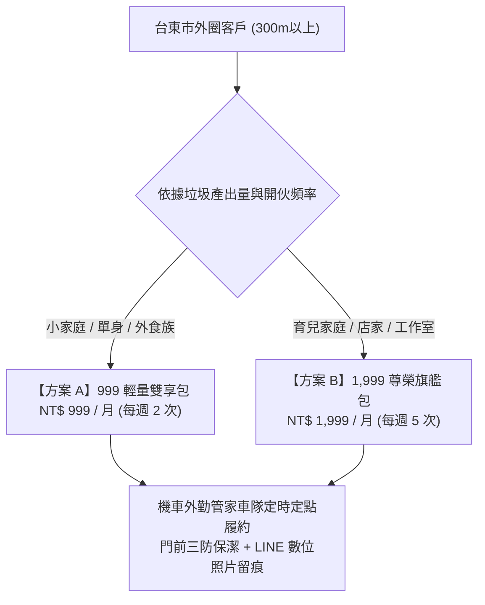

# 🗑️ 02_外圈代倒垃圾包月服務 (999元 / 1,999元)
## 生活管家服務商品化・常態性現金流核心模組

> **所屬單元**：00-03-08 生活管家服務商品化與銷售孵化中心  
> **營運負責**：陳品碩 (Pinshuo) / 首席品質長 戴明 (Dr. Deming) / 財務長 算盤 (Abacus)  
> **核心定位**：覆蓋台東市區（距離正氣北路家宅 300 公尺以上外圈商業營利圈），由機車管家車隊定時定點履約，提供「擺脫追車焦慮、乾淨無痕留證」的常態訂閱制生活服務。

---

## 🏛️ 一、 模組文件架構（三合一閉環體系）

本專區嚴格落實生活管家服務商品化之「三合一閉環」規範，包含三份核心交付手冊：

```
02_外圈代倒垃圾包月_999與1999/
├── 📄 README.md                        # 本服務模組總覽與導航索引
├── 📋 01_SOP_標準作業流程.md           # 第一線執行手冊：五步清運法、出勤檢核表、戴明安燈與防呆機制
├── 📜 02_產品規格與定價手冊.md         # 交易契約標準：999與1999方案矩陣、超量加價、服務邊界與嚴格拒收線
└── 📣 03_行銷文案與地推銷售話術.md      # 獲客轉化武器：FB長文故事、Threads短文鉤子、LINE推播與地推SOP
```

---

## 💡 二、 方案與定價速查表



| 方案名稱 | 價格規格 | 清運頻率 | 適用對象 | 核心權益 |
| :--- | :--- | :--- | :--- | :--- |
| **999 輕量雙享包** | **NT$ 999 元 / 月**（約 125元/次） | 每週 2 次（週二五 或 週一四） | 單身、小家庭、租屋族 | 每次 1 大袋 (≤20L) + 資源回收小包，享家宅借冰 8 折 |
| **1,999 尊榮旗艦包** | **NT$ 1,999 元 / 月**（約 99元/次） | 每週 5 次（週一、二、四、五、日） | 雙薪育兒、早午餐、咖啡店、工作室 | 每次至多 2 大袋 (總重≤10kg) + 資源回收大袋，享借冰免費 2 次與清潔 9 折 |

---

## 🎯 三、 履約五大核心鐵律

0. **絕對禁止背載保溫箱（務實卸箱・零交叉污染）**：
   - 倒垃圾出勤前**必須將食物保溫大箱、小箱拆卸留置家宅**，全車嚴禁出現任何外送保溫袋！無需昂貴專用改裝，採「彈力繩捆紮/快拆籃＋雙層特厚套袋防漏」，以最低摩擦力落實 100% 食安物理隔離。
1. **三防原則（防漏、防刺、防破）**：
   - 隨身必備 60L 特厚大袋，遇滲漏第一時間加套；必備防穿刺手套阻隔危險尖銳物。
2. **門面零滴漏保潔**：
   - 隨身配備 75% 酒精噴霧與吸水抹布，清運後即刻擦拭地面滴漏，維持住戶門面尊嚴。
3. **無接觸數位留痕**：
   - 到點與清運完畢必拍「Before / After」對比照片，發送至客戶專屬 LINE 官方帳號。
4. **安全紅線絕不妥協**：
   - 嚴格拒收卡式瓦斯罐、未熄滅香灰、未包紮針頭與裝潢廢土，守護清潔隊員與外勤專員安全。

---

## 🔗 四、 關聯導航

* 🔙 回到上一層：[00-03-08 生活管家服務商品化與銷售孵化中心](../README.md)
* 🏘️ 查看內圈方案：[01_社區生活包月卡_399元](../01_社區生活包月卡_399元/)
* 🍱 查看餐飲快閃：[03_一起叫便當_快閃與自取](../03_一起叫便當_快閃與自取/)
