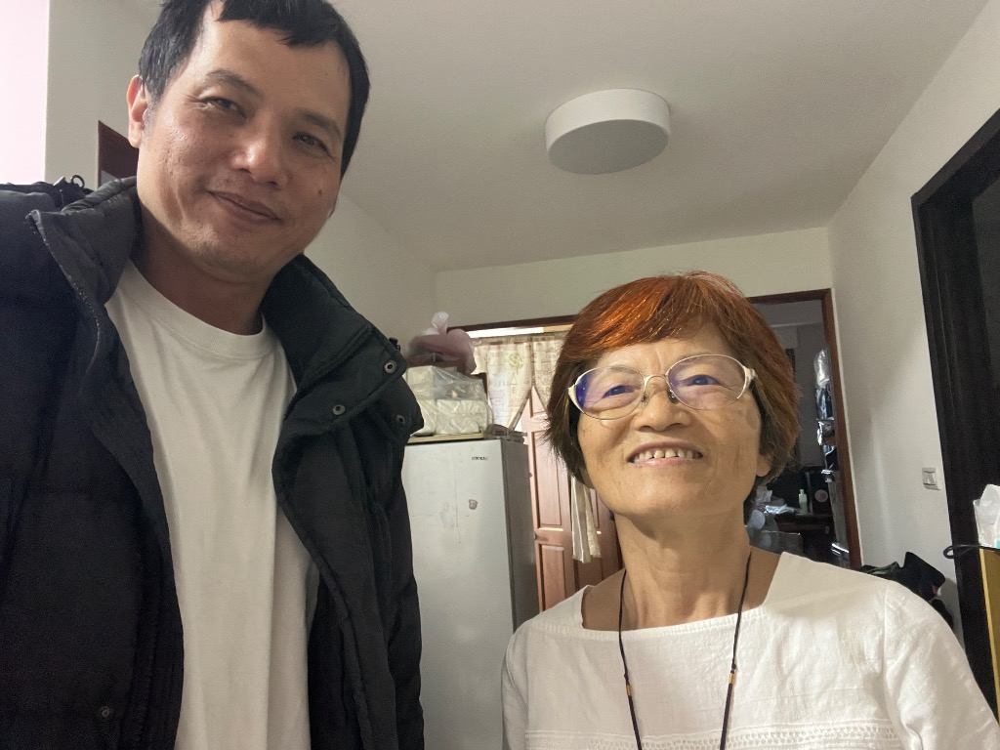
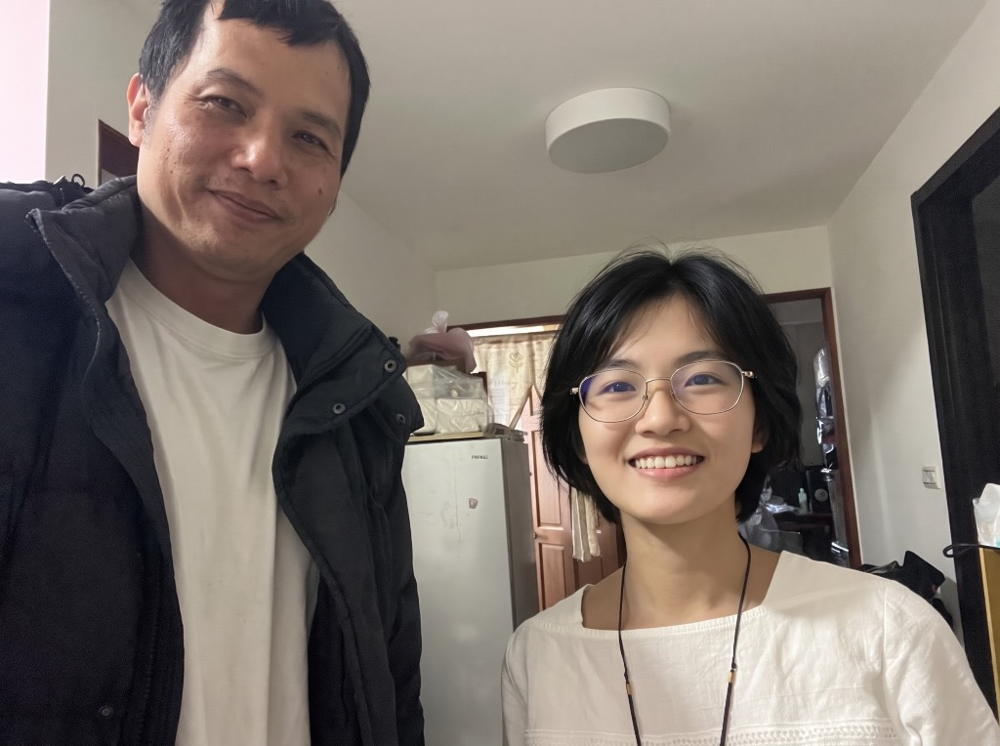

# 🌸 【聽妳慢慢說，生命轉錄】2026-11-16 到府教學與實體陪伴全景紀錄
> **會面日期**：2026 年 11 月 16 日（週一）15:00 ~ 16:30  
> **會面地點**：臺東市平等街 65 號（陳英里姐家中客廳）  
> **陪伴導師**：極星創辦人 陳品碩 (Pinshuo) 親自到府面授  
> **服務對象**：陳英里 姐（70多歲，台東氣功協會教練、熱心基督信仰見證人）  
> **專案品名**：**【聽妳慢慢說，生命轉錄】**  
> **存檔目錄**：`00-03_Brand_LifeButler/00-03-09_Digital_Twin/陳英里/2026-11-16_到府教學紀錄/`

---

## 📸 一、 當日到府實況與珍貴合影留念

| 現場實拍合影（生命現場溫度） | 數位孿生青春重塑（心靈願景重現） |
| :---: | :---: |
|  |  |
| **【真實生命當下】** 品碩與英里姐在客廳溫暖合影。 英里姐眼神清澈安詳、笑容踏實溫和，氣氛自然放鬆。 | **【靈魂青春孿生】** 基於同場景光影進行的青年容顏逆齡重塑。 見證科技如何為長輩留下一生最美、最神采奕奕的風華。 |

---

## 🎯 二、 11/16 當日核心進展與教學重點

1. **破除焦慮，在最熟悉的客廳上課**：
   - 創辦人親自登門拜訪，在英里姐熟悉的家中客廳進行教學，長輩身心處於完全放鬆的副交感神經狀態，完全無任何商業或科技被審視感。
2. **三千字文案結構化梳理**：
   - 英里姐當日上午 09:32 交付之近 3,000 字手稿文案，內容深刻探討「馬偕時代教會生活共同體」與「現代教會人際孤單與結構現象」。
   - 創辦人現場引導長輩分段拆解，建立「分段錄音、慢火成片」的標準節奏，避免一次性錄製過長造成的肺活量與記憶負擔。
3. **現場歷史意境畫面生成體驗**：
   - 結合英里姐對馬偕博士宣教歷史的情感，現場引導體驗生成「露天拔牙看診」、「婦女學白話字」、「田間同行生命共同體」等 5 張極富常民溫度的歷史意境圖，長輩看見自己的信仰記憶被具象化呈現，大為震撼與欣慰。
4. **首支 60 秒試播成片驗收**：
   - 完成首支試播短片：[`2026-11-16_陳英里_第一段_聚焦現代教會現象_精華試播.mp4`](file:///c:/Users/lenovo/我的雲端硬碟/00_Master_Polaris/00-03_Brand_LifeButler/00-03-09_Digital_Twin/陳英里/03_成片展示與發布庫/2026-11-16_陳英里_第一段_聚焦現代教會現象_精華試播.mp4)（時長 58.75 秒，結合歷史老照片意境 ＋ 沉穩台灣女聲配音 ＋ 動態字幕）。

---

## 📁 三、 2026-11-16 當日關聯資產總索引

* **合影紀錄**：
  * [`2026-11-16_合影照_陳英里與品碩_現場實拍.jpg`](file:///c:/Users/lenovo/我的雲端硬碟/00_Master_Polaris/00-03_Brand_LifeButler/00-03-09_Digital_Twin/陳英里/2026-11-16_到府教學紀錄/2026-11-16_合影照_陳英里與品碩_現場實拍.jpg)
  * [`2026-11-16_合影照_陳英里數位孿生青春重塑.jpg`](file:///c:/Users/lenovo/我的雲端硬碟/00_Master_Polaris/00-03_Brand_LifeButler/00-03-09_Digital_Twin/陳英里/2026-11-16_到府教學紀錄/2026-11-16_合影照_陳英里數位孿生青春重塑.jpg)
* **文案成果**：
  * [`../02_口述逐字稿與文案/2026-11-16_陳英里_馬偕時代教會氣氛與生命共同體文案.md`](file:///c:/Users/lenovo/我的雲端硬碟/00_Master_Polaris/00-03_Brand_LifeButler/00-03-09_Digital_Twin/陳英里/02_口述逐字稿與文案/2026-11-16_陳英里_馬偕時代教會氣氛與生命共同體文案.md)
  * [`../02_口述逐字稿與文案/2026-11-16_陳英里_三段聚焦論述_教會現象_馬偕歷史_改革出路.md`](file:///c:/Users/lenovo/我的雲端硬碟/00_Master_Polaris/00-03_Brand_LifeButler/00-03-09_Digital_Twin/陳英里/02_口述逐字稿與文案/2026-11-16_陳英里_三段聚焦論述_教會現象_馬偕歷史_改革出路.md)
* **影音成果**：
  * [`../03_成片展示與發布庫/2026-11-16_陳英里_第一段_聚焦現代教會現象_精華試播.mp4`](file:///c:/Users/lenovo/我的雲端硬碟/00_Master_Polaris/00-03_Brand_LifeButler/00-03-09_Digital_Twin/陳英里/03_成片展示與發布庫/2026-11-16_陳英里_第一段_聚焦現代教會現象_精華試播.mp4)
* **歷史意境圖集**：
  * [`../04_視覺與圖片素材庫/2026-11-16_馬偕時代意境圖/`](file:///c:/Users/lenovo/我的雲端硬碟/00_Master_Polaris/00-03_Brand_LifeButler/00-03-09_Digital_Twin/陳英里/04_視覺與圖片素材庫/2026-11-16_馬偕時代意境圖/)（共 5 張高清意境圖）
