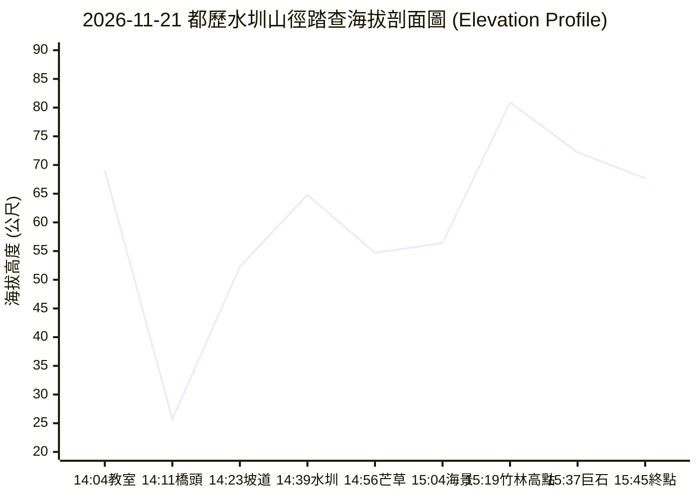

# 🗺️ 東海岸部落生態路徑 · 綠道路徑與空間圖資 (Greenway GIS & Spatial Assets)

> **建立時間**：2026-11-21  
> **軌跡數據規格**：`photos/trail_track.geojson`（共 51 個地理圖徵點線）  
> **空間涵蓋範圍**：臺東縣成功鎮都歷部落聚落區、海階梯田、灌溉水圳山徑、都歷巨石地景

---

## 一、 長距離步道規劃三大核心命題（鄭漢文校長提出）

1. **從哪裡出發？**
   * 空間起點之文化脈絡與交通可及性（如：小馬部落天主堂、都歷文化教室、或八嗡嗡舊部落入口）。
2. **要走多遠？**
   * 分段距離評估、體能負擔、長幼皆宜的步行尺度（本次踏查水圳段約 2.5 公里，耗時約 1.7 小時）。
3. **沿途可以看到什麼？**
   * 空間層次切換：聚落街道 ➔ 水圳便道 ➔ 芒草迷宮 ➔ 太平洋海景展望 ➔ 幽深竹林 ➔ 巨石文化地景。

---

## 二、 2026-11-21 下午水圳山徑踏查物理空間指標

* **最低點**：海拔 `25.7m`（14:11 水圳橋頭，經度 121.323822, 緯度 23.012561）
* **最高點**：海拔 `80.9m`（15:23 竹林深處水圳道，經度 121.322542, 緯度 23.019086）
* **總爬升落差**：`55.2 公尺`（屬於平緩舒適的親山型等高線水圳古道）

---

## 三、 路徑關鍵空間節點座標簿

| 節點代號 | 節點名稱 | 經度 (E) | 緯度 (N) | 海拔 (m) | 空間特色與地景敘事 |
| :--- | :--- | :--- | :--- | :--- | :--- |
| **Node-01** | **都歷文化教室起點** | 121.323683 | 23.018142 | 69.1 | 傳統茅草竹編家屋涼亭，室內理論研習與大桌航照圖圈繪基地。 |
| **Node-02** | **水圳橋頭整隊點** | 121.323822 | 23.012561 | 25.7 | 成功鎮水利水圳與聚落交界，學員整隊正式步入鄉間小道。 |
| **Node-03** | **芒草山徑廊道** | 121.321092 | 23.013339 | 54.7 | 人高芒草叢生，保留最原始的土徑與微風穿越感。 |
| **Node-04** | **海階稻田海景展望台** | 121.321975 | 23.014886 | 56.4 | 依山傍海海階稻田，太平洋水天相接，為最壯麗的視覺休憩點。 |
| **Node-05** | **竹林水圳加蓋幽徑** | 121.322542 | 23.019086 | 80.9 | 茂密刺竹/綠竹遮蔭，水泥板加蓋水圳路，水聲清脆幽靜。 |
| **Node-06** | **都歷巨石文化地景** | 121.322600 | 23.019092 | 72.2 | 巨型黑色集塊岩矗立於綠色草坪，背倚海岸山脈絕壁，震撼人心。 |

---

## 四、 現地航照圖大桌圈繪成果數位化課題
* **現狀**：學員在現場正射影像航照圖（大圖）上標繪了大量水圳支流、引水閘門與灌溉溝渠。
* **技術痛點**：現場手繪無人及時轉檔，紙圖容易捲曲折損。
* **AI 賦能解法**：透過高解析度照片進行仿射變換校正，自動對齊至國土測繪圖資，導出為標準 KML/GeoJSON 圖層。
