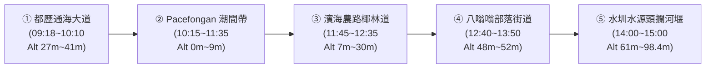
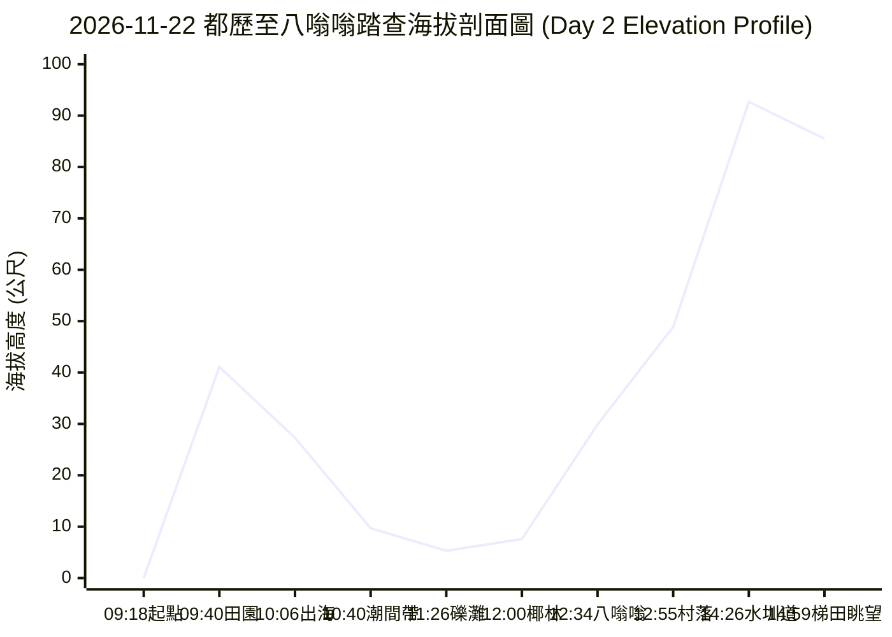

# 🗺️ 東海岸部落生態路徑 · 綠道路徑與空間圖資 (Greenway GIS & Spatial Assets)

> **建立時間**：2026-11-21  
> **更新時間**：2026-11-22（完整建檔 Day 1 都歷水圳山徑 ＋ Day 2 都歷通海大道至八嗡嗡水圳路全程）  
> **GIS 圖資規格**：
> - Day 1 軌跡：`photos/trail_track.geojson`（51 個點線圖徵，最高海拔 80.9m）
> - Day 2 軌跡：`photos/day2_trail_track.geojson`（113 個點線圖徵，最高海拔 98.4m，全海陸高程貫通）

---

## 🧭 一、 Day 2 空間路徑總覽（2026-11-22 都歷至八嗡嗡全段海陸踏查）

* **最低點**：海拔 `0.0m`（Pacefongan 太平洋黑沙潮間帶，IMG_2147、IMG_2180）
* **最高點**：海拔 `98.4m`（八嗡嗡水圳山林引水步道，IMG_2254）
* **總跨越尺度**：全段貫通「海平面 ➔ 海階椰林農路 ➔ 聚落人文生活圈 ➔ 海岸山脈深山水利水源頭」，為極具完整性的國家綠道山海廊道典範！

---

## 📍 二、 Day 2 五大空間分段與地景特徵簿

| 分段代號 | 區段名稱 | 時間區間 | 海拔範圍 | 關鍵照片編號 | 空間地景與文化設施特徵 |
| :--- | :--- | :--- | :--- | :--- | :--- |
| **Stage-1** | **都歷聚落通海大道** | 09:18 ~ 10:10 | 27m ~ 41m | IMG_2147 ~ 2173 | **軸線直通太平洋**。傳統乾砌石駁坎、台東蘇鐵、整齊落花生田畦、競選旗幟與部落米克斯散步，展現原鄉常民生活秩序。 |
| **Stage-2** | **Pacefongan 潮間帶** | 10:15 ~ 11:35 | 0.0m ~ 9.7m | IMG_2174 ~ 2195 | **山海交會的海洋冰箱**。黑沙礫石灘、都巒山層火山集塊岩角礫露頭、風化漂流枯木、潮池採集動線、草海桐與林投海防林。 |
| **Stage-3** | **濱海農路椰林綠道** | 11:45 ~ 12:35 | 7.6m ~ 30.0m | IMG_2196 ~ 2223 | **南島風情地景**。高聳微彎的大果椰子樹群、電線桿、開闊太平洋視角與平緩柏油/水泥農用路面，適合慢活自行車與健行。 |
| **Stage-4** | **八嗡嗡部落生活圈** | 12:40 ~ 13:50 | 48.9m ~ 52.7m | IMG_2224 ~ 2240 | **聚落地景與人文幽默**。標誌性英國米字旗彩繪屋頂、兩層水泥村屋、路邊引水溝渠與涵洞，聚落安寧祥和。 |
| **Stage-5** | **八嗡嗡水圳水源頭** | 14:00 ~ 15:00 | 61.7m ~ **98.4m** | IMG_2241 ~ 2262 | **部落生命線之源**。梯田石駁坎、黑色蓄水桶、引水閘門、八嗡嗡攔河堰防砂跌水壩、清澈見底溪流深潭、回望太平洋梯田絕景。 |

---

## 🛠️ 三、 現地空間公共設施與路況觀察（Infrastructure Survey）

1. **水利灌溉系統（Irrigation Network）**：
   * 八嗡嗡水圳水源取自海岸山脈純淨溪流，透過混凝土攔河堰落差沉砂引水，沿途採用「水泥明渠 ＋ 水泥板加蓋 ＋ 黑色高密度聚乙烯（HDPE）管線」並行方式輸水。
   * 田間設置大量黑色圓柱形蓄水塑膠塔（水塔），為因應枯水期或旱季之自主儲水調配設施。
2. **步道路面鋪面現狀（Trail Pavement）**：
   * **聚落與農路段**：單線柏油路與混凝土農路，路況良好平整。
   * **水圳與山徑段**：以水泥板加蓋水圳路為主，部分路段雜草（芒草、大花咸豐草）較密，需定期人工巡檢或手作除草維護。
   * **海灘段**：卵石與黑沙混合灘，退潮時礁岩濕滑，需具備防滑溯溪鞋或注意潮汐警示。
3. **通訊與指示標誌缺口（Digital & Signage Gaps）**：
   * 水圳深山攔河堰段手機訊號偏弱（1~2 格或斷訊），凸顯出**「PWA 離線地圖與預載導覽」**之極端必要性。
   * 沿途除競選旗幟與農用水利告示外，幾無給一般外地健行者的解說牌與安全指標。
