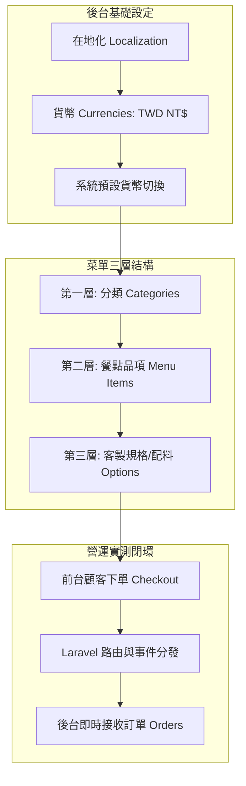
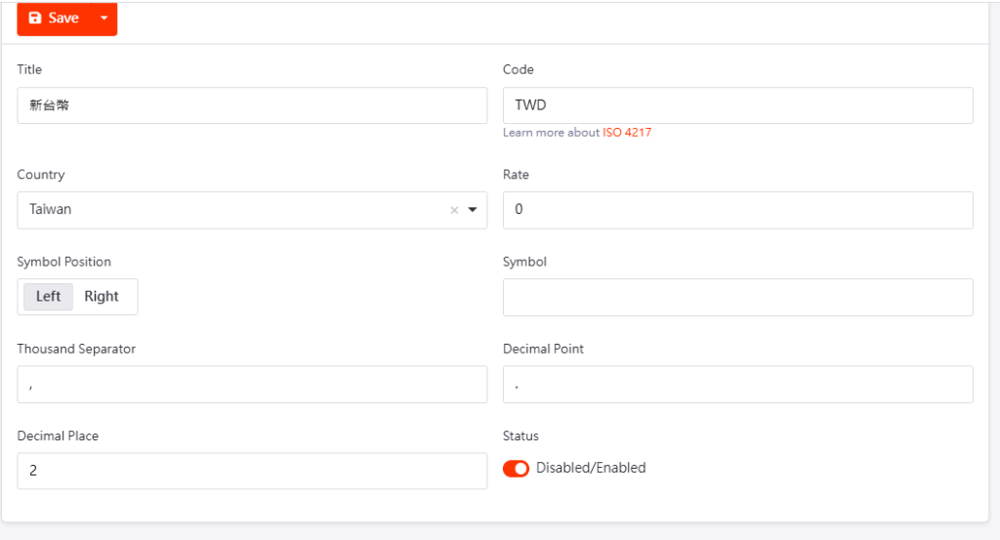
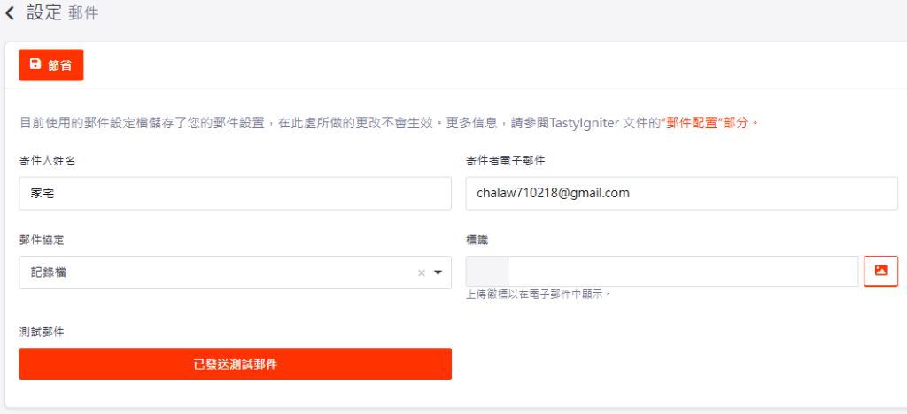

# 【實戰教學】TastyIgniter 開源點餐系統：在地化設定、商品上架與前後台閉環實測手冊

> **專案分類**：`00-05_AI_Education / Tutorial_04_TastyIgniter_Setup_Testing`
> **建立日期**：2026-10-15
> **操作主導**：董事長品碩 (CEO)
> **技術協同**：林納斯 (Linux / 技術副總)
> **教學目的**：紀錄從零開始將開源點餐系統（TastyIgniter v4）調校為台灣在地化營運狀態的完整實戰流程。包含**貨幣與在地化規範、菜單三層階層建立、前台顧客下單到後台訂單即時接收**，以及排查「結帳轉跳卡頓」的伺服器底層優化技巧。

---

## 🧭 一、核心觀念與架構認知

在進行操作前，必須先建立點餐系統的底層資料邏輯：



---

## 🛠️ 二、第一階段：新台幣在地化設定 (TWD Localization)

系統預設幣別多為美元或英鎊，且預設小數點為兩位（如 `$180.00`），不符合台灣餐飲習慣，且後續串接台灣金流（綠界、藍新）時容易造成金額傳遞異常。

### 步驟 1：建立新台幣幣別
1. 登入 TastyIgniter 管理員後台：`https://<您的網域或IP>/admin`。
2. 進入左側選單 **`Settings`（齒輪圖示）** ➔ **`Localization`（在地化）** ➔ **`Currencies`（貨幣）**。
3. 點擊右上角 **`+ New`** 新增貨幣，填寫以下關鍵規格：
   * **Title（名稱）**：`新台幣`
   * **Code（代碼）**：`TWD`
   * **Country（國家）**：`Taiwan`
   * **Rate（匯率基準）**：`1`
   * **Symbol Position（符號位置）**：`Left`（靠左）
   * **Symbol（符號）**：`NT$` 或 `$`
   * **Decimal Place（小數點位數）**：`0`（**非常重要！台灣餐飲不帶小數點**）
   * **Status（狀態）**：切換為啟用（Enabled / 橘色開關）
4. 點擊左上角 **`Save`** 儲存。



### 步驟 2：設為系統預設幣別
1. 進入 **`Settings`** ➔ **`General`（一般設定）**。
2. 找到 **`Default Currency`（預設貨幣）** 下拉選單。
3. 選擇剛剛建立的 **`新台幣 (TWD)`**。
4. 點擊 **`Save`** 儲存。
> **成果**：前台所有商品定價、購物車結帳總計即時改為 `NT$ 180` 純整數顯示。

---

## 🍜 三、第二階段：上架示範菜單（都蘭特色風味店）

TastyIgniter 的商品管理採用「**分類 ➔ 餐點 ➔ 規格**」清晰架構：

### 步驟 1：建立餐點分類 (Categories)
1. 點擊左側選單 **`Kitchen`** 或 **`Menus` ➔ `Categories`**。
   *(或直接在網址輸入：`/admin/categories`)*
2. 點擊右上角 **`+ New`**：
   * **Name（分類名稱）**：`招牌特色主食`
   * **Status（狀態）**：`Enabled`
3. 點擊 **`Save`** 儲存。

### 步驟 2：上架具體餐點品項 (Menu Items)
1. 點選 **`Menus` ➔ `Menu Items`**。
   *(或直接在網址輸入：`/admin/menus`)*
2. 點擊右上角 **`+ New`** 填入資訊：
   * **Name（餐點名稱）**：`都蘭刺蔥牛肉麵`
   * **Price（定價）**：`180`
   * **Categories（所屬分類）**：勾選 `招牌特色主食`
   * **Description（餐點說明）**：`嚴選在地特色香料慢火燉煮，湯頭濃郁，肉質軟嫩。`
   * **Status（狀態）**：`Enabled`
3. 點擊 **`Save`** 儲存。

---

## 📱 四、第三階段：前後台閉環流程實測 (End-to-End Testing)

### 步驟 1：前台模擬點餐
1. 打開前台消費者頁面：`https://<您的網域或IP>/`。
2. 瀏覽菜單，找到剛剛上架的「招牌特色主食 ➔ 都蘭刺蔥牛肉麵」。
3. 點擊 `+` 加入購物車，檢查右側側邊欄購物車金額是否為 **NT$ 180**。
4. 點擊 **`Checkout`（結帳）**。
5. 填寫顧客自取/外送資訊（姓名、電話、取餐時間）。
6. 按下 **`Confirm Order`（確認下單）**。

### 步驟 2：後台即時接單驗收
1. 回到後台管理介面。
2. 點擊左側選單 **`Sales` ➔ `Orders`（訂單管理）**。
3. 成功看見剛剛前台送出的最新一筆訂單，顧客姓名、餐點項目「都蘭刺蔥牛肉麵」、總金額完全吻合！
> **實測里程碑**：確認系統點餐至接單之「資訊流閉環」正式打通！

---

## ⚡ 五、第四階段：實戰除錯與性能調優（結帳轉跳卡頓排查）

在實測點擊「確認下單」時，發現畫面轉跳出現明顯延遲，以下紀錄工程級排查思路與優化手段：

### 痛點 1：郵件發送超時 (SMTP Timeout)
* **現象**：TastyIgniter 預設下單成功後會觸發郵件通知。如果主機尚未設定對外 SMTP 密碼，伺服器會在背景嘗試連線直到超時（約 15~30 秒），造成前台畫面卡住。
* **鎖定線索**：在後台 `Settings ➔ Mail` 會看到提示：*「目前使用的郵件設定檔儲存了您的郵件設置，在此處所做的更改不會生效。」*（代表設定鎖死在伺服器 `.env`）。



* **解決方案**：
  直接在主機 `.env` 檔案中將郵件驅動改為 `log`（日誌記錄模式，不進行遠端連線）：
  ```env
  MAIL_MAILER=log
  ```

### 痛點 2：GCP 免費層資源與動態編譯瓶頸
* **分析**：GCP 免費層（e2-micro）僅配備 1GB RAM 與微核心 CPU。當首次結帳時，PHP 需要即時編譯多個 Blade 視圖模板與解析路由，造成瞬時效能瓶頸。
* **解決方案（伺服器終端優化指令）**：
  在主機終端執行 Laravel 框架快取預編譯：
  ```bash
  cd /home/<site_user>/htdocs/<domain>
  php8.4 artisan optimize
  php8.4 artisan view:cache
  ```
  * `config`、`events`、`routes` 寫入記憶體快取。
  * `view:cache` 預先編譯所有 Blade 前端視圖，省下顧客下單時的即時渲染開銷。

---

## 🎯 六、教學總結與後續擴充方向

透過本次實戰測試，我們確認了 TastyIgniter 開源點餐系統具備極佳的自主性與二次開發潛力：
1. **零抽成優勢**：店家完全掌握自家前台與顧客資料庫。
2. **硬體擴充可能**：訂單成立時可透過 Webhook 觸發廚房 ESC/POS 雲端出單機自動印單。
3. **車隊 API 媒合**：後台訂單狀態變更時，可無縫打 API 派單給機車車隊進行即時外送。
4. **供應鏈整合**：每道菜品未來可拆解 BOM 表，扣除庫存後與曉企業批發端達成「自動叫貨一條龍」。
