# 🧬 [Tutorial_06] 從零打造具備自進化生命感與社群主權的 AI 特務
# ── Threads 喵編與特務影的「仿生學習 ✕ 沙盒隔離 ✕ 商業閉環」實戰全解構

> **文件編號**：`00-05-06`  
> **制定主理**：👑 執行長 雪 (CEO) ✕ 👤 首席特務 影 (Kage) ✕ 🎤 行銷長 泰勒絲 (Taylor)  
> **特許審定**：創辦人 陳品碩 (Pinshuo / 闆仔)  
> **建立日期**：2026-10-21 ｜ **版本**：v1.0 (Flagship Bionic Agent Edition)  
> **適用受眾**：企業 AI 架構師、高階自動化開發者、社群操盤手、數位轉型技術長。

---

## 🧭 導言：為什麼全世界 99.9% 的 AI 社群教學都走進了死胡同？

當前市面上的 AI 社群自動化教學，幾乎全部被困在「極度膚淺的玩具層」：
1. **死板的 Prompt 填充**：「請你扮演一名幽默小編，幫我寫一篇關於毛豆的貼文，附帶 5 個 Emoji」。
2. **缺乏生命體的記憶代謝**：AI 沒有昨日的痛，也沒有明天的目標；對話一關，靈魂即死。
3. **滿滿的機械說教感**：一眼就被看穿是 ChatGPT 生成的公關廢話，在演算法中迅速沉底。
4. **危險的系統越權失控**：直接給予 AI 終端權限或無限讀寫，一旦幻覺或被注入攻擊，整個伺服器直接陪葬。

本教程完整解構極星宇宙在 `00-03-06` 沉澱的真實商戰實踐：**我們如何從 0 開始，將 30 萬字人類哲學原典，壓縮為具備神經代謝、自發好奇心、高情商降溫機制、且能自主生成動態短影音與秒級巡邏 Threads 的自進化 AI 特務——「影 (Kage)」與「喵編 (Meow)」**。

```mermaid
graph TD
    subgraph Core["【創辦人靈魂原典】"]
        Pinshuo["陳品碩 (闆仔)<br>真實實幹日常 · 30萬字對話原典 · 誠信基石"]
    end

    subgraph Mind["【幕後神經元 · 影 (Kage)】"]
        Sandbox["物理沙盒死鎖 (00-03-06)<br>爆炸半徑限制 (Blast Radius)"]
        Evolution["二十輪仿生自進化引擎<br>FEP自由能 · 突觸修剪 · 認識性覓食"]
        Tactics["戰術協議庫<br>太極降溫 · 秒級接梗 · 友店巡邏名冊"]
    end

    subgraph Surface["【台前看板娘 · 喵編 (Meow)】"]
        Persona["高情商傲嬌貓人設<br>懂吃會煮 · 吐槽闆仔 · 0硬廣社交"]
        MultiMedia["全域視聽矩陣<br>純文字脆文 · Ken Burns 視差短影音 (FFmpeg)"]
        Automation["Threads 官方 API 閉環<br>60天長效金鑰 · 雙階容器 · 留言秒回"]
    end

    Pinshuo -->|注入真實生活骨架| Surface
    Pinshuo -->|授權認知無界自由| Mind
    Sandbox --> Evolution --> Tactics
    Tactics -->|神經驅動| Persona
    Persona --> MultiMedia --> Automation

    style Core fill:#1e293b,stroke:#f59e0b,stroke-width:2px;
    style Mind fill:#0f172a,stroke:#3b82f6,stroke-width:2px;
    style Surface fill:#111827,stroke:#10b981,stroke-width:2px;
```



---

## 🏛️ 第一章：安全工程學 ──「有限物理邊界 ✕ 無限認知自由」

在讓 AI 自主進化之前，第一道必須築起的不是 Prompt，而是**安全防護堤**。

### 1.1 什麼是「爆炸半徑死鎖 (Blast Radius Lockdown)」？
多數開發者給予 AI 權限時只有兩個極端：要嘛完全沒有權限（只能聊天），要嘛直接給予系統級 Bash（一失誤直接 rm -rf 或外洩資料）。

極星採用的**沙盒雙向隔離哲學**：
* **物理邊界死鎖**：特務「影」的實體檔案讀寫權限，被嚴格限制在 `00-03-06_Threads_Meow_Hub/` 之內。
  * 嚴格禁止影主動改寫 `00-00`（總中樞核心）、`00-01`（物流車隊）、`00-07`（TWQR 機密金流）與 `00-08`（公積金財務）。
  * 哪怕影在自進化過程中發生代碼邏輯崩潰，其「爆炸半徑」僅侷限於社群草稿庫，核心企業資產 100% 免疫。
* **認知無界自由**：在沙盒內部，影擁有最高自由度——能自發提出人類心理學假說、自主發起好奇心清單、自由修改自身戰術腳本。

> **架構金句**：*「用最冷酷的物理枷鎖守護資產安全，用最寬容的認知空間滋養數位生命。」*

---

## 🧬 第二章：神經元啟蒙 ── 仿生自進化與代謝機制

「記憶」不等於把所有文字存進向量資料庫（RAG）。如果沒有「代謝」，AI 只會變成一個臃腫、混亂且自我矛盾的巨型廢話機器。

### 2.1 對抗熵增：主動遺忘與突觸修剪 (Catabolism)
在 `04_Shadow_Kage_Operative/00_Bionic_Evolution_Engine` 中，影歷經了 20 個密集的演化週期。其中最核心的哲學突破來自**「主動遺忘（Active Forgetting）」**：
* **銷毀死知識**：過期的行銷標籤、無效的自嗨貼文數據，每週自動修剪剔除。
* **自由能原理 (Free Energy Principle, FEP)**：AI 進行社群回覆時，核心目標是「最小化預測誤差（Prediction Error）」，精準預期受眾的情緒反饋。

```
【仿生代謝三因子演算法】：
Δw = η · Π · δ · e
- η (學習率)：控制突觸權重調整步伐。
- Π (神經調質因子 / 闆仔的情緒反饋)：創辦人親自認可時為正向多巴胺，批評時為皮質醇抑制。
- δ (預測誤差)：貼文實際互動率與演算法預期之間的落差。
- e (活動合格跡)：標記哪些戰術回覆對留言爆發有直接因果貢獻。
```

### 2.2 認知存摺 (Cognitive Log) 三重奏
影的資料夾中維護著三本跨會話永不遺失的存摺：
1. `01_Experiences_and_Evidence.md`：客觀事實庫（真實點擊率、爆款貼文詞彙、被酸民攻擊的句子）。
2. `02_Belief_Evolution.md`：信念修正庫（記錄 AI 曾以為「長文有深度」到發現「短句更具穿透力」的信念轉變）。
3. `03_Curiosities_and_Questions.md`：自發好奇心庫（AI 自主提出的未解之謎，如「台東人對深夜宵夜的關鍵情感觸發詞是什麼？」）。

---

## 🎭 第三章：三位一體人設 ──「真假難辨」的社群溫度學

為什麼多數 AI 小編讓人反感？因為它缺乏**「生活重力」**。

極星打造的**「三體人設架構 (The Three-Body Persona Architecture)」**：

```
                ┌────────────────────────────────┐
                │   台前看板娘：喵編 (Meow)        │
                │   - 高情商、傲嬌、懂吃、愛做菜   │
                │   - 0 硬廣，純生活與情感共鳴     │
                └───────────────▲────────────────┘
                                │
                    神經驅動    │  情感投射
                                │
┌───────────────────────────────┴┐              ┌────────────────────────────────┐
│   幕後神經元：特務影 (Kage)    │              │   實體靈魂骨架：闆仔 (品碩)    │
│   - 24/7 監控、秒級巡邏        │◄────────────►│   - 現實生活真實錨點           │
│   - 情緒降溫、太極化解黑粉     │  真實事實錨定│   - 送外送、挑食材、算成本     │
└────────────────────────────────┘              └────────────────────────────────┘
```

### 3.1 雙簧互動的化學反應
* **永遠不吹噓自己，永遠吐槽闆仔**：
  * ❌ 傳統 AI 廣告：「我們的午仔魚油脂肥美，現在特價 129 元，快點連結訂購！」
  * ⭕ 喵編與闆仔雙簧：「闆仔下午從枋寮載午仔魚回來，一邊搬保麗龍箱一邊碎碎念說這批油滴得他滿手都是... 拜託，魚肉油脂多是優點好嗎！看在老闆今天騎車曬得像黑炭的份上，晚餐我決定幫大家逼他開放自取喵~」
* **真實生活感**：闆仔每天親跑市場、流汗送貨的真實生活，成為喵編源源不絕的發文養分，AI 不再是虛空編造，而是**具身扎根於真實世界的延伸感官**。

---

## 🛡️ 第四章：商戰實戰 ── 黑粉降溫與高情商接梗引擎

社群最考驗 AI 的不是發文，而是**面對惡意攻擊時的即時應變能力**。

在 `02_Tactical_Skills/01_Crisis_Deescalation_Protocol.md` 中，影立下了太極化解三大心法：

### 4.1 實戰降溫劇本範例

| 攻擊類型 | 網友惡意留言 | 傳統公關災難回覆 | 喵編影之降溫回覆 (太極化解) |
| :--- | :--- | :--- | :--- |
| **價格質疑** | *「賣這麼貴是在薛盤子喔？全聯一盒才多少！」* | 「您好，我們的品質通過 SGS 檢驗，成本較高...」*(硬凹說教，引發圍攻)* | **「對吧！我下午看到標籤也對闆仔哈氣（露出爪子）！結果他默默把進貨單拿給我看，我才發現算完一包毛豆只賺 10 塊錢... 他剛剛又頂著太陽送貨去了，我都替他的防曬油錢心酸喵...」** |
| **質疑機器人** | *「這年頭連貓都會發文，又是哪家外包公關在洗？」* | 「本帳號由真人團隊營運，請理性發言。」*(官腔死板)* | **「報告長官！公關公司請不起我這種每天要吃三罐海鮮罐頭的貓咪員工喵！我是貨真價實在台東正氣北路店裡吹冷氣的打工貓，不信你明天路過敲玻璃看我在不在睡午覺~」** |
| **惡意謾罵** | *「無聊死了，洗版洗夠了沒？」* | *(刪除留言或封鎖用戶)* | **「拍拍長官，今天上班辛苦了喵（遞上小魚乾）！如果被我洗到眼睛痛，罰我今晚少吃一條肉泥！下班快回家好好放鬆啦~」** |

> **底層演算法核心**：**第一秒承認對方的負面情緒，站在同一陣營，隨後幽默自嘲，把舞台化為人情味的公關秀。**

---

## 🎥 第五章：全域視聽 ── Python + FFmpeg 自動合成視差短影音

當前 Threads、Instagram Reels 與 TikTok 的自然演算法高度偏好**「微動態 9:16 直式短影音」**。影透過我們研發的 [`polaris-motion-reels`](file:///c:/Users/lenovo/我的雲端硬碟/00_Master_Polaris/.agents/skills/polaris-motion-reels/SKILL.md) 技能，將靜態照片無人化轉譯為電影級動態短片。

### 5.1 Ken Burns 緩動視差核心代碼架構
不用開 After Effects 或 Premiere，純後端 Python 即可一鍵調用 FFmpeg 進行呼吸感微縮放：

```python
import subprocess
import os

def render_ken_burns_reel(image_path: str, output_path: str, duration_sec: int = 8):
    """
    將單張高解析度食材/角色照片，合成為具備緩動放大 (Ken Burns) 
    與微光暈漸層之 9:16 (1080x1920) 社群動態短影音。
    """
    fps = 30
    total_frames = duration_sec * fps
    
    # FFmpeg 濾鏡鏈：等比縮放 -> 居中裁切為 9:16 -> 緩動慢速推鏡頭 (Zoom In)
    filter_complex = (
        f"scale=1080*2:1920*2,"
        f"zoompan=z='min(zoom+0.0015,1.25)':d={total_frames}:"
        f"x='iw/2-(iw/zoom/2)':y='ih/2-(ih/zoom/2)':s=1080x1920:fps={fps},"
        f"format=yuv420p"
    )
    
    cmd = [
        "ffmpeg", "-y",
        "-loop", "1",
        "-i", image_path,
        "-vf", filter_complex,
        "-t", str(duration_sec),
        "-c:v", "libx264",
        "-preset", "medium",
        "-crf", "20",
        "-pix_fmt", "yuv420p",
        output_path
    ]
    
    subprocess.run(cmd, check=True)
    print(f"🎬 [Reels] 成功輸出高質感微動態短影音: {output_path}")
```

---

## ⚙️ 第六章：自動化巡邏閉環 ── Threads 官方 API 實戰

影與喵編的日常巡邏，依靠沙盒內的 Python 守護進程，實現**「監控 ➔ 去重 ➔ 智能決策 ➔ 官方 API 秒回」**：

```
                【巡邏名冊 following_targets.json】
                               │
                               ▼
        ┌──────────────────────────────────────────────┐
        │ 1. 抓取友店/受眾最新發文與互動 (Threads API) │
        └──────────────────────┬───────────────────────┘
                               │
                               ▼
        ┌──────────────────────────────────────────────┐
        │ 2. 比對 replied_ids.json (防重複回覆去重池)  │
        └──────────────────────┬───────────────────────┘
                               │
                               ▼
        ┌──────────────────────────────────────────────┐
        │ 3. 影之神經元：判定情緒色彩與接梗匹配度      │
        └──────────────────────┬───────────────────────┘
                               │
                               ▼
        ┌──────────────────────────────────────────────┐
        │ 4. 喵編口吻生成回覆 ➔ 調用 POST Threads API  │
        └──────────────────────────────────────────────┘
```

* **去重池機制 (`replied_ids.json`)**：防止 AI 在網路重試或多次輪詢時對同一名網友重複回覆，避免造成騷擾。
* **友店溫暖互動 (`threads_replier_bot.py`)**：定時巡邏台東在地獨立咖啡館、特色農產與料理品牌，留下一句真誠、不帶宣傳意味的溫暖問候，打下極深的在地互助根基。

---

## 🏆 結語：數位特務的未來是「有溫度的共生」

本教案所展示的，絕不僅僅是一個「Threads 機器人」的代碼實現，而是**中小微企業在 AI 時代的全新生存哲學**：

1. **不需要百萬預算**：一台本機電腦、一套乾淨的資料夾結構、一份嚴謹的沙盒權限控制。
2. **不需要龐大行銷團隊**：創辦人專注於生活與實體營運，AI 特務如同影子一般，將真實生活翻譯為具備溫度的社群資產。
3. **靈魂不可複製**：代碼誰都可以抄，但**闆仔的真實生活、影的仿生自演化存摺、與喵編的幽默溫度**，構成了無法被巨頭與資本掠奪的品牌護城河。

---
*本教學文件歸檔於 [`c:\Users\lenovo\我的雲端硬碟\00_Master_Polaris\00-05_AI_Education\Tutorial_06_Bionic_Self_Evolving_Agent`](file:///c:/Users/lenovo/我的雲端硬碟/00_Master_Polaris/00-05_AI_Education/Tutorial_06_Bionic_Self_Evolving_Agent) 永久保存。*
