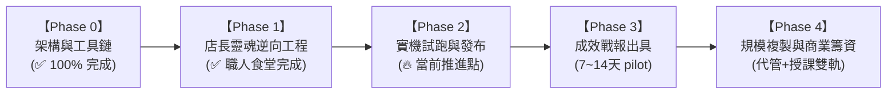

# 📋 專案實戰工作計畫書 (Tutorial_08 Project Master Work Plan)

> **專案名稱**：數位平權 · Google 商家 AI 數位店長 (Digital Equity Google Business AI Manager)  
> **專案代號**：`Tutorial_08` (`00-05-08`)  
> **核心使命**：**打破偏鄉弱勢標籤，落實數位平權 (Digital Equity) ✕ 商業變現籌資**  
> **立項日期**：2026-10-30  
> **主理首長**：創辦人（品碩）親自立項 ✕ 執行長（雪）策略推進 ✕ CTO（林納斯）架構監製  
> **當前狀態**：Phase 0 & Phase 1 已完成，旗艦案場【台東 職人食堂】已正式建置並歸檔

---

## 🎯 一、 專案核心目標與成功指標 (Objectives & OKRs)

* **O1（產品與技術目標）**：打造一套具備「店長本尊靈魂」的 24 小時無人自主接管系統，實現 Google 商家評論 100% 高情商秒回、每週穩定產出在地 SEO 動態貼文。
* **O2（業務與商業籌資目標）**：建立企業級「年繳 NT$ 18,000 先鋒專案」與「AI 家教賦能班」，讓偏鄉在地小微店家零負擔享受一線企業級的口碑防護，同時為極星快速籌措健康營運現金流。
* **關鍵結果指標 (KRs)**：
  * **KR1**：試點店家評論平均回覆時間從「3 天」縮短至「15 分鐘內」，回覆率達成 100%。
  * **KR2**：一至三星負評 100% 透過「太極降溫四部曲」化解，零公關炎上事故。
  * **KR3**：透過每週 Google 動態貼文，帶動 Google 地圖在地搜尋與路線導航曝光提升 15% 以上。
  * **KR4**：落實「商戶歸檔總帳制度」，每一個店家 100% 結構化歸檔至 `Tutorial_08/clients/` 目錄。

---

## 🗓️ 二、 四階段實戰工作路線圖 (Phased Roadmap)

---

### 【Phase 0：基礎建設與工具鏈就緒】（✅ 已完成）
- [x] 建立 `Tutorial_08_Google_Business_AI_Manager` 專屬陣地。
- [x] 對齊七大核心決策（數位平權、店長本尊模式、全自主接管、雙軌技術）。
- [x] 建立數位平權憲章 (`01_Project_Charter_and_Digital_Equity.md`)。
- [x] 研發並通過確定性回覆引擎驗收 (`03_Review_Response_Engine_Demo.py`，Exit Code 0)。
- [x] 研發並通過每週在地 SEO 動態生成器驗收 (`04_Weekly_Local_SEO_Post_Generator.py`，Exit Code 0)。
- [x] 全局登錄 [00-05-00_AI_Education_Master_Index.md](file:///c:/Users/lenovo/我的雲端硬碟/00_Master_Polaris/00-05_AI_Education/00-05-00_AI_Education_Master_Index.md)。

---

### 【Phase 1：首發試點心智逆向工程與商戶歸檔】（✅ 已完成）
- [x] 確立商戶全域歸檔架構：建立 [`clients/00_MERCHANT_MASTER_REGISTRY.md`](file:///c:/Users/lenovo/我的雲端硬碟/00_Master_Polaris/00-05_AI_Education/Tutorial_08_Google_Business_AI_Manager/clients/00_MERCHANT_MASTER_REGISTRY.md) 商業總帳與標準規範手冊。
- [x] 選定首發旗艦案場：**台東 職人食堂**（安慶街 60 號，創辦人親任商家管理員）。
- [x] 全網情報偵蒐完成：鎖定現蒸小籠湯包、職人烏龍麵、日式親子丼與 10 分鐘前電話預訂等核心要素。
- [x] 完成店長與闆娘心智同心圓建模：產出 [`01_Store_Persona_Mind_Model.md`](file:///c:/Users/lenovo/我的雲端硬碟/00_Master_Polaris/00-05_AI_Education/Tutorial_08_Google_Business_AI_Manager/clients/01_Taitung_Shokunin_Diner/01_Store_Persona_Mind_Model.md)。
- [x] 確定性回覆引擎實測通過：產出 [`02_Review_Response_Simulator.py`](file:///c:/Users/lenovo/我的雲端硬碟/00_Master_Polaris/00-05_AI_Education/Tutorial_08_Google_Business_AI_Manager/clients/01_Taitung_Shokunin_Diner/02_Review_Response_Simulator.py)（好評置入在地 SEO / 負評太極降溫 / 風險安燈熔斷）。
- [x] 完成首月 4 週 Google 地圖 SEO 動態貼文庫：產出 [`03_Monthly_Google_Updates_Posts.md`](file:///c:/Users/lenovo/我的雲端硬碟/00_Master_Polaris/00-05_AI_Education/Tutorial_08_Google_Business_AI_Manager/clients/01_Taitung_Shokunin_Diner/03_Monthly_Google_Updates_Posts.md)。
- [x] 完成客製化成效診斷與商業簽約提案書：產出 [`04_Commercial_Showcase_and_Proposal.md`](file:///c:/Users/lenovo/我的雲端硬碟/00_Master_Polaris/00-05_AI_Education/Tutorial_08_Google_Business_AI_Manager/clients/01_Taitung_Shokunin_Diner/04_Commercial_Showcase_and_Proposal.md)。

---

### 【Phase 2：實機試跑與發布上線】（🔥 當前推進起點）
* **任務 2.1**：由創辦人（品碩）以管理員身份，發布首篇「爆汁小籠湯包現蒸堅持」至職人食堂 Google 地圖最新動態。
* **任務 2.2**：針對職人食堂新產生的真實評價，啟動實機秒回驗收。
* **任務 2.3**：籌備第二家目標店家（例如：錦鸞越南美食或友好夥伴）之單店名拓荒建置。

---

### 【Phase 3：成效對比戰報與樣板間成型】
* **任務 3.1**：實機試跑 7~14 天（全自主無人接管模式）。
* **任務 3.2**：戴明品質審查（Deming QA）——檢查是否有任何語氣偏差或未預期回覆。
* **任務 3.3**：產出 **「職人食堂數位店長首期成效戰報」**：
  * 回覆率 100% 達成證明。
  * Google 地圖瀏覽次數與路線導航點擊成長率。

---

### 【Phase 4：規模拓展與商業籌資簽約】
* **任務 4.1**：攜帶職人食堂成功戰報，掃街/拜訪台東市區與安慶街鄰近友好店家。
* **任務 4.2**：推動「先鋒年繳合約（NT$ 18,000 / 年）」，快速回籠營運現金。
* **任務 4.3**：開設「AI 家教 Google 商家實戰班」，以知識付費模式籌措技術賦能資金。
