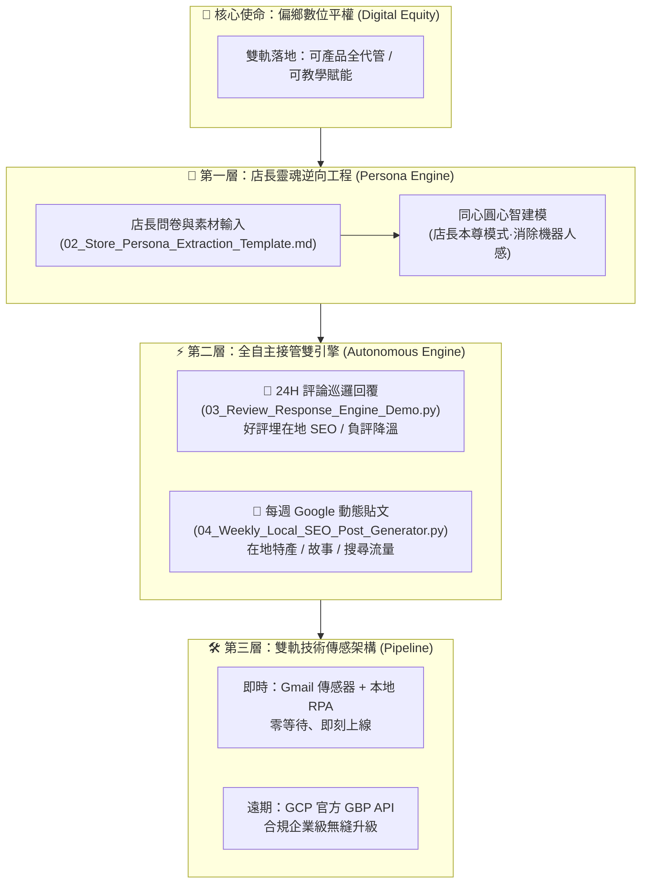

# 🌟 Tutorial_08 (00-05-08) 數位平權 · Google 商家 AI 數位店長 (總樞紐與啟動入口)

> **專案代號**：`Tutorial_08 (00-05-08)`  
> **核心使命**：**打破偏鄉弱勢標籤，落實數位平權 (Digital Equity)**  
> **建立時間**：2026-10-30  
> **主理首長**：創辦人（品碩）親自立項 ✕ 執行長（雪）戰略推進 ✕ 技術長（林納斯）架構監製  
> **當前狀態**：**【已就緒 · 等待品碩接管展開】**

---

## 🧭 一、 品碩對齊之核心決策清冊 (The 7 Aligned Pillars)

剛剛我們透過七輪深度對焦，確立了本專案的鋼鐵意志與落地架構：

| 維度 | 決策重點 | 實戰意涵 |
| :--- | :--- | :--- |
| **1. 核心願景** | **數位平權 (Digital Equity)** | 讓偏鄉與在地小店不用付昂貴公關費，也能擁有媲美大集團的 24H 數位店長。可賣產品代管，亦可作為 AI 賦能授課。 |
| **2. 首發試點** | **在地友好實體店家** | 以具備真實客人反饋、歷史菜單與評價樣本之實體店鋪為基準，最具說服力。 |
| **3. 人格定位** | **溫暖接地氣「店長本尊模式」** | 透過 `persona-reverse-engineer` 萃取店長說話風格、食材堅持與在地人情味，杜絕機器人感。 |
| **4. 交付範圍** | **口碑防護 ＋ 地圖 SEO 流量雙管齊下** | 全天候評論自動回覆 ＋ 每週 1 篇 Google 動態貼文（新品推薦、在地故事、搜尋關鍵字）。 |
| **5. 運作模式** | **完全自主無人接管 (Autonomous)** | 徹底釋放店長時間，AI 自動巡邏、分析並直接發布，定期匯總月報。 |
| **6. 技術架構** | **雙軌落地（Gmail 傳感器 + 本地 RPA ＋ GCP 官方 API）** | 近期零等待即刻接管；遠期申請官方 Google Cloud GBP API 配額無縫升級。 |
| **7. 啟動起點** | **在 Tutorial_08 (00-05-08) 建立標準工具鏈與範本** | 由品碩接續填入店家特徵，啟動人格拆解與實機演練。 |

---

## 🏛️ 二、 系統架構全景圖 (Mermaid Architecture)

---

## 📂 三、 本資料夾核心檔案清冊（品碩等等從這裡開始）

* 🌟 **[📋 專案實戰工作計畫書 (PROJECT_WORK_PLAN.md)](file:///c:/Users/lenovo/我的雲端硬碟/00_Master_Polaris/00-05_AI_Education/Tutorial_08_Google_Business_AI_Manager/PROJECT_WORK_PLAN.md)** —— 【專案總指揮藍圖】涵蓋 Phase 0~4 完整推進路線圖、OKRs 指標與 Phase 1 即刻起點。

1. [📄 01_Project_Charter_and_Digital_Equity.md](file:///c:/Users/lenovo/我的雲端硬碟/00_Master_Polaris/00-05_AI_Education/Tutorial_08 (00-05-08)_Google_Business_AI_Manager/01_Project_Charter_and_Digital_Equity.md)  
   * **說明**：專案立項憲章、偏鄉數位平權宣言、雙軌商業與教學定價藍圖。
2. [📝 02_Store_Persona_Extraction_Template.md](file:///c:/Users/lenovo/我的雲端硬碟/00_Master_Polaris/00-05_AI_Education/Tutorial_08 (00-05-08)_Google_Business_AI_Manager/02_Store_Persona_Extraction_Template.md)  
   * **說明**：店家人格逆向工程標準問卷。**品碩等等可直接在此填寫或貼入目標店家（如錦鸞或其他友好小店）的菜單、老闆口吻與故事。**
3. [💻 03_Review_Response_Engine_Demo.py](file:///c:/Users/lenovo/我的雲端硬碟/00_Master_Polaris/00-05_AI_Education/Tutorial_08 (00-05-08)_Google_Business_AI_Manager/03_Review_Response_Engine_Demo.py)  
   * **說明**：可直接執行的 Python 引擎。示範如何吃進店家資訊，對五星好評精準置入 SEO 關鍵字，對一星負評進行高情商溫暖降溫。
4. [📢 04_Weekly_Local_SEO_Post_Generator.py](file:///c:/Users/lenovo/我的雲端硬碟/00_Master_Polaris/00-05_AI_Education/Tutorial_08 (00-05-08)_Google_Business_AI_Manager/04_Weekly_Local_SEO_Post_Generator.py)  
   * **說明**：Google 地圖每週在地 SEO 動態貼文生成腳本。
5. [🚀 05_Operational_Roadmap_and_Next_Steps.md](file:///c:/Users/lenovo/我的雲端硬碟/00_Master_Polaris/00-05_AI_Education/Tutorial_08 (00-05-08)_Google_Business_AI_Manager/05_Operational_Roadmap_and_Next_Steps.md)  
   * **說明**：下一步實戰操作指南，引導品碩從拆解人格、沙盒測試到正式接管。

---

## 🏪 四、 商戶全域管理與歸檔總庫 (`clients/`)

遵照創辦人（品碩）親定之商業規範：**「每一個店家都必須歸檔記錄起來在 Tutorial_08 資料夾的下方」**！

* 📊 **[商戶全域管理總帳 (00_MERCHANT_MASTER_REGISTRY.md)](file:///c:/Users/lenovo/我的雲端硬碟/00_Master_Polaris/00-05_AI_Education/Tutorial_08_Google_Business_AI_Manager/clients/00_MERCHANT_MASTER_REGISTRY.md)** —— 記錄所有店家之編號、管理權限、商業合約方案、營運數據大盤。
* 📜 **[商戶入冊與建置歸檔標準規範 (00_CLIENT_ONBOARDING_SPEC.md)](file:///c:/Users/lenovo/我的雲端硬碟/00_Master_Polaris/00-05_AI_Education/Tutorial_08_Google_Business_AI_Manager/clients/00_CLIENT_ONBOARDING_SPEC.md)** —— 法定五件套規格指引。
* 🏆 **旗艦案場 01**：**[台東 職人食堂 (安慶街 60 號)](file:///c:/Users/lenovo/我的雲端硬碟/00_Master_Polaris/00-05_AI_Education/Tutorial_08_Google_Business_AI_Manager/clients/01_Taitung_Shokunin_Diner/)**（創辦人親任管理員，全套 Profile、店長心智、回覆引擎、4 週動態貼文與商業提案全備）。
