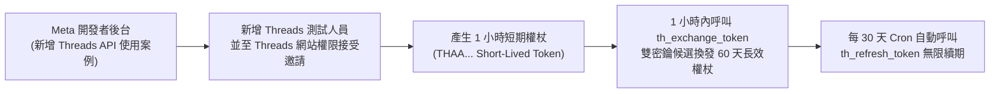

# 🔑 Threads (脆) 官方 API 權杖申請、60 天長效換發與實戰排錯全指南 (SOP)

> **教案編號**：`00-05-10`  
> **建立日期**：2026-11-23  
> **撰寫主責**：生活管家 影 (Shadow)  
> **適用場景**：Meta Threads 官方 Graph API 權杖（Token）首次申請、測試人員邀請開通、1 小時短期權杖升級 60 天長效權杖、每 30 天自動續期排程、以及 Token 過期防洗零保護機制。

---

## 一、 核心觀念：為什麼你的權杖打不通 Threads API？

在 Meta 開發者生態系中，**Facebook / Instagram Graph API** 與 **Threads Graph API** 是兩套完全獨立的權杖體系。新手最常見的錯誤就是拿錯權杖或用錯 App Secret：

| 比較維度 | Facebook / IG 權杖 (`EAAP...`) | Threads (脆) 專屬權杖 (`THAA...`) |
| :--- | :--- | :--- |
| **權杖開頭特徵** | **`EAAP...`** 開頭 | **`THAA...`** 開頭 |
| **呼叫網域** | `https://graph.facebook.com/v20.0/` | `https://graph.threads.net/v1.0/` |
| **對應 App ID / 密鑰** | 主應用程式編號與主密鑰 (`FB_APP_ID`, `FB_APP_SECRET`) | **Threads 專用編號與專用密鑰 (`THREADS_APP_ID`, `THREADS_APP_SECRET`)** |
| **能否跨網域混用** | ❌ 拿 `EAAP...` 打 `graph.threads.net` 會報錯 `Cannot parse access token (code: 190)` | ❌ 拿 `THAA...` 打 `graph.facebook.com` 同樣無法解析 |
| **支援用途** | FB 粉專發文、未發布相片 CDN 圖床託管 | 脆自動發文 (`threads_publish`)、抓瀏覽與按讚 (`insights`)、抓整串留言 (`conversation`) |



---

## 二、 標準申請五步曲（從 0 到拿到 `THAA...` 權杖）

### 步驟 1：建立應用程式並勾選「存取 Threads API」
1. 前往 [Meta for Developers 應用程式後台](https://developers.facebook.com/apps/)。
2. 點擊「建立應用程式 (Create App)」，在「使用案例 (Use Cases)」中選擇 **「存取 Threads API (Access the Threads API)」**。
3. **認識 Meta 的雙層 App 架構（關鍵避坑點！）**：
   * **主應用程式編號與主密鑰 (`FB_APP_ID` / `FB_APP_SECRET`)**：
     位於左側「應用程式設定 ➡️ 基本資料」，直達網址：`https://developers.facebook.com/apps/{APP_ID}/settings/basic/`
   * **Threads 專屬應用程式編號與專屬密鑰 (`THREADS_APP_ID` / `THREADS_APP_SECRET`)**：
     位於左側「使用案例 ➡️ Threads API ➡️ 設定」，直達網址：`https://developers.facebook.com/apps/{APP_ID}/use_cases/customize/?use_case_enum=THREADS_API`
   * ⚠️ **兩者不可混淆**：換發長效權杖時，Meta 要求密鑰必須與發行權杖的 App 相容。我們在 `.secrets.env` 中採取雙軌結構化存儲，腳本具備雙候選自動輪詢！

> [!NOTE]
> **常見疑惑：後台出現紅框警告 `Currently ineligible for submission` 是壞掉了嗎？**  
> **答案：完全不用理會！** 該警告僅表示「若要把此 App 公開發布給全世界陌生大眾使用，缺少圖示或隱私政策」。但我們是自己品牌內部營運，處於「開發者模式 (Development Mode)」自用即可，永遠不需要向 Meta 提交公開審查，所有 API 權限 100% 正常運作！

### 步驟 2：開啟 5 大核心權限 (Scopes)
在同一設定頁的「權限 (Permissions)」區塊，確認以下權限皆已啟用：
* `threads_basic`（讀取帳號基本資料與貼文清單）
* `threads_content_publish`（兩階段容器自動發文與留言回覆）
* `threads_manage_insights`（抓取貼文 `views`、`likes`、`replies`、`reposts`、`quotes` 數據）
* `threads_read_replies` / `threads_manage_replies`（抓取 `/{post_id}/conversation` 整串回覆與管理留言）
* `threads_keyword_search`（選配，關鍵字巡邏搜尋）

### 步驟 3：新增「Threads 測試人員」並接受邀請（破解 `1349245` 報錯）
若未完成此步，產生權杖時會跳出：
```json
{"error_message":"Invalid Request: The user has not accepted the invite to test the app.","error_code":1349245}
```

#### 🔧 正確開通與「邀請空白」排錯法：
1. 在 Meta 開發者後台左側點擊 **「應用程式角色 (App Roles)」➡️「角色 (Roles)」**。
2. 點擊「新增用戶 (Add People)」，選擇 **「Threads 測試人員 (Threads Tester)」**，輸入你的 Threads 帳號（例如 `hellotaitung`）並送出。
3. **去哪裡按接受？（解決手機 App 找不到或邀請空白問題）**：
   * 使用電腦瀏覽器打開並登入 **[Threads 網頁版 (threads.com)](https://www.threads.com/)**。
   * 點擊左下角選單 **「設定 (Settings)」➡️「帳號 (Account)」➡️「網站權限 (Website Permissions)」➡️「邀請 (Invites)」**。
   * 若看到「邀請 (Invites)」是空白的：請先確認瀏覽器目前登入的 Threads 帳號是否與後台填寫的測試帳號一致，或回到開發者後台將該測試人員移除後重新發送一次邀請，再重新整理「網站權限 -> 邀請」分頁，點擊 **「接受 (Accept)」**！

### 步驟 4：產生 `THAA...` 存取權杖
有兩種官方取得途徑：
* **途徑 A（最穩健，直接給 60 天長效權杖）**：
  在開發者後台 **「使用案例」➡️「存取 Threads API」➡️「設定」** 頁面下方，找到 **「用戶權杖產生器 (User Token Generator)」**，在已接受邀請的帳號右側點擊 **「產生權杖 (Generate Token)」**，完成彈窗授權後直接複製 `THAA...` 字串。
* **途徑 B（透過 Graph API Explorer 測試工具）**：
  1. 打開 [Graph API Explorer](https://developers.facebook.com/tools/explorer/)。
  2. 將頂部網域下拉選單從 `graph.facebook.com` 切換為 **`graph.threads.net`**。
  3. 右側選取你的應用程式，點擊 **「Generate Access Token（產生存取權杖）」**。
  4. ⚠️ **關鍵防呆**：若你隔天重新打開 Graph API Explorer，輸入框內顯示的**仍是昨天的舊權杖字串**！必須親自點擊一次 **「Generate Access Token」** 按鈕，確認字串結尾已經改變，才是新產生的有效短期權杖。

---

## 三、 1 小時短期權杖升級為「60 天長效權杖」與每 30 天自動續期

### 1. 核心觀念：Meta 網頁上「沒有延長按鈕」！
許多初學者在 Meta 後台到處尋找「延長權杖」或「展延到期日」的按鈕，結果找不到而感到困惑。  
* **真相**：**Meta 官方網頁界面上永遠只有「產生存取權杖 (Generate Token)」一個按鈕！**
* 網頁產出的權杖預設一律只有 1 小時效期。
* **「延長成 60 天」必須透過後端程式呼叫 Meta API 兌換**，這是工程師的職責，無法在網頁上單純點擊完成。

### 2. 為什麼昨晚的權杖到了凌晨 01:00 就過期 (`code: 190`)？
透過 Graph API Explorer 或後台產生的 `THAA...` 權杖，預設是 **1 小時短期權杖 (`Short-Lived Token`)**。一旦超過 1 小時未換發，就會出現：
```json
{"error":{"message":"Error validating access token: Session has expired on Sunday, 22-Nov-26 09:00:00 PST...","code":190,"type":"OAuthException"}}
```
且 **Meta 伺服器規定：已過期的短期權杖無法再拿去換發長效權杖**，必須在產生後的 **1 小時有效期限內** 立即換發！

### 3. 換發 60 天長效權杖 (`th_exchange_token`)
在短期權杖 1 小時效期內，呼叫以下端點：
```http
GET https://graph.threads.net/access_token
  ?grant_type=th_exchange_token
  &client_secret={THREADS_APP_SECRET}
  &access_token={SHORT_LIVED_THAA_TOKEN}
```
* **成功回傳標準**：
  ```json
  {
    "access_token": "THAA...***MASKED***",
    "token_type": "bearer",
    "expires_in": 5184000
  }
  ```
* **檢驗指標**：`expires_in` 必須約為 **`5184000` 秒（即整整 60 天）**。若回傳 `3600` 左右，代表仍是短期權杖。

> [!WARNING]
> **排錯案例：換發時回傳 `客戶密鑰無效 (code: 100, error_subcode: 4279023)`**  
> 代表你傳入的 `client_secret` 與當初產生 Token 的 App ID 不匹配（例如使用了另一個 App 的密鑰，或是混淆了主 App 密鑰與 Threads 專屬密鑰）。  
> **解決方案**：至開發者後台核對當前 App 的「基本資料 ➡️ 應用程式密鑰」或「Threads API ➡️ 設定 ➡️ Threads 應用程式密鑰」。

### 4. 每 30 天自動續期 (`th_refresh_token`)
已經換成 60 天長效權杖後（且距離換發已滿 24 小時、尚未過期前），可隨時呼叫以下端點將效期重新延長回 60 天：
```http
GET https://graph.threads.net/refresh_access_token
  ?grant_type=th_refresh_token
  &access_token={LONG_LIVED_THAA_TOKEN}
```
* **特點**：續期端點只需傳入 `access_token`，不強制依賴密鑰，極端穩定。

### 5. 標準自動化腳本 (`exchange_long_lived_token.py`)
我們已將「短期換 60 天長效（支援雙密鑰候選輪詢）」與「長效自動續期」封裝為單一健全腳本（位於 [`scripts/exchange_long_lived_token.py`](file:///c:/Users/lenovo/我的雲端硬碟/00_Master_Polaris/00-03_Brand_LifeButler/00-03-06_Threads_Meow_Hub/scripts/exchange_long_lived_token.py)）：
* **核心防呆特性**：
  1. 自動載入 `.secrets.env` 中的 `THREADS_APP_SECRET` 與 `FB_APP_SECRET`，依序輪詢嘗試，徹底免疫密鑰不匹配問題。
  2. 換發成功後自動覆寫 `.secrets.env` 第 13 行，並精準計算出到期日期時間。
  3. 終端機日誌對 Token 進行安全遮罩 (`***MASKED***`)，嚴防明文外洩。
* **常駐自動續期排程**：
  已在 Antigravity 守護進程中設定每 30 天（每月 1 日上午 09:00，`Cron: 0 9 1 * *`，Task `task-18831`）自動執行續期，達到全自律免手動登入之終極境界。

---

## 四、 實戰血淚防呆：Token 過期時的「防空資料覆蓋保護」

### 1. 事故根因回顧
當 `THREADS_ACCESS_TOKEN` 過期（API 回傳 HTTP 400 / `code: 190`）時，若數據收集腳本 (`feedback_loop.py` 或 `post_walk_reflector.py`) 採用寬鬆的 `try...except` 並回傳預設空字典 `{"views": 0, "likes": 0}`，排程一跑 `collect()` 就會**把本地資料庫原本已經抓到的真實瀏覽數與按讚數全部覆蓋歸零**！

### 2. 硬性防呆規範（已寫入底層代碼）
1. **非 200 立即拋出例外中止更新**：
   ```python
   r = requests.get(insights_url, timeout=15)
   if r.status_code != 200:
       raise RuntimeError(f"Threads Insights API 失敗 (HTTP {r.status_code}): {r.text}")
   ```
2. **查不到就回報「查不到」**：遇到 Token 過期或 API 錯誤時，保留本地最後一次成功收集的真實數據，絕不拿 `0` 或空字典覆寫歷史紀錄，亦不准由 AI 憑空補數字。
3. **雙權杖互補圖床機制**：
   Threads API (`publish_thread`) 發圖時需要公開的圖片 HTTPS URL。系統自動利用 `.secrets.env` 中的 `FB_PAGE_ACCESS_TOKEN` (`EAAP...`) 自動轉換為粉專 Page Token，將本地圖片上傳為臉書未發布相片取得 Meta 官方高速 CDN 連結，再交由 `THREADS_ACCESS_TOKEN` (`THAA...`) 建立容器發布，實現零外部圖床依賴的穩定出圖。
