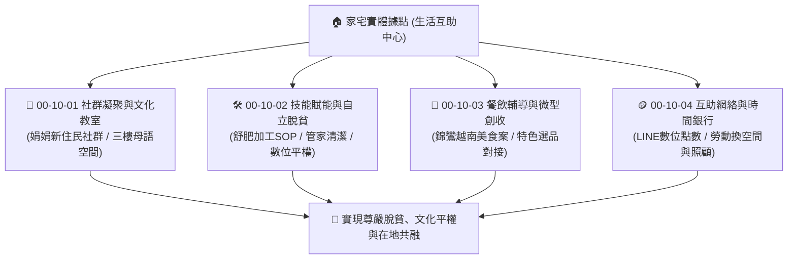

# 🌏 00-10 新住民培力與多元共融發展體系 (New Immigrant Empowerment)

> **定位**：極星宇宙 (00_Master_Polaris) 旗下專屬的「新住民族群自立、支持與文化共融戰區」。  
> **核心使命**：堅守創辦人「好安居、好營生、同質等價、與自然共升」四大理念，為臺東在地逾 4,500 名新住民夥伴建立實體基地、技能培力、微型創收與情感歸屬的完整支持生態。

---

## 🏛️ 一、 核心戰略定位與底層邏輯

新住民族群絕非單向接受救濟的對象，而是地方多元文化、家庭勞動與社區生命力不可或缺的核心柱石。  
本專區旨在打破傳統「慈善施捨」框架，轉化為**「尊嚴自立、以勞換顧、專業賦能、文化驕傲」**的永續共生模式。

---

## 📂 二、 專案架構與子目錄分工

| 子目錄代號 | 目錄名稱 | 核心任務與推進重點 |
| :--- | :--- | :--- |
| **00-10-01** | `00-10-01_Community_Network` | **社群凝聚與文化空間**： • 串聯「娟娟新住民社群」（楊氏娟老師號召網絡）。 • 家宅三樓「語言與文化教室」運作、母語傳承、跨文化客廳會與姊妹隱私深談。 |
| **00-10-02** | `00-10-02_Skills_Empowerment` | **技能培訓與自立脫貧**： • 商業派單級 SOP 培訓：舒肥食品加工 SOP、管家級居家清潔 SOP。 • 弭平數位落差：手機小學堂（行動支付、地圖導航、LINE 官方帳號應用）。 |
| **00-10-03** | `00-10-03_Catering_Consulting` | **餐飲輔導與微型創業**： • 整合「錦鸞越南美食營運優化案」復盤教案（定價防護罩、故事行銷、KPI 落地查核）。 • 異國道地香料、食材供應鏈對接與生活管家選品通路整合。 |
| **00-10-04** | `00-10-04_Mutual_Aid_Points` | **互助網絡與時間銀行**： • 「LINE 數位共生點數存摺」微型生活互助服務（輪值接待、茶水招呼）。 • 點數無現金對換家宅 1~3 樓空間使用權，落實自給自足生態。 |
| **00-10-05** | `00-10-05_No_Cloth_Island_Campaign` | **《島上沒有布》台東場宣傳戰役**： • 協同南洋台灣姊妹會首本繪本全台巡迴（正氣北路家宅主場）。 • 臉書 5 階段連環下鉤轉換文案庫、9 張視覺資產庫、越式餐飲 10 張海報實體配送戰術。 |

---

## 👥 三、 內閣幕僚協同防線

* **👑 雪 (Yuki / CEO)**：跨專案資源調度、計畫書整合、維護新住民體系在極星宇宙中的戰略地位。
* **🎤 泰勒絲 (Taylor / CMO)**：以知心閨蜜視角深談新住民女性生命歷程，產出四大面向深度專訪文案，打造高尊嚴的文化品牌敘事。
* **🧮 算盤 (Abacus / CFO)**：微型創業損益精算、舒肥加工與清潔勞務定價模型，杜絕被剝削，死守姊妹實質收入。
* **🦅 獵鷹 (Falcon / CIO)**：常駐掃描移民署「新住民發展基金」、教育部多元文化補助及勞動權益法規。
* **🛠️ 林納斯 (Linus / CTO)**：設計最簡短、直白、零多餘層級的手機操作介面與出單工具，極致防呆，讓長輩與姊妹秒級上手。

---

## 🔗 四、 關鍵外部資源與內部文件索引

* **計畫書淵源**：
  * [共生宅計畫書_V4_新增規範與會員制.md](file:///c:/Users/lenovo/我的雲端硬碟/00_Master_Polaris/00-04_Personal_Growth/第八屆社區專業經理人/共生宅計畫書_V4_新增規範與會員制.md)（詳載台東 4,500 人新住民現況、三樓文化教室、娟娟社群與 SOP 培訓）。
* **餐飲輔導經典教案**：
  * [🍜 錦鸞越南美食 營運優化計畫 (Google Doc)](https://docs.google.com/document/d/1PTp2JtIfRUQumMDJ-0prWUAzipecuf3hTZ0Bws_XsOI/edit?usp=sharing)（創辦人親自操盤之定價防護罩與復盤紀錄）。
* **實體空間基地**：
  * 「家宅」台東市正氣北路166巷90號（1樓客廳接待與舒肥加工、2樓清潔實訓與隱私深談、3樓文化教室）。
