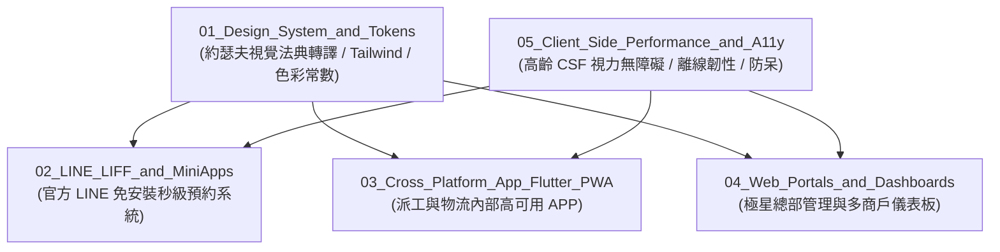

# 🌐 00-16 前端與客戶端體驗架構陣地 (Frontend and App Architecture)

> **領地最高主理人**：🕶️ 尼奧 (Neo) · 首席前端與客戶端體驗架構師  
> **戰略使命**：消滅數位鴻溝，將極星的後端運算力與視覺藝術，封裝為台東長輩與全民一秒上手的極致軟體產品。

---

## 🏛️ 五大核心支柱目錄 (Five Pillars of Architecture)

### 1. [`01_Design_System_and_Tokens/`](./01_Design_System_and_Tokens/)
- 存放約瑟夫 60 項視覺法典轉譯後的 Design Tokens、CSS 變數、Typography 大小常數與按鈕規範。

### 2. [`02_LINE_LIFF_and_MiniApps/`](./02_LINE_LIFF_and_MiniApps/)
- 存放生活管家（倒垃圾、到府服務）與就醬點團購商城專用的 LINE LIFF 輕量網頁前端代碼與架構。

### 3. [`03_Cross_Platform_App_Flutter_PWA/`](./03_Cross_Platform_App_Flutter_PWA/)
- 存放供司機、生活管家內部夥伴使用的跨平台 APP 架構（Flutter / PWA），具備離線快取與 GPS 背景排程能力。

### 4. [`04_Web_Portals_and_Dashboards/`](./04_Web_Portals_and_Dashboards/)
- 存放極星總部營運、財務 5D 精算與訂單派工的 Next.js / React 響應式管理後台。

### 5. [`05_Client_Side_Performance_and_A11y/`](./05_Client_Side_Performance_and_A11y/)
- 存放無障礙標準檢測腳本（WCAG AAA）、前台防呆機制（Poka-Yoke）、以及弱網斷線快取測試套件。
