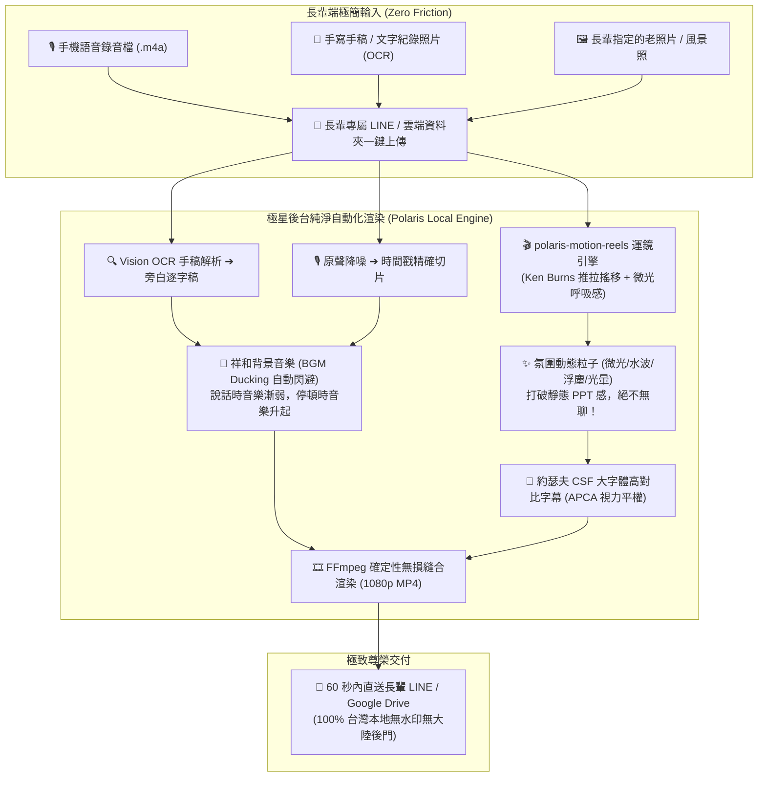

# 💡 陳英里案 · 現場問題卡點日誌與商業產品化孵化庫
> **專案主政**：❄️ 執行長 雪 (Yuki) ✕ 🛠️ 工程長 林納斯 (Linus) ✕ 📐 首席品質長 戴明 (Dr. Deming)  
> **孵化代號**：`PROJECT-SOUL-TRANSCRIPTION`（極星·生命轉錄與傳家寶典藏協議）  
> **建檔路徑**：`數位孿生/陳英里/03_現場問題卡點日誌與產品化孵化庫.md`  
> **創辦人戰略法旨**：**「一邊紀錄一邊進行，把問題記錄下來，將來變成一隻產品！」**

---

## 🧭 第一部分：戴明安燈現場問題卡點日誌 (Friction & Problem Ledger)

> **戴明原則**：**「問題不是人的錯，是系統流程設計的缺陷。」**  
> 現場英里姐遇到的任何猶豫、停頓、忘記按鍵、哭泣中斷、手稿遺失恐懼，都是未來產品的「核心功能改進點」。

### 📋 卡點分類矩陣與登錄規範

| 編號 | 類別 | 卡點痛點現象 | 當場應變處置 (Workaround) | 系統性根本防呆 (Poka-Yoke / Linus 解法) | 產品化對應功能 (Feature Spec) | 狀態 |
| :---: | :---: | :--- | :--- | :--- | :--- | :---: |
| **ISS-001** | 設備認知 | 長輩以為做影片一定要買筆電或 iPad，產生預算與科技恐懼 | 創辦人肉身破冰，強調「只要手機＋嘴巴」 | 制定《極簡硬體說明卡》，開局第一張紙徹底破除設備迷思 | **【零設備負擔承諾】**：保證不需增購任何硬體 | ✅ 已鎖定 |
| **ISS-002** | 心理防禦 | 對著鏡頭大腦空白、緊張結巴，抗拒露臉錄影 | 改採「純錄音＋意境大自然素材配搭」 | 建立「無鏡頭陪伴採集協定」，錄音時手機反扣或放置側邊 | **【去鏡頭化靈魂聲像技術】**：原聲提取＋意境畫面匹配 | ✅ 已鎖定 |
| **ISS-003** | 流程斷裂 | 過去手寫稿等影片軌耗時數月，稿件遺失造成巨大挫折 | 現場 20 分鐘快速跑通原型，立等可取 | 現場 10 分鐘自動化 STT 轉錄，並即時雲端/本機雙備份 | **【15分鐘立等即見見證短片】**：消滅等待焦慮 | ⏳ 今日驗證 |
| **ISS-004** | 介面認知 | 長輩記憶力衰退，多軟體切換或選單層級深會立即忘記 | 創辦人親自手把手盯著操作 2 次存檔 | 手機桌面「單一巨型捷徑」（One-Touch Recording）或專屬一鍵錄音 | **【高齡友善極簡交互】**：一鍵開啟、大按鈕、自動存檔 | ⏳ 今日驗證 |
| **ISS-005** | 情感承載 | 談及過往受傷、饒恕另一半時情緒崩潰或語塞凝滯 | 保持沉默、遞上面紙、眼神溫暖傾聽不打斷 | 陪伴者引導話術 SOP：三階段溫和引導（接納 ➔ 留白 ➔ 轉化恩典） | **【長輩心靈傾聽引導語料手冊】**：賦予服務專員溫度 | 📋 提煉中 |
| **ISS-006** | 交付摩擦 | 長輩擔心影片檔案太大不知道放哪裡、怕被刪除遺失 | 建立專屬 LINE 群組 / 家族共享相簿，並備份到極星雲端 | 雙軌交付：數位雲端長效連結 ＋ 物理隨身碟 / 實體精裝書 | **【雙軌傳家防丟封裝】**：雲端永久留存＋實體典藏書 | 📋 提煉中 |
| **ISS-007** | 期待落差 | 長輩誤以為 AI 可「一鍵神奇秒變影片」，不知中間有眾多環節連結 | 坦誠告知 AI 現實與步驟複雜度，引導長輩接受「慢慢學」節奏 | 設計「視覺化流水線樂高圖卡」，把黑盒解構為「說話➔逐字稿➔配圖➔成片」4 塊透明積木 | **【透明化慢火學習協議】**：讓長輩在每一步保有參與感與主導權 | ✅ 11/4 已驗證 |
| **ISS-008** | 資安心理 | **堅決排斥使用大陸軟體（如 CapCut / 剪映）**，具備強烈隱私與心理防禦 | 尊重長輩意願，立即停止推薦剪映，確立極星「自研本土無感流水線」 | 基於 Python ✕ FFmpeg ✕ polaris-motion-reels 打造本地私有化渲染管線 | **【100% 台灣在地純淨管線】**：長輩只需傳 LINE，後台自主渲染交付 | 🚀 重大架構確立 |

---

### 🌟 創辦人 11/04 第一現場核心靈魂突破（產品哲學北極星）

> 💡 **創辦人品碩 11/04 親定核心洞察**：  
> **「我們見面達成第一次的共識，她並不是來學 AI 課的，而是要把她自己的故事轉錄分享出來；她也很樂意自己動手來做（這才是她學習 AI 的意願）！」**

#### 產品化轉譯（雪 ✕ 泰勒絲 ✕ 戴明 解讀）：
1. **市面「銀髮科技課程」集體陣亡的原因**：市售課程把重心放在「教會阿公阿嬤用 ChatGPT / 剪映 / Midjourney」，強行灌輸工具邏輯，長輩學了不用立刻忘記，挫折感爆棚。
2. **極星產品的核心定位**：長輩願意碰科技的唯一動能，是**「我要把我的故事留下來」**。科技必須百分之百隱形退後，長輩動手參與的那 10%~20%（例如按下錄音、親選一張代表照片、確認一段話），帶給她的是**「我親自為一生立傳」的至高尊嚴與掌控感**！

---

## 🚀 第二部分：產品化孵化藍圖（從個案到商業產品）

### 1. 產品正式命名與定位

* **產品正式官方命名**：**【聽妳慢慢說，生命轉錄】**（The Living Memoir & Soul Transcription Protocol）
* **創辦人定名憲則**：
  * **「聽妳慢慢說」**：賦予長輩極致的溫柔、耐心、安全感與常民尊嚴，徹底消除「科技催促與記憶衰退」的心理負防線。
  * **「生命轉錄」**：賦予專案神聖的份量、深度與家族使命感——這不是隨意聊天，而是一個人一生信仰、原諒與處世智慧的永恆存檔。
* **核心宣傳語**：*「心裡話，留給家。沒有鏡頭的壓力，只有溫暖的傾聽；用妳最熟悉的聲音，把愛說給歲月聽。」*
* **目標客群（Target Audiences）**：
  1. **高齡長輩自主委託**（60~85歲）：急欲在有生之年為信仰、婚姻、奮鬥史留下無悔紀錄者。
  2. **外地子女孝親委託**（35~55歲）：常年在外打拼，渴望為台東或家鄉父母留下一生語音故事與精裝傳家書作為珍貴紀念。
  3. **社群團體集體採購**（教會樂齡團契、氣功協會、退休教職聯誼會）：集體生命見證與退職紀念。

---

### 2. 標準產品規格包（三合一產品矩陣）

依據極星《萬用服務與業務商品化總控技能 (Polaris Universal Productization Protocol)》，將本專案標準化為三大交付套件：

#### 套件 A：01_標準服務作業規範 (SOP 手冊)
* **前置籌備**：長輩背景安全穿透 ＋ 心理安全場地建構（L型沙發、2700K 暖光、溫茶、面紙）。
* **採集流程**：
  * 第 1 堂（破冰與初次見證，產出 1 支 1 分鐘短片，建立信任）。
  * 第 2 堂（童年與早年奮鬥歷史，採集 15 分鐘）。
  * 第 3 堂（重大生命轉折與家庭饒恕心路，採集 15 分鐘）。
  * 第 4 堂（晚年恩典、智慧叮嚀與傳承叮嚀，採集 15 分鐘）。
* **後台管線自動化**：STT 原音轉錄 ➔ 泰勒絲心靈潤稿 ➔ 約瑟夫 CSF 大字體精裝排版 ➔ 林納斯意境影音管線渲染。

#### 套件 B：02_產品規格與 5D 定價手冊
* **入門體驗版【初次結緣·原聲見證卡】**：
  * 內容：1 小時線下一對一破冰 ＋ 1 支 1~2 分鐘意境原聲見證短片。
  * 定價：**NT$ 500 ~ 800 元**。
* **尊榮旗艦版【生命守護·慢火陪伴傳家典藏包】**：
  * 內容：4~6 次實體茶席陪伴採集 ＋ 3~5 支高畫質大字體意境影音 ＋ 5,000 字回憶錄 ＋ **2 本燙金全彩布紋硬殼精裝傳家紀念書** ＋ 專屬典藏木盒與原音隨身碟。
  * 定價：**NT$ 8,800 ~ 12,800 元**（實體硬體成本約 NT$ 1,200，毛利率達 85%~90%）。
* **家族尊享版【三代同堂·家族史詩全紀錄】**：
  * 內容：含長輩訪談 ＋ 子女視角訪談 ＋ 10 本精裝書 ＋ 15 分鐘微紀錄片。
  * 定價：**NT$ 28,000 ~ 36,000 元**。

#### 套件 C：03_行銷文案與地推銷售話術
* **痛點共鳴話術**：
  > *「我們常以為時間還很多，但父母那些放在心裡一輩子的心裡話，如果沒有記錄下來，真的哪一天就再也聽不到了。不需要逼爸媽對著鏡頭尷尬說話，我們用一杯茶的時間，讓長輩用最舒服的聲音，把一生的智慧留給子孫。」*
* **孝親轉化文案**：針對子女發布之社群與 LINE 官方文案，強調「今年送給父母最尊貴的禮物，不是紅包，是一本屬於他自己的生命之書」。

---

### 3. 極星自研【生命轉錄微動態流水線 (Polaris Soul Reel Engine)】架構

針對英里姐「不想用大陸 App、只要傳音檔/文字照片＋指定照片」的核心訴求，CTO 林納斯 (Linus) ✕ 尼奧 (Neo) ✕ 約瑟夫 (Josef) 確立以下純淨自研管線：

#### 破解「靜態照片很無聊」的四大動態視覺機關：
1. **好萊塢推軌視差 (Ken Burns 3D Parallax)**：每張老照片進入時緩慢 `zoom_in`（推進）、回憶展開時 `zoom_out`（拉遠）、長條照片 `pan_up`（由下往上搖鏡）。
2. **微光呼吸節奏 (Breathing Motion)**：即使定格畫面，畫面也有正弦波呼吸感，搭配台東柔和光暈濾鏡。
3. **氛圍動態粒子疊加 (Ambient Particles)**：在照片表面疊加微弱的聖潔光芒、湖水波紋或晨光微塵，讓老照片瞬間「活」過來。
4. **音樂智慧閃避 (Audio Ducking)**：長輩一開口說話，背景音樂自動壓低 18dB；長輩思索停頓時，琴聲與大提琴緩緩浮現，營造深邃的心靈沉浸感。

---

### 4. 內閣閉環落地清單（Next Actions）

1. [ ] **今日 11/05 14:00~15:00 實戰記錄**：創辦人完成會面後，將現場語音/文字隨筆回傳，登錄進 [`02_歷次會面陪伴全景記錄簿.md`](file:///c:/Users/lenovo/我的雲端硬碟/00_Master_Polaris/數位孿生/陳英里/02_歷次會面陪伴全景記錄簿.md)。
2. [ ] **問題卡點即時歸檔**：將今日現場英里姐遇到的卡點新增至本檔案之【第一部分】。
3. [ ] **工程與視覺管線固化**：林納斯與約瑟夫根據今日實測數據，將「原音轉錄 ➔ 意境影像合成 ➔ 精裝書大字體版型」封裝為本機自動化腳本。
4. [ ] **正式產品化封裝**：於 `00-08_Life_Butler_Services`（生活管家）下正式掛載本標準產品線，作為極星年度旗艦人文服務！
